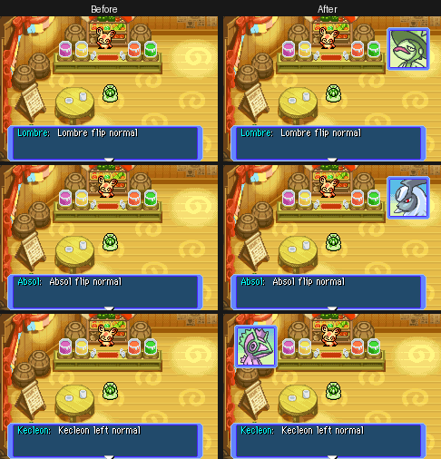

# Custom Portraits: SpriteCollab Faces

---

## Index

- [Introduction](#introduction)
- [Coverage](#coverage)
- [Special NPC slots](#special-npc-slots)
- [Artist / build workflow](#artist--build-workflow)
- [Code Locations](#code-locations)

---

## Introduction

This feature loads **[SpriteCollab](https://sprites.pmdcollab.org)** portraits from `graphics/portraits/<species>/`, converts them at build time to **AT4PX** (vanilla kao compression) + RGBX palettes, and serves them from a separate `pksdir0` archive when enabled.

Toggle: `gRuntimeConfig.custom_portraits` in [`configs/runtime.c`](../../configs/runtime.c) (default `TRUE`). Set to `FALSE` to restore vanilla kao lookup only.

| Mode | Behavior |
|------|----------|
| `TRUE` (default) | Prefer `ckaoNNN` from `gCustomPortraitArchive` when that pack has the emotion; otherwise vanilla `kaoNNN`. Single-emotion loaders (`GetDialogueSpriteDataPtrForEmotion`, etc.) fall back to vanilla if the custom file fails to open or lacks that emotion’s gfx. |
| `FALSE` | Vanilla `kaoNNN` / `dialogueSprites` only |

Portraits credit the SpriteCollab contributors listed in each folder’s `credits.txt`.

---

## Coverage

**Normal portraits:** every unique Gen 1–3 species in the game (national dex 1–386, one Unown / Castform / Deoxys form each) plus **Munchlax**.

**Full emotion packs** (13 kao slots, starter evolutions + café NPC):

| Line | Evolutions |
|------|------------|
| Bulbasaur | Ivysaur, Venusaur |
| Charmander | Charmeleon, Charizard |
| Squirtle | Wartortle, Blastoise |
| Pikachu | Raichu |
| Meowth | Persian |
| Psyduck | Golduck |
| Machop | Machoke, Machamp (Normal only on SpriteCollab) |
| Cubone | Marowak |
| Eevee | Vaporeon, Jolteon, Flareon, Espeon, Umbreon |
| Chikorita | Bayleef, Meganium |
| Cyndaquil | Quilava, Typhlosion |
| Totodile | Croconaw, Feraligatr |
| Treecko | Grovyle, Sceptile |
| Torchic | Combusken, Blaziken |
| Mudkip | Marshtomp, Swampert |
| Skitty | Delcatty |
| — | Spinda (Juice Bar reactions) |

**Charizard / Blastoise** keep vanilla NPC slot packing so story scripts still show the intended face.

**Not included:** Bonsly, Lucario, and Weavile — no monster IDs in Red Rescue Team (only Munchlax exists as a Gen 4 species).

---

## Special NPC slots

In cutscenes, four NPCs show a different kao slot than the script asks for:

| NPC (lives type) | Vanilla swap | Custom pack | Shown |
|---|---|---|---|
| Kecleon, purple brother (`0x47`) | Always: slots 6+ (purple palette) | Normal only | Vanilla purple Kecleon |
| Lombre (`0x4D`) | Flipped placement: emotion + 4 (pre-drawn mirror) | Normal only | Custom face, flipped in hardware |
| Absol (`0x53`) | Flipped placement: emotion + 1 | Normal only | Custom face, flipped in hardware |
| Spinda (`0x73`) | Flipped placement: emotion + 2 | All 13 slots | Custom mirror slot (as before) |

`GetSpecialPortraitFaceId` picks the slot **before** the file is opened:

- A swapped slot the custom pack lacks loads from vanilla `kaoNNN`.
- A custom face whose mirror slot is missing stays custom and keeps the hardware flip.

Before this fix the slot was swapped after the custom file was already open. Those faces pointed at an empty slot, so the portrait vanished:

- Lombre or Absol speaking from a right-hand (flipped) placement.
- The purple Kecleon in every scene.



Emotions a species has in neither pack still show no portrait, as in vanilla.

---

## Artist / build workflow

### Refresh from SpriteCollab

```bash
python3 convert_custom_portraits.py --fetch --force-fetch --convert --generate
```

### Convert / regenerate only (Makefile does this)

Requires `skytemple-files` (`pip install skytemple-files`) for AT4PX encoding.

```bash
python3 convert_custom_portraits.py --convert --generate
# or: make custom-portraits-convert
```

| File | Role |
|------|------|
| `graphics/portraits/<species>/*.png` | Source art (40×40) |
| `*.pal` / `*.at4px` | Build outputs next to each PNG (AT4PX = vanilla kao gfx) |
| `src/custom_portraits_data.c` | Auto-generated SIRO archive + INCBINs |

---

## Code Locations

| Piece | Path |
|-------|------|
| Runtime toggle | `configs/runtime.c` → `custom_portraits` |
| Converter | `convert_custom_portraits.py` |
| Archive helpers | `src/custom_portraits.c`, `include/custom_portraits.h` |
| Generated data | `src/custom_portraits_data.c` |
| Load hooks | `src/pokemon.c` (`GetDialogueSpriteDataPtr`, `GetDialogueSpriteDataPtrForEmotion`, etc.) — emotion loaders fall back to vanilla `kao` if custom open/gfx fails (rescue thank-you, dungeon talk, …) |
| Overworld gate | `src/textbox.c` (allow custom faces for hero/partner) |
| Special NPC slots | `GetSpecialPortraitFaceId` / `ScriptSetPortraitInfo` in `src/textbox.c`; `CustomPortraitHasEmotion` in `src/pokemon.c` |
