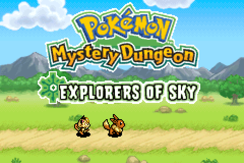
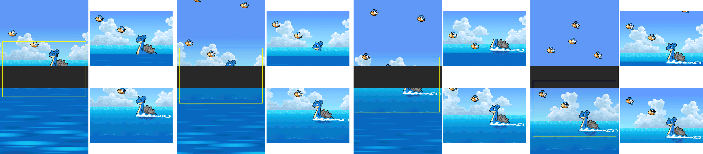

# Explorers of Sky Demake (Chapter 1)

---

## Index

The chapter-1 scenes, the story CGs and the opening's timings are text files
under `events/sky/`, with a local editor: see [EventEditor.md](../EventEditor.md).

- [Introduction](#introduction)
- [What plays](#what-plays)
- [Building](#building)
- [EoS maps](#eos-maps)
- [Beach Cave and the boss](#beach-cave-and-the-boss)
- [Music](#music)
- [Dungeon tilesets](#dungeon-tilesets)
- [Dungeon talk](#dungeon-talk)
- [Title screens](#title-screens)
- [Gen 4 Pokémon and moves](#gen-4-pokémon-and-moves)
- [Testing](#testing)
- [Code Locations](#code-locations)
- [Limitations](#limitations)

---

## Introduction

A demake of the opening chapter of *Pokémon Mystery Dungeon: Explorers of Sky*
("A Storm at Sea"), from the storm to the end of the Zubat & Koffing fight in
Beach Cave Pit, built from the real EoS assets: ground maps, second-screen art,
dungeon tileset, the Beach Cave Pit room, music, title screens, portraits and
the Gen 4 Pokémon and moves, all converted from a user-supplied EoS ROM (which
is never committed). The choreography and text follow the EoS scene scripts
(`SCRIPT/<level>/m01a0xxx.ssb`).


It is the default story of the modern build on this branch (`STORY=sky`).
The game is a demo of chapters 1 to 3: after chapter 1's beach epilogue
("And so...") it asks whether to save and goes on with chapter 2, "The New
Guild Recruits" (Wigglytuff's Guild, the team's name, Drenched Bluff:
[SkyChapter2.md](SkyChapter2.md#what-plays)); after chapter 2's good night
chapter 3, "The Scream", starts with its card and the morning's save
(Treasure Town, the visions, Mt. Bristle and Drowzee, the dream:
[SkyChapter3.md](SkyChapter3.md#what-plays)). After chapter 3's last scene
(m03a1314) it asks whether to save, shows "The demo ends here. Look forward
to updates!" and returns to the title screen. Continuing a finished save
shows the same ending again; a save made earlier (chapter 1's end, chapter
2's good night, the morning after fainting in Drenched Bluff, chapter 3's
mornings and the crew room's bed) goes on from there (`s_script_SKY_DEMO_END` in
[`src/data/ground/sky/sky_ch2_events.h`](../../src/data/ground/sky/sky_ch2_events.h),
`SKY_SAVE_GAME` / `SKY_DEMO_TO_TITLE` in [`src/sky_story.c`](../../src/sky_story.c),
the Continue check in [`src/ground_main.c`](../../src/ground_main.c)).

Red's story after chapter 1 is not in the sky build: only the ground maps the
demo visits keep their scripts and map files (Tiny Woods entrance/end, which
host the Sky scenes, the personality test, the two logo maps and the Sky
maps; found by tracing a full playthrough). The other 130 station script
files compile to nothing under `SKY_STORY` (but d02p01, gs180, and d02p02,
gs181, which became chapter 2's and chapter 3's stations:
[SkyChapter2.md](SkyChapter2.md#station-gs180),
[SkyChapter3.md](SkyChapter3.md#station-gs181)), their `gMapScriptTable` entries
are empty (`GetGroundScript` returns the null script) and their map files
are not linked (their names in the sorted ground file table point at a kept
file). This saves about 3.7 MB. The vanilla build keeps everything.

---

## What plays

Boot: EoS's Nintendo logo and ESRB notice, Red's logo screens, EoS's whole
opening (Shaymin flying over the land, then thirteen more scenes to the end of
"Pokémon Exploration Team Theme", see [The opening](#the-opening)), then the
EoS title (EoS's English logo, blinking "Press START", fading in from white
as the song ends). The top
menu has EoS's options and background and plays the EoS top-menu theme; the quiz uses EoS's intro wording and "Welcome to the World
of Pokémon". The starter list adds Turtwig, Chimchar, Piplup, Munchlax and
Riolu (with Vulpix, Meowth, Phanpy). Then:

| # | EoS script | Map (converted EoS level) | Scene |
|---|---|---|---|
| 1 | — | — | Chapter card: EoS banner font over Sharpedo Bluff (`v01p02a` darkened, as EoS's `back_SetBanner2`), **Chapter 1 — A Storm at Sea** |
| 2 | m01a0101/0102 | `v01p07b` stormy sea, `v01p01a` storm at sea | Lightning on black, voices, the stormy sea in the rain, the storm cliff lit by lightning twice, frame for frame as in EoS, then a fade to the waves (EoS's "Storm") |
| 3 | m01a0103 | `d01p11a` beach (day) | The EoS sky panorama, the hero washed up on the sand |
| 4 | m01a0104 | `g01p01b` Wigglytuff's Guild (dusk) | Guild sky; the partner loses their nerve on the sentry grate; the Relic Fragment close-up; Zubat & Koffing watch and follow |
| 5 | m01a0202/0203 | `v01p04b`, `v01p05b` | Dusk sky; Krabby blowing bubbles at sunset ("On the Beach at Dusk") |
| 6 | m01a0204–0208 | `d01p11b` beach (sunset) | The glittering sunset sea; the partner finds the hero; naming; Zubat & Koffing steal the Relic Fragment; "can you please help me?" |
| 7 | — | Beach Cave B1F–B4F | EoS Beach Cave tileset and wild Pokémon (Shellder, Kabuto, Corsola, Shellos), "Beach Cave" music |
| 8 | m01a0401 | Beach Cave Pit (B5F) | The EoS Pit room and background, "In the Depths of the Pit", pre-fight dialogue, then the Zubat & Koffing fight ("Boss Battle") |
| 9 | m01a0701 | `d01p41a` Beach Cave Pit | The thieves give the fragment back and flee |
| 10 | m01a0702 | `d01p11b` beach (sunset) | The Relic Fragment; "Form a team / Say no"; "And so..." |
| 11 | — | — | The save prompt; chapter 2 (card, the guild, Drenched Bluff, the faint path): [SkyChapter2.md](SkyChapter2.md#what-plays) |
| 12 | — | — | After chapter 2's good night: chapter 3 (card, Treasure Town, Mt. Bristle, the dream): [SkyChapter3.md](SkyChapter3.md#what-plays) |
| 13 | m03a1314, then the demo end | `v03p12a` | The save prompt, "The demo ends here. Look forward to updates!", the title |

The Relic Fragment is a ground object (EoS `GROUND/g01p01a1.wan`, ornament
`relicfragmentp`, object kind `SKY_OBJ_RELIC_FRAGMENT`): at the guild grate
the partner sets it down at (30, 23) with the treasure sound and picks it up
again after the close-up (m01a0104: `supervision_Acting(2)` /
`supervision_RemoveActing(2)`; gs178 group 6, sector 2, removed on cue 9); it
falls on the sand when Zubat rams the partner and is gone when Zubat grabs it
(m01a0208), and it lands in front of the heroes when Zubat throws it back in
the Pit (m01a0701).

The `SKY_CUTAWAY_*` picture ids are fixed numbers (`include/sky_story.h`):
when the storm cliff's two CGs were removed, ids 2 and 3 were left empty
instead of moving the later pictures down, so scene data built against the
old list (a partly rebuilt ROM) still names the same picture. Id 5 had
become the sunset sea, which a stale object showed in place of the Relic
Fragment close-up.

The two totem poles beside the guild entrance are ground objects too, not part
of the map: EoS places them from the level's `SCRIPT/G01P01B/enter.sse`
(`t01p01a1_174` at tile (18, 22.5), `t01p01a3_176` at (42, 22.5), hitbox 2x1),
and they stay up through the cutscene. They are converted from
`GROUND/t01p01a1.wan` and `GROUND/t01p01a3.wan` (32x64, two 32x32 pieces each)
with `convert_eos_wan_to_ax.py ornament ... totempole1|totempole2
--own-palette`: ornaments `totempole1p`/`totempole2p` on their own EoS
palettes `totempole1c`/`totempole2c`, which load into the two ground
extend-palette slots (OBJ palettes 13 and 14; object palette field
`0x125`/`0x126`). Object kinds `SKY_OBJ_TOTEM_POLE_1`/`_2` (70, 71) are past
the end of the vanilla `gGroundObjectTypes` table, so
[`src/ground_object.c`](../../src/ground_object.c) gives them type 1 (a plain
prop, no flags) from `sSkyGroundObjectTypes`. m01a0104 (group 6, sector 0 of
`events/sky/scenes/sky_d01p01_scenes.scene`) places them at EoS's positions; they are drawn over the
map like other sprites, and Koffing passes in front of the left one as in EoS.

Losing in Beach Cave plays m01a0301 on the beach ("Ouch! We didn't do too
well...") and goes straight back in; the re-fight uses m01a0501's text.

Dialogue uses EoS's box, measured on the DS (Sky UI style): 52 px tall with
5 px bevelled frames and EoS's rounded corners (a 7-tile window from row 12,
2 px left transparent above and below, so the bottom margin is 10 px as on
the DS; corner tiles in `graphics/custom/ui_style/sky_story_chrome.png`,
frame blues measured from EoS), text 4 px below and 6 px right of the frame's
inner edge, 13 px between lines; portraits have EoS's 4 px frame, 14 px above
the box,
bottom portraits kept just above the box, and a full box clears for the next
page instead of scrolling (`sSkyTextbox` in
[`src/string_format.c`](../../src/string_format.c)). The box is narrower than Red's and
speaker names vary, so a line that would run past it wraps at its last space
and the rest joins the next line (`SkyWrapDialogueText`). The dungeon message box has
the same box; it keeps Red's 7-row window (an 8th would reach the minimap's
tiles), so when it is full it scrolls a line up before writing the next,
and the minimap's tilemap stops at row 11 while it is up. As in EoS,
windows in a dungeon are translucent (fill blended 10/16 over 6/16 of the
dungeon, measured on DeSmuME as 60% / 40%; `ToggleWindowBgBuffer` in
[`src/window_buffer.c`](../../src/window_buffer.c)); ground windows stay opaque (`LOG_*` in [`src/dungeon_message.c`](../../src/dungeon_message.c),
`sub_803EAF0` kind 3 in [`src/dungeon_vram.c`](../../src/dungeon_vram.c),
`UpdateBgTilemapForDungeonMap`).

Red puts a "gutter" tile in column 0 of the two text layers (BG0 tile 0x279,
whose first pixel column is palette 15 colour 3, black), so a 1-px black line
ran down the left edge of every screen with the text layer on. EoS has no
such line: the sky build leaves the column empty (`TEXT_LEFT_GUTTER_OFF` in
[`include/bg_control.h`](../../include/bg_control.h), used by `src/text_1.c`
and `src/text_3.c`). Check `no_left_edge_line`.

### Dungeon menus

The dungeon menus follow EoS's, measured on DeSmuME (Beach Cave savestate)
and from EoS's own window table (overlay 31 `DUNGEON_WINDOW_PARAMS_*`,
read from RAM with the pmdsky-debug symbols). EoS lays them out on its
32×24-tile bottom screen; the GBA has 30×20 tiles, so each window keeps
EoS's column and is 2 tiles narrower where it reaches the right edge, and
heights are trimmed to fit 160 px.


- **Frames.** EoS menu windows have the dialogue box's frame: 7 px sides,
  5 px top and bottom frames 2 px in from the tile edge, with 1 px of fill
  inside. Every Sky-style window of the sky build uses it (the title menu
  too, as in EoS): the corners are the dialogue
  box's tiles and the top / bottom edge is chrome slot 0x2F8 (a spare
  all-white tile vanilla never draws; `menu_top` in
  `sky_story_chrome.png`), swapped in by `RemapSkyFrameEntry`
  ([`src/ui_style.c`](../../src/ui_style.c)). Fill and translucency are
  unchanged (60% fill in a dungeon). A speaker's dialogue box in a dungeon (cutscenes,
  talking to the partner) stays opaque, as in EoS (`gSkyDungeonTalkOpaque`).
- **Cursor.** EoS's arrow blinks 16 frames on, 16 off (Red: 8 / 8;
  `AddMenuCursorSprite_` in [`src/menu_input.c`](../../src/menu_input.c)).
- **Main menu** (B): EoS's options **Moves, Items, Team, Others, Ground,
  Rest, Exit**. Rest opens **Quicksave / Give Up** (Red's "Quicksave or Give
  Up", which EoS moved out of Others); Exit closes the menu. EoS: menu at
  (2,2), 6×12 tiles, 14 px per option; dungeon name at (11,4) 19×2 in orange;
  team info at (2,16) 28×6. GBA: menu (2,2) 6×9 with 10 px per option (the
  9 rows left above the info panel), name (11,4) 17×2 right-aligned with the
  info panel as in EoS (Red's was one column left and not aligned), info
  (2,13) 26×6. Option text 13 px in, cursor 1 px in; info values at EoS's
  columns (HP at 68, Belly / Money / Weather / Play at 160). The name uses
  the font's coral (slot 2), the closest colour to EoS's orange in the font
  palette (`SkyPrintOnMainMenu` in [`src/dungeon_main.c`](../../src/dungeon_main.c),
  `sSkyMainMenu` in [`src/dungeon_vram.c`](../../src/dungeon_vram.c)). The
  sky build uses this menu in either window style.
- **Titled submenus** (Items, Team, Moves, Others, Rest): one box with the
  title 8 px in, EoS's separator 12 px under it (2 px in from each side,
  black shadow), options from 18 px down, 13 px in, 12 px apart (EoS 14 px
  on its taller screen; `SKY_MENU_*` in [`include/ui_style.h`](../../include/ui_style.h),
  the separator in `PrepareTextbox_8008C6C`, [`src/text_2.c`](../../src/text_2.c)).
- **Others**: Options, Message log, Mission objectives, Recruitment search
  (when recruiting is on), Dungeon hints; 13 tiles wide as in EoS.
  EoS's Window and Map entries are left out: Red has no separate screens for
  them (Options holds the window colour and map settings).
- **Items**: "Treasure Bag", 18 tiles wide, names 21 px in; pages as
  "(1/2)" at the title's right instead of arrows (Red's held-item and Ground
  pages count). EoS's description box sits under the list, its top frame
  over the list's bottom frame; Red has no short descriptions, so it shows
  the first line of Red's description and is 26 tiles wide (Red's lines are
  set for that width). It stays up while the Use / Give / ... submenu is open
  (`CreateDungeonMenuSubWindowKeepWindow1`, [`src/dungeon_submenu.c`](../../src/dungeon_submenu.c)).
- **Team**: the team name as the title ("????" before the team is named,
  as EoS shows in chapter 1; Red drops the title then), 15 tiles wide, no
  leader star, hearts at 81 px, and EoS's role window under the list: "Team
  Leader" or the member's tactic.
- **Moves**: "X's moves" with the member as "(1/2)" at the title's right
  instead of arrows.

EoS's touch-screen row at the bottom of each submenu (separator, ◀ ▶ and
the close / sort icons) is not drawn: it has no GBA use and no art in Red.

The Krabby bubbles (EoS's `supervision_SpecialActing` 4/5 effect; spawn
points, sizes and velocities measured frame by frame in EoS: down-right from
the Krabby mouths on the sand, up-left at sunset, a slow leftward drift on
the beach) drift
over the two Krabby scenes, the sunset beach and the sunset-sea cutaway:
`SKY_BUBBLES(mode)` in scripts, OBJ sprites captured from EoS's OBJ layer
([`src/sky_bubbles.c`](../../src/sky_bubbles.c),
`graphics/custom/sky_bubbles/`). Bubbles hide behind open windows, since EoS
shows text on the other screen. The same effect draws the rain over the
storm (`SKY_BUBBLES_RAIN`: the stormy sea, m01d0112, and the cliff,
m01a0102). Both EoS scenes use the same `EFFECT_VERY_HEAVY_RAIN`, a 3D-layer
effect, measured in DeSmuME with only BG0 shown: about 146 streaks on the
256x192 screen, 18–72 px long (median 36), 26.5° from vertical (dx/dy 0.5),
falling 7 px down and 3.5 px right a frame, added as rain + half the picture
(every rain colour: background weight 0.5). The demake tiles the screen with
three 64x64 sheets cut from EoS's own streaks (screen cell (c, r) shows
sheet (c + r) % 3, which wraps seamlessly; `graphics/custom/sky_rain/`,
built by [`tools/make_sky_storm_fx.py`](../../tools/make_sky_storm_fx.py)
from a capture of that layer, `eos_rain_layer.png`) and scrolls them at
EoS's speed: 20 semi-transparent 64x64 OBJs, blended 16/16 over 8/16 of the
picture, which is EoS's formula. No BG is a first blend target while it
rains (the waves would blend into the sky), and the weights also go to
`gUnknown_2026E4E`, which `ToggleWindowBgBuffer` reloads into BLDALPHA every
frame (before, it reset them to 16/0 and the streaks were drawn opaque);
the previous settings come back when the rain stops. Converted maps keep EoS's palette animations
(the sea shimmer, the sunset glitter, the Pit water) and, on maps that fit
VRAM, EoS's BPA tile animations: the storm-sea waves (`EV0101A1.bpa`) and
the guild torches (`EG0101B1.bpa`), in RT's BPA slots.

Connected CGs pan instead of cutting: where EoS shows a top-screen CG right
above the scene (the sky over the beach, the dusk clouds over the guild), the
demake shows the CG and eases down into the scene. The storm cliff instead
fades out and the stormy sea fades in, as the two screens fade on the DS. The 240x320 pictures come from
[`tools/make_sky_cutaway_scrolls.py`](../../tools/make_sky_cutaway_scrolls.py)
(`graphics/custom/sky_scrolls/`: the CG over a capture of the scene's first
view, with the player's Pokémon replaced by the rendered map; between them
the map from its top edge, so the tent is whole under the guild's sky, as on
the DS); the pan ends on exactly the map's first view and the scene is shown
at once, without a fade; the tiles
stream through a 21-row ring in the cutaway's VRAM (`ScrollConnected` in
[`src/sky_cutaways.c`](../../src/sky_cutaways.c)).

The pan hands over to the map without black or garbage frames: the map's
rebuild reuses the cutaway's VRAM, so the pan ends on an exact cover of the
map's first view (`<pair>_cover.{tiles,tilemap}`: the map's two layers as
BG0 = front and BG1 = back, using the map's own tiles, flips and palettes)
and keeps it up for a few frames while `GroundMap_Select` rebuilds BG2/BG3
(`ShowCover` / `SkyCutaway_UpdateCover`; `gSkyCoverActive` lets BG1 show
outside the text windows, see `REG_WINOUT` in
[`src/cpu.c`](../../src/cpu.c)). While the cover is up its layers take BG2 /
BG3's priorities (`src/reg_control.c`), OBJ stays on and the actors are drawn
at the cover's view, so nobody blinks out; the priorities come back one frame
after `ShowWindows` has replaced the cover. The cover's view (`CAM_X/CAM_Y` in
`src/data/sky_scrolls.h`) must equal the map's real first view, found by
matching `<pair>_bottom.png` (a capture of that view) against the map; the
beach's is (166, 88). Mid-scene CGs (the Relic Fragment, the
sunset sea) fade out of and back into the scene. The scene's actors are on
screen during the pan (the hero lying on the sand, the partner at the
grate): the pan draws them each frame with the ground camera at the map
position the picture shows (`SKY_SCROLL_<PAIR>_CAM_X/Y`,
`SkyGroundSprite_DrawActors` in [`src/ground_sprite.c`](../../src/ground_sprite.c)),
after unfading the ground palettes the scene's `FADE_OUT` darkened.

The storm voices follow m01a0101: EoS's thunder (`SE_NUM_EVENT_MAIN01_THUNDER_01/02`,
Red ids 461/467) with each white flash, and after "Waaaaaah!" (`..._WARP`,
id 488) a 90-frame white-out with the text box up, a hold on white, then
black before the cliff, whose lightning plays the same thunder.

Between the white-out and the cliff, EoS plays `V01P07B/m01d0112` (the
unionall runs it between m01a0101 and m01a0102): the stormy sea on the
bottom screen. Its script, with the timing measured in DeSmuME (frames from
the start of the fade in, F):

| EoS | Frame | Demake |
|---|---|---|
| `sound_Stop()`, `back_SetGround(LEVEL_V01P07B)` | about F−47 | `BGM_STOP`, `SELECT_MAP(MAP_SKY_STORM_WAVES)` (60 frames of black) |
| `bgm_PlayFadeIn(BGM_STORM, 160, 256)` | F−7 | `BGM_FADEIN(160, MUS_SKY_STORM)` |
| `screen_FadeIn(1, 60)` | F | `FADE_IN(TRUE, 60)` |
| `SetAnimation<object V01P07B1_192>(18)` | F+119 | `SKY_STORM_BOLT` |
| `screen_FadeOut(1, 30)` | F+359 | `FADE_OUT(TRUE, 30)` |

There is no `se_Play` in the scene (hooked `PlaySeByIdVolume` and the other
SE / BGM entry points in DeSmuME: the only calls are the BGM stop, the
storm BGM at F−7, and the cliff's own `bgm_PlayFadeIn(BGM_STORM, 0)` and
thunder `se_Play(6401)` after it). The sound of the sea is the storm BGM
(wind and rumble, EoS bgm0101) fading in. The demake used to fade the BGM
out at the white-out and keep the sea silent until the cliff; it now
restarts it at F−7 as EoS does, and the cliff's `BGM_FADEIN(30,
MUS_SKY_STORM)` leaves the playing song alone (EoS's level runs on with no
break there either). Recorded with `sndshot`: silence from the white-out to
F−7, then the BGM from −46 dB rising to about −21 dB RMS, unbroken into the
cliff.

The waves (front layer, with their 6-frame BPA animation) roll under a
cloudy sky (back layer, palette animation flickering grey to brown), dark
clouds hang over it, the rain falls, and the view pans left at 0.4 px a
frame (EoS: 48 px in 120 frames, from x 342 to 187).

The lightning is the cloud object's WAN (`GROUND/v01p07b1.wan`) animation 1,
played once (118 frames; WAN frame 0 is the dark clouds, 1–3 the hidden
cloud above the view lit from below with a spark, 4 a lit puff and lit
rims, 5 and 6 a bolt from the puff into the sea):

| From F+ | Frames | WAN frame |
|---|---|---|
| 119 | 2 | 4 |
| 123 | 4 | 4 |
| 151 | 2, 2, 2, 2, 2 | 4, 1, (dark 4), 1, 2, 3, 1 |
| 209 | 2 | 4 |
| 211 | 22 | 5 and 6 alternating every 2 frames (the bolt, map x 365–400, from the puff at the top of the view to the waves) |
| 233 | 2 | 4 |

The sky's palette animation flashes brown at F+90, 122, 150, 210, 242, 270,
330 and 362 (a 120-frame cycle), so the lit frames land on its flashes.
There is no screen flash and no thunder SE. The demake
([`src/sky_storm.c`](../../src/sky_storm.c)) plays the same animation: a
lit frame turns the two baked cloud colours to EoS's lit body colours
((16,24,24) → (0,8,8), (40,40,48) → (0,48,24), BG palette 1) and draws the
rest of the frame (yellow light, puff, bolt) as up to 33 OBJs placed in map
pixels, cut from EoS's own frames (captured from DeSmuME's OBJ layer in map
coordinates, `graphics/custom/sky_storm/lit_1..6.png`; OBJs, tiles and the
14-colour palette built by `tools/make_sky_storm_fx.py`:
`graphics/custom/sky_storm/bolts.png`, `src/data/sky_storm_bolts.h`). Each
frame's tiles (up to 201) are uploaded into whichever of two VRAM slots
(OBJ tiles 0x100–0x292) the displayed OAM does not use; OBJ palette 15. OBJ
palette 15 is the text arrow's, the emotes' and the dungeon map dot's in
other scenes, so `sky_storm.c` saves it before the bolt and puts it back when
the bolt ends. The same goes for OBJ tiles 0x100–0x292, which hold the
ground emotes (the anger mark etc.): they are kept in a heap buffer during
the bolt (no bolt if the heap has no room) and restored after it. The
bolt's foot is behind the waves (OBJ priority 3 below map row 160), as in
EoS. `SKY_MAP_PAL_RESTART` restarts the map's palette animation at F−7 so
the GBA's sky flashes on the same frames as EoS's; measured on the GBA, the
flashes and the lit frames fall on exactly EoS's frames. The OAM budget in
the scene: 20 rain OBJs + at most 33 lightning OBJs. The demake plays it on `MAP_SKY_STORM_WAVES`: the view
starts at map (350, 64), 8 px right of EoS's so the 240 px screen keeps
EoS's centre, 64 px down so the 160 px screen shows the sky's lower half and
the waves, and `SKY_CAMERA_MOVE_X(-154, 102)` pans it. `SKY_CAMERA_SET(x, y)`
places the view's top-left at once (`SkyCamera_SetView`); the map loads
hidden for 5 frames, since a freshly loaded map's palettes are unfaded.

Zubat and Koffing walk in from off screen at the guild as in m01a0104: the
camera follows the partner 104 px down, the two spawn above the view, and
`SKY_CAMERA_MOVE(dy, speed)` (`SkyCamera_MoveBy` in
[`src/code_809D148.c`](../../src/code_809D148.c)) raises the camera 88 px
while they walk to their marks. Both carry lives flag `0x80000` (EoS
`SetOutputAttribute(8)`), the higher OBJ priority, so they are drawn over the
guild's bushes.

EoS's `SetAnimation` ids match Red's ground animation ids for the common
ones (2 still, 5 walking in place, 11 surprised/hurt, 12 attack), so the
scenes copy EoS's: the hero's `CORO_EXPLANATION_FUNC` (walking in place for
45 frames) when telling the partner they are human, backing off with feet
moving, the partner knocked back, Zubat's tackle.

The DS second screen has no GBA equivalent, so its art (sky panoramas, the
storm cliff, the Relic Fragment close-up, the animated sunset sea) is shown as
full-screen cutaways in the middle of scenes (`SKY_CUTAWAY(id, frames)`,
[`src/sky_cutaways.c`](../../src/sky_cutaways.c)).

### The storm cliff

EoS's m01a0102 shows Sharpedo Bluff (`v01p02a`) on the top screen over the
sea (`v01p01a`) on the bottom one. `v01p02a` is two 288x216 pictures side by
side, the cliff in the dark and the cliff lit by lightning, and the script
flashes by jumping the top screen's camera between them
(`camera2_SetPositionMark`: the DS screen shows the picture from (0, 0) in
the dark and from (287, 0) when lit). Nothing flashes white and no palette
changes. Over the lit picture, object `V01P02A1_181` plays its bolt
(`SetAnimation(17)`): four frames, yellow on five colours. The sea screen
does nothing in time with the flashes (waves and rain only).

Recorded in DeSmuME frame by frame (frame 0: the first frame the cliff is
visible; the top screen fades with the DS master brightness, read from the
register, in sixteenths):

| Frames | EoS |
|---|---|
| 0–27 | `screen2_FadeIn(0, 30)`: darkening 15, 14, 14, 13, 13, 12, 12, 11, 11, 10, 10, 9, 9, 8, 8, 7, 6, 6, 5, 5, 4, 4, 3, 3, 2, 2, 1, 1 |
| 28–151 | the dark cliff |
| 149 | `se_Play(6401)`, thunder |
| 152–153 | lit (2 frames) |
| 154–158 | dark (5 frames: `Wait(2)` and the frames EoS takes to load the sound and the bolt object) |
| 159–192 | lit, with the bolt: none 4, frame 1 for 2, none 1, frame 2 for 6, none 1, then three times (frame 3 for 2, frame 4 for 2, none 1), none 5 more (34 frames) |
| 193–242 | dark (`Wait(50)`) |
| 242 | `se_Play(6401)` |
| 243–244 | lit (2 frames) |
| 245–246 | dark (2 frames) |
| 247–280 | lit, with the same bolt animation |
| 281–373 | dark (`Wait(90)`) |
| 374–429 | `screen2_FadeOut(0, 60)`: darkening `(frame - 370) * 16 / 60` |
| 430 | black |

The demake plays the same 431 frames (`ShowStormCliff` in
[`src/sky_cutaways.c`](../../src/sky_cutaways.c); `SKY_CUTAWAY_STORM`'s frame
count is not used). Both pictures are in VRAM at once as EoS's own 4bpp
tiles and 14 palettes (837 tiles at 0x6000: the dark picture on BG3, the lit
one on BG2 over it, the layer mode EoS's opening uses), so a flash is one
tilemap copy in a vblank, with no decompression in between. The GBA shows
the middle 240x160 of the DS screen ((8, 16); the lit layer is scrolled 7 px
because EoS's lit view starts at 287, not 288). The fades use the DS
formula on the 5-bit palette, `c - c * d / 16`, and the rain's palette
follows. The bolt is 16x16 OBJs (at most 27) from captures of EoS's OBJ
layer, OBJ palette 15 and OBJ tiles 0x100–0x21F, both saved before and put
back after (the ground emotes and the UI palette live there). Thunder is
SE 461 on frames 149 and 242. Before, the demake showed two flashes of
2 white frames, 4 lit, 2 white and 6 lit (the lit picture was decompressed
between them), 80 and 40 frames apart, with no bolt, and a 32-frame fade.

[`tools/make_sky_storm_cliff.py`](../../tools/make_sky_storm_cliff.py)
(`tools/make_sky_storm_cliff.py EOS.nds`) writes
`graphics/custom/sky_storm_cliff/` (`cliff.tiles`, `dark.tilemap`,
`lit.tilemap`, `cliff.pal`, `bolt.tiles`, previews `dark.png` / `lit.png`)
and `src/data/sky_storm_cliff.h` from the ROM and from `bolt_1..4.png`, the
bolt's four frames as captured (DS screen coordinates).

---

## Building

```bash
make -j$(nproc)                 # sky story (default for the modern build)
make -j$(nproc) STORY=vanilla   # Red's story, no EoS content
```

- `STORY=sky` selects the ground-script pack `src/data/ground/sky/` and
  defines `SKY_STORY`. Everything EoS-specific is inside `#ifdef SKY_STORY`.
- `MODERN=0` (retail-matching) always uses the vanilla pack.
- `custom_story = TRUE` in `configs/runtime.c` still wins over `STORY`.
- Flipping `STORY` rebuilds every C object (the pack stamp is a dependency of
  all C objects, because headers test `SKY_STORY`).
- `SKY_ONLY_C_SOURCES` (Makefile) are linked only in the sky build;
  `NON_SKY_C_SOURCES` / `NON_SKY_ASM_SOURCES` are left out of it (Red-only
  systems, next section). Both lists keep the vanilla link unchanged.

### Red-only systems left out

To save ROM space the sky build does not link Red systems that EoS does not
have and that the demo cannot reach. The vanilla build keeps all of them
(`make STORY=vanilla` is still byte-identical). Sizes are from the sky
build's `pmd_red.map`; the ROM went from 25,537,529 to 25,294,397 bytes
(243,132 bytes, 237 KB, less).

| System | Left out of the link (`NON_SKY_C_SOURCES`) | Bytes |
|---|---|---|
| Wonder Mail, Pokémon News, mailbox, Pelipper Post Office and board, job list, thank-you mail | `pokemon_mail`, `pokemon_mail_pre`, `mailbox`, `pokemon_news1-3`, `wonder_mail*` (12 files), `thank_you_wonder_mail`, `thank_you_messages`, `mission_reward`, `post_office_guide1`, `pelipper_board`, `code_802DE84`, `code_803B344`, `code_803C1B4`, `code_8031D70`, `data/data_80E7D40.s` | 92,720 |
| Red's friend rescue (SOS / A-OK mail, rescue passwords) | `friend_rescue`, `rescue_password_menu` | 28,749 |
| Friend Areas (map, action menu, intros, habitat talk, Wigglytuff's shop and area info) | `friend_area_action_menu`, `friend_areas_map`, `friend_areas_map_util`, `friend_area_intros`, `friend_area_intros_data`, `friend_area_dialogue`, `wigglytuff_shop1-3`, `code_8023144` | 19,809 |
| Team-base flags (`flag##c` / `flag##p`, 64 ornament files) | `ornament_gfx1-4`; the 64 entries leave `gOrnamentFiles` | 90,216 |
| Code and data in kept files that only those systems used (`#ifndef SKY_STORY`) | job / mail generation and checks (`code_80958E8.c`), the password codec (`code_803D0D8.c`), the item-per-dungeon table (`items.c`), helpers in `code_8094F88.c`, `code_80A26CC.c`, `friend_area.c`, `ground_lives.c`, `world_map_sound.c`, ..., and their strings | 11,638 |

`friend_area.c` (which Friend Areas the team owns, read by recruiting),
`code_80958E8.c` / `code_8094F88.c` (the mail and job slots in the save),
`rescue_scenario.c`, `post_office_guide2.c` (Others > Mission objectives) and
the Trade Items link code stay.

Every removed object was reachable only through one of these doors, now
closed under `SKY_STORY` (the vanilla code is unchanged):

- **Top menu**: no Friend Rescue / Wonder Mail S entry, and Continue only
  (`main_menu2.c`). `main_menu1.c` drops the Friend Rescue, Wonder Mail and
  rescue-password screens. No other kept screen returns those menu ids
  (only the left-out flows, and the save menu's `0x2A`/`0x2B` modes that only
  they open). Revive Team / Awaiting Rescue need an SOS or A-OK mail: those
  come from the friend-rescue screens or from fainting where rescues are
  allowed; Beach Cave (Tiny Woods) has `rescuesAllowed = -1`.
- **Ground special texts** (`textbox.c`): Friend Rescue counter, Wonder Mail
  2, thank-you mail, Pelipper help counter, bulletin / outlaw board, mailbox,
  thank-you messages, Wigglytuff's shop, buying Friend Areas and picking a
  Friend Area (`0x16`) are compiled out, so a script asking for one gets no
  menu. The scripts the sky build links (`ground_event_data`, the d01p01 /
  d01p02 / s01 / s04 / s05 stations, and chapters 2's and 3's d02p01 / d02p02 placeholders; checked in the preprocessed `.i`
  files) only ask for Save, Storage, the scripting menu, the personality
  quiz and kind `0x29`; code asks for the ground menu, naming, yes/no boxes,
  the dungeon / Dojo list and the custom debug menu.
- **Ground menu** (`code_801D014.c`, B in free roam; the demo has no free
  roam): no Job List; the Friend Area version of the menu (Info, Exit) and
  the unused friend-area action menu are compiled out (the sky build has no
  Friend Area maps, so `MapIdToFriendAreaId` is always 0 there).
- **Ground script**: `CMD_BYTE_03` (to the Friend Areas map) takes its "no
  areas" branch; special processes 0x04 (mailbox delivery) and 0x06 (tutorial
  mail) do nothing; 0x0A (Friend Area habitat talk, `HABITAT_TALK`, used only
  by Red's Friend Area maps) prints nothing. None is in a linked sky script.
- **Game loop** (`main_loops.c`, `ground_main.c`): `STARTMODE_FRIEND_AREAS`
  goes back to the ground map instead of the Friend Areas map; no Friend
  Area intro on entering a map.
- **Jobs**: `GeneratePelipperJobs` (run at every dungeon entry and day
  change) only clears the board; the job and mailbox generators, Wonder Mail
  validation and their tables are compiled out.
- **Mission objectives** (dungeon Others): the out-on-rescue case and the
  job list are compiled out; a job dungeon shows "Just go!".
- **Custom debug menu**: Unlock Friend Areas, All Friend Areas, Friend Area
  Intros, PMD2 Rescue Points, Outlaw Missions, Refresh Bulletin, Unrestricted
  Bulletin Jobs and Expanded Job Slots are not listed.
- **Team-base flags**: only Red's team-base scripts (not in the sky build)
  place flag objects or load flag palettes; the sky scripts place only the
  totem poles, the Relic Fragment and chapter 2's and 3's objects, and use no
  `SPAWN_OBJECT`. The palette name table `gUnknown_81178F4` keeps the flag
  names, so palette slots 37 / 38 (the totem poles), 39 / 40 (the dinner,
  the pearl) and 41-44 (chapter 3's totem poles 3 / 4, the dojo warp, the
  Time Gear, the crumbling rock) do not move. The sky build's `gOrnamentFiles` is its
  own list without them, sorted by name for `OpenFile`'s binary search.

How it was checked: a symbol graph of the objects (`arm-none-eabi-nm`) gave
every reference from a kept object into the removed set, and each one is
closed above; the link has no undefined references. A sky build with
`-ffunction-sections -fdata-sections --gc-sections --print-gc-sections`
listed the code left dead in kept files, and only the pieces that the
removed systems used were compiled out. Then the demo was played headless
(title, both top menus, New Game, the quiz, chapter 1, Beach Cave and its
menus, the Pit, the aftermath, the demo end and Continue).

---

## EoS maps

The EoS ROM is never committed. Only the converted map files are:
`data/map_bg/E*.bpl`, `E*c.bpc`, `E*m.bma` (+ GMLZ copies in `data/map_bg_lz/`).

| Map id | File stem | EoS level | Tiles |
|---|---|---|---|
| `MAP_SKY_STORM_SEA` | `EV0101A` | `v01p01a` | 613 (VRAM) |
| `MAP_SKY_BEACH_DAY` | `ED0111A` | `d01p11a` | 1651 (streamed) |
| `MAP_SKY_GUILD_DUSK` | `EG0101B` + `EG0101B2m` | `g01p01b2` (gate closed) | 878 + 78 animated (VRAM) |
| `MAP_SKY_KRABBY_BUBBLES` | `EV0104B` | `v01p04b` | 1067 (streamed) |
| `MAP_SKY_KRABBY_SUNSET` | `EV0105B` | `v01p05b` | 1080 (streamed) |
| `MAP_SKY_BEACH_DUSK` | `ED0111B` | `d01p11b` | 1767 (streamed) |
| `MAP_SKY_BEACH_CAVE_PIT` | `ED0141A` | `d01p41a` | 1503 (streamed) |
| `MAP_SKY_STORM_WAVES` | `EV0107B` | `v01p07b` | 546 + 240 animated (VRAM) |
| `MAP_SKY_GUILD_ENTRANCE` | `EG0101B` | `g01p01b` (gate open) | 878 + 78 animated (VRAM) |
| `MAP_SKY_GUILD_1F` | `EG0102A` | `g01p02a` | 752 (VRAM) |
| `MAP_SKY_GUILD_B1F` | `EG0103A` | `g01p03a` | 1984 (streamed) |
| `MAP_SKY_GUILD_B2F` | `EG0104A` | `g01p04a` | 1982 (streamed) |
| `MAP_SKY_GUILD_B2F_DOOR` | `EG0104A` + `EG0104A2m` | `g01p04a2` | 1982 (streamed) |
| `MAP_SKY_GUILD_B2F_NIGHT` | `EG0104C` | `g01p04c` | 1982 (streamed) |
| `MAP_SKY_GUILD_WIGGLYTUFF` | `EG0105A` | `g01p05a` | 734 + 24 animated (VRAM) |
| `MAP_SKY_GUILD_WIGGLYTUFF_NIGHT` | `EG0105C` | `g01p05c` | 734 + 24 animated (VRAM) |
| `MAP_SKY_GUILD_MESS_HALL` | `EG0106B` | `g01p06b` | 1336 (streamed) |
| `MAP_SKY_GUILD_CREW_ROOM` | `EG0107A` | `g01p07a` | 763 (VRAM, one layer) |
| `MAP_SKY_GUILD_CREW_ROOM_NIGHT` | `EG0107C` + `EG0107A`'s BPC, BMA | `g01p07c` | 763 (VRAM, one layer) |
| `MAP_SKY_DRENCHED_BLUFF_ENTRANCE` | `ED0211A` | `d02p11a` | 1268 (streamed) |
| `MAP_SKY_DRENCHED_BLUFF_END` | `ED0231A` | `d02p31a` | 2313 (streamed) |
| `MAP_SKY_TREASURE_TOWN_SQUARE` | `ET0101A` | `t01p01a` | 1749 (streamed) |
| `MAP_SKY_TREASURE_TOWN_WEST` | `ET0102A` | `t01p02a` | 902 + 75 animated (VRAM) |
| `MAP_SKY_CROSSROADS` | `EP0101A` | `p01p01a` | 785 + 64 animated (VRAM) |
| `MAP_SKY_BEACH_PATH` | `EP0102A` | `p01p02a` | 232 + 6 animated (VRAM) |
| `MAP_SKY_GUILD_ENTRANCE_DAY` | `EG0101A` | `g01p01a` | 877 + 23 animated (VRAM) |
| `MAP_SKY_MT_BRISTLE_ENTRANCE` | `ED0311A` | `d03p11a` | 1007 (VRAM) |
| `MAP_SKY_MT_BRISTLE_PEAK` | `ED0341A` | `d03p41a` | 533 (VRAM, one layer) |
| `MAP_SKY_BIDOOF_HOME` | `EP1501A` | `p15p01a` (cropped) | 833 + 117 animated (VRAM) |
| `MAP_SKY_DUGTRIO_TUNNEL` | `EV0303A` | `v03p03a` | 459 (VRAM) |
| `MAP_SKY_STORM_CLOUDS` | `EV0305C` | `v03p05c` | 978 (streamed, one layer) |
| `MAP_SKY_TIME_GEAR_FOREST` | `EV0306A` | `v03p06a` | 2070 (streamed) |
| `MAP_SKY_TIME_GEAR_LAKE` | `EV0307A` | `v03p07a` | 834 (VRAM) |
| `MAP_SKY_TIME_GEAR_VOLCANO` | `EV0308A` | `v03p08a` | 1021 (VRAM) |
| `MAP_SKY_TIME_FLOW` | `EV0309A` | `v03p09a` (cropped) | 889 (VRAM) |
| `MAP_SKY_GROVYLE_RUN` | `EV0311A` | `v03p11a` | 1039 (streamed) |
| `MAP_SKY_GROVYLE_CLOSEUP` | `EV0312A` | `v03p12a` | 1195 (streamed) |

The chapter-2 maps (from `MAP_SKY_GUILD_ENTRANCE`) and what was left out of
them: [SkyChapter2.md](SkyChapter2.md#ground-maps); the chapter-3 maps (from
`MAP_SKY_TREASURE_TOWN_SQUARE`), the two cropped ones and the river left
still on the square: [SkyChapter3.md](SkyChapter3.md#ground-maps). Where EoS has two levels
over one BPC (g01p01b / g01p01b2, g01p04a / g01p04a2, g01p07a / g01p07c),
the demake shares the files the same way: a `<STEM>2m` BMA, or one map's
BPC and BMA under another's BPL (`gMapFilesTable` names each file).

Converter: [`tools/convert_eos_ground_map.py`](../../tools/convert_eos_ground_map.py)

```bash
tools/convert_eos_ground_map.py EOS.nds d01p11b ED0111B --render check.png
tools/convert_eos_ground_map.py EOS.nds g01p04a2 EG0104A --bma EG0104A2 --compare   # files already written
tools/convert_eos_ground_map.py EOS.nds v03p09a EV0309A --crop-chunks 1 2 11 8      # only chunks x 1-11, y 2-9
```

- Lossless: EoS and RT share 4bpp tiles, 3×3-tile chunks and 16-colour
  palettes, so tiles, palettes and chunk layouts are copied, not re-quantized.
  `--render` draws the written RT files back to a PNG; `--compare` compares
  them (BPA frame 0) with skytemple's render of the EoS level: every map
  except the hand-built `EV0107B` is pixel-identical. The regression check
  `sky_map_files` keeps each render's sha1.
- Both EoS layers become the RT dual-layer map (EoS upper layer → RT layer 0,
  in front of sprites). On maps that fit VRAM, palette animations and up to
  two animated BPAs are kept (`--no-palette-animation` leaves the palette
  animation out); streamed maps bake BPA frame 0.
- Maps over the VRAM tile budget (1024 dual-layer, 896 single-layer) are
  streamed by `src/ground_bg_tile_stream.c`, which has no tile-flip bits, so
  the converter bakes flipped tiles for those. In the sky build a streamed map
  can have up to 4096 tiles (the source-to-slot table comes from the heap
  while it streams), and one screen of it must fit the 1023 VRAM slots.
- Collision comes from the EoS BMA.
- New BPCs stay uncompressed in ROM (streamed like the café's);
  `compress_ground_assets.py` skips `E*.bpc`.

The stormy sea (`EV0107B`) has its own builder,
[`tools/make_sky_storm_waves_map.py`](../../tools/make_sky_storm_waves_map.py)
(`tools/make_sky_storm_waves_map.py EOS.nds`). `v01p07b`'s sky is 680 tiles,
too many next to the waves' 48 tiles and 240 animated ones, so the builder
leaves out the sky's top two chunk rows (above the view) and pools only the
chunks the map uses. EoS draws the dark clouds as sprites fixed in the
world; they were captured from DeSmuME's OBJ layer, placed in map
coordinates (`graphics/custom/sky_storm/clouds.png`, two colours), and baked
into the front layer's empty chunks above the waves on palette 1 (unused by
EoS's chunks), so they move with the sky. Its waves BPA is byte-identical to
`v01p01a`'s, so the map reuses `EV0101A1.bpa`. The lightning (the same
cloud object's lit frames) is drawn over the map at run time, see
[What plays](#what-plays).

Map registration: `include/constants/ground_map.h`, `include/map_files_table.h`,
`src/map_files_table.c`, `src/ground_map_conversion_table.c`,
`src/map_script_table.c`, `src/ground_files_table.c` (sorted by name; the
block is inserted under `#ifdef SKY_STORY` and later indices shift by
`SKY_GROUND_FILES`), `src/ground_map_files_sky.c`.

`SELECT_MAP` also selects the script file of the map in `gMapScriptTable`, so
each EoS map points at the station file whose groups use it (gs178 for the
beach, guild and storm scenes, gs179 for Beach Cave Pit, gs180 for every
chapter-2 map: [SkyChapter2.md](SkyChapter2.md#station-gs180), gs181 for
every chapter-3 map: [SkyChapter3.md](SkyChapter3.md#station-gs181)).

---

## Beach Cave and the boss

Tiny Woods plays Beach Cave ([`src/sky_story.c`](../../src/sky_story.c)):

- Name "Beach Cave", floors shown as B1F–B4F (`IsStairDirectionUp`).
- EoS Beach Cave tileset (EoS tileset 1, see [Dungeon tilesets](#dungeon-tilesets)).
- Wild Pokémon from EoS's `mappa_s.bin`: Shellder L1, Kabuto L1, Corsola L2,
  Shellos L2 (25% each), Kecleon L48 for shops.
- On the story run (`SCENARIO_MAIN` major 2) B5F is **Beach Cave Pit**: EoS
  fixed floor 1 (14×15) in Red's `fixedmap` encoding, patched over the Team
  Meanies room number while in Beach Cave, with Zubat L4 and Koffing L7 and
  EoS's Pit background as the floor's tileset. Its cutscene is
  `CUTSCENE_BEACH_CAVE_PIT`
  ([`src/dungeon_cutscene_beach_cave.c`](../../src/dungeon_cutscene_beach_cave.c)):
  m01a0401 (first visit) or m01a0501 (re-fight) dialogue and sounds, the
  camera shows the thieves, EoS's boss-battle transition (two white flashes,
  the speed streaks, a white-out; see [Boss battle transition](#boss-battle-transition)),
  boss music, and the dungeon ends once both are down. No cutscene
  flags are touched, so Sinister Woods is unaffected.
- Later visits to Beach Cave have no Pit.
- Bosses grant no EXP, as in EoS: `gSkyBossExp` (src/sky_story.c, default
  FALSE) gates EXP from Pokémon with `bossFlag` (the Pit's Zubat and Koffing
  set it); the debug menu's "Boss EXP" toggles it at runtime.
- Gen 4 Pokémon have no lines in Red's per-species talk files (level-up and
  team chat); they use a Red Pokémon's (`SkyStory_TalkSpecies`: Turtwig →
  Bulbasaur, Chimchar → Charmander, Piplup → Squirtle, Riolu → Machop, else
  Pikachu). Reading a missing talk file showed garbage and could crash.
- Zubat and Koffing use EoS's fixed-floor boss stats (overlay 10's monster
  spawn stats, entries 1 and 2): Zubat L3, 15 HP, 15 Atk / Sp. Atk, 11 Def /
  Sp. Def; Koffing L6, 27 HP, 20 / 20, 8 / 8
  (`SkyStory_ApplyFixedRoomBossStats`).
- The Pit's background keeps EoS's animated water colours (palettes 10-11,
  `dungeon_bg0.dpla`); the cutscene camera is centred on the sand.
- The Pit's background is 925 tiles, more than Red's 512-tile slot, so it
  covers the trap and grid tiles at tile 0x200. `SkyStory_RelocateGridTiles`
  copies the rotate-mode grid tiles (R) from `trappat` after the Pit tiles.
- Red's species (all 419 that EoS also has, except Munchlax) use EoS's base
  stats, EXP yield and level-up growth (`gSkyRedLevelData`, generated by
  [`tools/make_sky_gen4_data.py`](../../tools/make_sky_gen4_data.py)), so the
  Beach Cave Pokémon have EoS's stats at EoS's levels (Corsola L2: 11 base HP,
  not Red's 45).
- The sky build mixes 8 DirectSound channels instead of 12 (`src/m4a.c`),
  which cuts the frames the dungeon falls behind in Beach Cave by about a third.

Chapter 2's dungeon, **Drenched Bluff**, is played by Thunderwave Cave the
same way, with EoS's floor layouts, traps and floor items as well (generated
from mappa_s.bin): see [SkyChapter2.md, "Drenched Bluff"](SkyChapter2.md#drenched-bluff).
Chapter 3's **Mt. Bristle** and its peak are played by Mt. Steel's two
entries; the peak is EoS's fixed floor 2 in Red's Skarmory room with Drowzee
at EoS's boss stats, its cutscene ends in the same boss battle transition:
see [SkyChapter3.md, "Mt. Bristle"](SkyChapter3.md#mt-bristle).

### Dungeon speed

How fast the dungeon plays was measured in mGBA (`build/tools/mgba_rpc`,
its `prof` command) on one fixed floor (`DEBUG_BOOT_SEED=7`, Beach Cave B1F;
Tiny Woods B1F for the vanilla build), and in DeSmuME for EoS. A *dropped
frame* is a video frame in which the main loop did not finish
(`gUnknown_203B0B8` did not move).

**Pacing is the same in all three games.** Nothing in the sky build waits
longer than Red or EoS:

| Action | Sky before | Sky now | Vanilla (Red) | EoS |
|---|---|---|---|---|
| Walk one tile, nobody else on screen; the partner follows in the same turn (frames) | 25.97 (25, or 26 on 1 turn in 3) | 25.14 (26 on 1 turn in 7) | 25.31 | 25.3 (25 or 26) |
| Dash one tile, B held, corridor (frames) | 2.96 (3, some 4) | 2.63 (2 or 3) | 3.21 (3, some 4) | 3 |
| Attack with nothing in front (A to A, frames) | 31–33 | 29–32 | 31–33 | 33–36 |
| Walk one tile with a wild Pokémon on screen that does not act (frames) | 25 or 26 | 25 or 26 | 25 | — |
| Dropped frames while walking | 7.6% | 4.5% | 5.2% | — |
| Longest freeze in the test walk and dash (frames) | 13 | 3 | 8 | — |
| CPU load standing still (% of a frame) | 63.4 | 60.7 | 38.7 | — |
| CPU load over the test walk | 67.5 | 62.4 | 50.8 | — |

A tile is 24 frames of walking at 1 px a frame, plus the turn. A turn (24
fractional turns, every Pokémon's AI, the minimap) is 0.8 to 1.4 frames of
CPU work in Red's engine, so every turn drops a frame in the sky and the
vanilla build alike (EoS's 25 or 26 frames a tile look the same). That is
where "25" comes from, and why a dashed tile takes 2 or 3 frames, not one.

Messages do not hold the game up in either build: a log line is drawn in one
frame (9% of a frame's CPU), the box stays 240 frames after the last line,
and a full box scrolls a line up while the game goes on (13 frames in the Sky
box, which holds 3 lines; 11 in Red's, which holds 4). Fights were not timed
against EoS (the floors have different Pokémon and moves); the sky build has
no wait of its own in them.

**What made the sky build slower than that**, in order of what a player
would notice:

1. **Freezes of 12–13 frames** (0.2 s; the music kept playing) each time the
   whole minimap was redrawn: `UpdateMinimap` drew all 1792 tiles through
   `DrawMinimapTile`, 5.7 frames of work. It runs when the message log
   closes (4 s after the last message), when a menu closes, and when the
   camera goes to another Pokémon and back (every level-up). Red has the
   same freeze, 8–13 frames long. While the main loop is late the mixer
   still runs every frame (from the VBlank interrupt), so a third of each
   of those frames goes to sound.
2. **A second dropped frame on a third of the turns** (26 frames a tile
   instead of 25, and 4 instead of 3 when dashing). The turn's work is the
   same as Red's, but the frame it starts in is 63% full, not 39%.
3. **The message log's scroll** (`SkyLogScrollUp`): 16% of a frame, every
   frame of the 13-frame scroll, because each pixel row's index was computed
   with a shift, a multiply and a mask. Frames were 83% full during a scroll.

**The fixes** (all `#ifdef SKY_STORY`):

- `UpdateMinimap` ([`src/dungeon_map.c`](../../src/dungeon_map.c)) reads
  what is the same for every tile once (`struct MinimapState`), clears the
  map and draws only the tiles that are not the empty picture (walls, water
  and unknown tiles are): 1.1 frames of work instead of 5.7.
- When the log closes, the redraw is spread over 16 frames
  (`UpdateMinimapSoon` / `UpdateMinimapStep`, 2 rows a frame, 4–16% of a
  frame each; a map picture whose 4 tiles are empty and whose pixels are
  already clear is skipped). The map's tiles are copied back to VRAM at
  once, so nothing is missing meanwhile.
- A corridor step redrew the 5×5 tiles around the leader; 20 of them were
  drawn on the step before. `DiscoverMinimap`
  ([`src/dungeon_map_access.c`](../../src/dungeon_map_access.c)) skips a
  seen tile with no Pokémon on it (a tile costs about 850 cycles to draw,
  so 25 of them were 7% of a frame on every corridor turn).
- `CpuCopy` / `CpuFill` / `CpuClear` ([`src/cpu.c`](../../src/cpu.c)) use
  DMA 3 instead of the BIOS's `CpuSet` (9 cycles a word from EWRAM to VRAM
  instead of 15), in blocks of 512 bytes (under a scanline each, so
  interrupts are not held up). The dungeon copies 5 KB a frame through them
  (BG tilemaps 0 and 1, the HP bar): 6.9% of a frame before, 4.0% now. The
  boss transition owns DMA 3 while it runs; copies use `CpuSet` then.
- `SkyLogScrollUp` ([`src/dungeon_message.c`](../../src/dungeon_message.c))
  walks whole tiles with pointers: 5% of a frame (frames 67% full).
- The spawn-position search (`sub_8083660`,
  [`src/dungeon_range.c`](../../src/dungeon_range.c)) reads the tile
  pointers directly (it looks at every tile each time a wild Pokémon may
  spawn: 0.85 frames, now 0.5).

The minimap's tiles in VRAM and the window tiles (the log) were compared
with the old build's after each of 80 tiles of the same walk, with the menu
and the map toggled on the way: identical. Nothing changes in the sound.

**What is left.** The mixer is still the largest fixed cost: 8 channels at
18157 Hz are 35% of every frame (4.4% a channel; Red's songs keep 2–3 of
its 5 channels busy, 14–25%). The alternatives were measured and not taken,
because each can be heard and the gain is small once the freezes are gone:

| Change | Mixer | Walk (frames a tile) | Dash | Cost |
|---|---|---|---|---|
| 5 channels (built and measured) | 35% → 22% | 25.2 → 25.05 | mostly 2 | EoS songs use 7 voices on average, all 8 in half the frames; 2–3 would be cut |
| 13379 Hz (computed: the cost follows the rate) | 35% → 26% | — | — | nothing above 6.7 kHz; the samples are stored for 9 kHz |

The turn itself (0.8–1.4 frames) is Red's engine and was left alone, so the
one dropped frame a turn stays, as in Red and EoS.

`scripts/cloud/sky_regression.sh --rom perf` measures all of this again
(see [Testing](#testing)).

### Boss battle transition

EoS starts every boss fight with the same transition: 71 scripts call
`CallCommon(CORO_BOSS_WIPE_FUNC)` (Beach Cave Pit to the postgame, plus two
debug scripts), and none run its effect any other way. m01a0401 / m01a0501 run:

```
message_Close(); bgm_Stop();
se_Play(5143); screen_WhiteOut(1, 2); Wait(2); screen_FadeIn(1, 2); Wait(10);
se_Play(5143); screen_WhiteOut(1, 2); Wait(2); screen_FadeIn(1, 2); WaitSe(5143);
CallCommon(CORO_BOSS_WIPE_FUNC);   // unionall.ssb:
    se_Play(5136); supervision_SpecialActing(13, 0, 0); Wait(60);
    screen_WhiteOutAll(1, 30); supervision_SpecialActing(3, 0, 0);
main_EnterDungeon(2, 30);          // Beach Cave Pit's fight
```

`SpecialActing(13)` draws blue-white speed streaks with the 3D engine (main
BG0, over the sprites; DeSmuME with every other layer off shows them alone):
six 256×64 strips of 4-pixel-tall pills (16, 33, 48, 80 and 110 pixels long,
white core, blue rim, 15 colours), repeated every 256 pixels, centred on
rows 28, 36, 92, 100, 156 and 164 of the 256×192 screen. The strips at 28 /
92 / 156 draw over the ones at 36 / 100 / 164. From EoS's RAM (the strip
structs at 0x020F4DE4, 40 bytes each, x and y in 20.12): every strip moves
4 px per frame (28, 100, 156 left; 36, 92, 164 right); after 32 (y 100), 36
(36, 164), 40 (92, 156) or 44 (28) frames it gains 1/4 px per frame up to
9 px per frame. Each strip opens vertically out of its centre line over the
32 frames before that (one-pixel lines that thicken and spread), and all of
them fade in together, polygon alpha +1/31 per frame. The flashes and the
white-out are master brightness.

Measured frame by frame in DeSmuME (s = frames from the first `se_Play(5143)`;
the GBA matches every step):

| s | EoS |
|---|---|
| −3 | dialogue box gone (`message_Close`), `bgm_Stop` |
| 0 | `se_Play(5143)` |
| 1, 2–4, 5, 6 | brightness 8/16, 16/16, 8/16, normal |
| 16 | `se_Play(5143)`; 17–21 the same flash |
| 49 | `se_Play(5136)` |
| 60 | `SpecialActing(13)`'s first frame (strips closed, alpha 0) |
| 62 | streaks visible, alpha 1/31; full at 92 |
| 92, 96, 100, 104 | strips 100, 36 / 164, 92 / 156, 28 fully open; then they speed up |
| 123–152 | white-out: brightness 1,1,2,2,3,3,…,7,8,8,9,…,15,16,16 |
| 151–289 | white (EoS loads the dungeon); Boss Battle! starts at 286 |
| 290–305 | fade-in on the fight, brightness 15 → 0 |

The GBA ([`src/sky_boss_wipe.c`](../../src/sky_boss_wipe.c), called by
`PitBossWipe` in
[`src/dungeon_cutscene_beach_cave.c`](../../src/dungeon_cutscene_beach_cave.c)
for the first fight and the re-fight) runs the same timeline in the dungeon
frame loop:

- Flashes, white-out, white hold and fade-in are `BLDY` brightness on every
  layer (`BLDCNT` lighten), with EoS's levels frame for frame. SEs 526 / 527
  play at s = 0, 16 and 49. The camera returns to the leader behind the white.
- The streaks are BG1 (strips 28 / 92 / 156) and BG2 (36 / 100 / 164), both
  priority 0 over the sprites, sharing one map. EoS's textures, cropped to
  the rows the GBA shows, are packed into 100 unique 256-pixel rows (279
  tiles, BG palette 12). An HBlank DMA (DMA3) writes BG1 / BG2 HOFS and VOFS
  each line: HOFS is the strip's x, VOFS picks the texture row for that line,
  which is how the strips open from their centre lines. The strips move with
  EoS's own steps (4 px, +1/4 px per frame, 9 px cap). The fade-in is
  `BLDALPHA` (EVA = alpha × 16 / 31).
- The GBA shows the middle 240×160 of EoS's 256×192 screen (rows 16–175,
  columns 8–247).
- The streak tiles and map borrow the dungeon's text-window tiles at VRAM
  0x2000–0x4DFF (blank once the dialogue box closes; BG0 is hidden while they
  hold streaks); the two HBlank tables sit after them and in BG2's empty map
  at 0x7000 (the dungeon heap has no room for them, and EWRAM has 3.7 KB
  left). All of it is cleared again behind the white. If that VRAM is not
  blank, the transition runs without the streaks.
- `VBlank_CB` ([`src/cpu.c`](../../src/cpu.c)) and
  `UpdateBGControlRegisters` ([`src/reg_control.c`](../../src/reg_control.c))
  hand the blend, window and BG1 / BG2 registers to the transition while
  `gSkyBossWipeActive` is set.
- The pills are rebuilt from a DeSmuME capture by
  [`tools/make_sky_boss_wipe.py`](../../tools/make_sky_boss_wipe.py)
  (`capture` from a savestate before the fight, then `build`) into
  [`src/data/sky_boss_wipe.h`](../../src/data/sky_boss_wipe.h) (12 KB of
  ROM).

Against the capture, once the strips are open, 95–97% of the streak pixels
overlap EoS's frame for frame.

---

## Music

The sky build plays no Red music: every Red song id (0–128) points at an
EoS track instead ([`tools/eos_music/sky_red_bgm_map.py`](../../tools/eos_music/sky_red_bgm_map.py)
→ `sound/sky_red_bgm_table.inc`). EoS has no versions of Red's songs, so the
mapping is by name where EoS has the same piece (Rising Fear, Kecleon's
Shop, Monster House!, Heartwarming, In the Depths of the Pit, Boss Battle!)
and otherwise by place and mood (Pokémon Square → Treasure Town, team base →
Wigglytuff's Guild, Makuhita Dojo → Marowak Dojo, Tiny Woods → Apple Woods,
Magma Cavern → Steam Cave, ...). Red's music sequences, its music
voicegroups (`bank_000`–`bank_024`, the drum kits) and the 75 samples only
they use are left out of the sky build (about 780 KB). Most sound effects are
EoS's too ([Sound effects](#sound-effects)); the ones that stay Red's keep
Red's instruments (`bank_026`–`bank_028`). Red's jingles (`seq_200`–`seq_219`)
are left out too ([Jingles](#jingles)), and so are the Red SEs the remap
replaces, with the samples only they used
([Red sound data left out](#red-sound-data-left-out)).

EoS's sequences on EoS's own instruments
([`tools/eos_music/convert_eos_bgm.py`](../../tools/eos_music/convert_eos_bgm.py)):
SMDL → MIDI (`sound/songs/midi/sky_*.mid`) → `mid2agb` →
`sound/songs/seq_061.s`–`seq_068.s` (song ids 61–68, `MUS_SKY_*` in
`include/sky_story.h`).

Instruments come from EoS's DSE sound banks
([`swdl.py`](../../tools/eos_music/swdl.py) parses them,
[`sky_soundfont.py`](../../tools/eos_music/sky_soundfont.py) converts them):

- **Samples**: the 204 samples of `SOUND/BGM/bgm.swd` the songs use, decoded
  (IMA-ADPCM / PCM), resampled to at most 18157 Hz (the mixer rate),
  normalised to full 8-bit scale, in
  `sound/direct_sound_samples/sky/eos_NNN.bin`. Loop points are kept: the
  loop length is rounded to whole samples and the playback rate adjusted to
  match.
- **WaveData**: `sound/songs/sky_samples.s`, one per sample and tuning (349,
  1.91 MB). DSE plays a note at `32728 * 2^((note - root + ctune + ftune/256)/12)`
  Hz. That pitch is baked into the WaveData `freq`, because m4a ignores a
  DirectSound voice's base key.
- **Voicegroups**: every song has its own voicegroup (`sky_vg_bgmNNNN`, at the
  top of the song's `.s`) built from its `bgmNNNN.swd`. The MIDI program is
  the EoS program id. A program with one split is a DirectSound voice. One
  with several splits is a KeySplit voice. A drum kit with per-key pan is a
  DrumTable voice. Each DSE envelope (attack, hold, decay, sustain, decay2,
  release) is approximated by m4a ADSR bytes.
- **Volumes**: split, program and sample volume, and the normalisation gain,
  scale note velocities. EoS volume × expression becomes MIDI volume, and pitch
  bends are kept. Each song's master volume comes from an offline model of the
  m4a mixer ([`m4a_render.py`](../../tools/eos_music/m4a_render.py)) so the
  8-bit mix, which wraps instead of clipping, keeps headroom. That brings
  every song to about the same level, so `LEVEL_DB` trims songs EoS keeps
  quieter: Ocean1 (`seq_070`) is 6 dB down (see
  [Chapter 1 audio audit](#chapter-1-audio-audit)).
- **Loops**: DSE loops each track by itself (its 0x99 loop point to its end).
  In music every track loops together, so a song has one loop, as mid2agb
  writes it. EoS's ambient songs (bgm0100–0118, 0179–0193) layer short loops
  of different lengths instead. In bgm0101 "Storm" the wind noise (sample
  903) loops every 85, 145 and 150 ticks, and the low rumble loops every 3420.
  With one loop for the whole song, the wind played once for 1–3 s and was
  then silent until the 36 s loop came round, so the storm voices had no wind.
  When a track's loop is under half the longest track's loop
  (`per_track_loops`), the converter runs mid2agb once per track, giving each
  track its own `GOTO`, and splices the tracks into one song. The MIDI files
  are then `midi/<name>_trackN.mid`. Of the converted songs, `seq_069`,
  `seq_070` and `seq_071` do this. Some music songs have one track whose end is 256 ticks
  later than the others' (a trailing rest). They keep the shared loop.
- **Engine**: in the sky build the mixer uses 8 DirectSound channels instead
  of Red's 5, and the BGM player has 16 tracks instead of 12 (`src/m4a.c`,
  `sound/music_player_table.inc`). The vanilla build is unchanged.

- **Sweeps**: SMDL events `0xE2` (track volume), `0xEA` (pan) and `0xD4`
  (pitch) ramp linearly from the current value to a target over a number of
  ticks (u16 duration, then the target: volume / pan 0-127, pitch in signed
  semitones; ppmdu lists them only as `Unk_0xE2` / `Unk_0xEA` / `Unk_0xD4`, and
  the layout is read off the songs, where the three come together with the same
  durations). `smdl.py` (`sweep_steps`) turns a sweep into a VOL / PAN step
  every 2 ticks, cut short by the next set or sweep; pitch sweeps become bends
  with a 12-semitone bend range (`BENDR`, MIDI CC 20). Only Ocean1 and Storm
  use them in the converted songs. Ocean1 is nothing but looping wave noise
  shaped by these sweeps: without them each wave track played at one flat
  level, which sounded like static. In mGBA its 10-frame loudness on the beach
  by day now goes from ~0 to ~1600 (the swells), where it sat at 1100-1600
  before. Check `ocean_waves_swell`.

Not ported: LFOs (vibrato), key groups, layered splits (the first split wins),
and the `0xD2` tune events (Fire Crackling's random crackle pitches).

| Id | EoS | Used for |
|---|---|---|
| 61 | bgm0069 On the Beach at Dusk | Krabby, beach scenes |
| 62 | bgm0021 Beach Cave | Beach Cave floors |
| 63 | bgm0015 Boss Battle! | Zubat & Koffing |
| 64 | bgm0014 In the Depths of the Pit | Beach Cave Pit |
| 65 | bgm0130 title theme | Title screen |
| 66 | bgm0002 Top Menu Theme | Main menu |
| 67 | bgm0001 Exploration team theme | (available) |
| 68 | bgm0006 Welcome to the World of Pokémon! | Personality quiz |
| 69 | bgm0101 Storm | The storm at sea (m01a0101, m01d0112 stormy sea, m01a0102) |
| 70 | bgm0100 Ocean1 | The waves on the beach (m01a0103, m01a0201–0208, m01a0301, m01a0702) |
| 71 | bgm0116 Fire Crackling (louder) | The guild's torches at dusk (m01a0104) |

`seq_069`–`seq_071` are past Red's music ids, so non-sky builds leave
their objects out of the link (Makefile `SONG_SRCS`): an extra object
reorders the linker's long-call stubs and would change the vanilla ROM. The
same goes for sky-only C files added since (`SKY_ONLY_C_SOURCES`:
`src/sky_storm.c`).

### The beach's waves (EoS's second BGM player)

EoS plays its ambience "Ocean1" (bgm0100: five looping tracks of wave noise)
on a second BGM player, under the music (`bgm2_PlayFadeIn`, `bgm2_Stop`,
`bgm2_FadeOut`), and in some scenes on the main player instead. Its
chapter 1 uses, from the decompiled scripts, and the demake's equivalents:

| EoS script | EoS | Demake (gs178) |
|---|---|---|
| m01a0103 (beach, day) | `sound_Stop(); bgm_PlayFadeIn(BGM_OCEAN1, 120)` … `bgm_FadeOut(120)` | group 5: `BGM_FADEIN(120, MUS_SKY_OCEAN)`; its `BGM_FADEOUT(120)` |
| m01a0201 (beach at dusk, not in the demake) | `sound_Stop(); bgm2_PlayFadeIn(BGM_OCEAN1, 160)` | group 7 (Krabby): `SKY_AMBIENCE(MUS_SKY_OCEAN, 160)` |
| m01a0202–0208 | `bgm2_PlayFadeIn(BGM_OCEAN1, 0)` (keeps playing) | groups 8 and 1: `SKY_AMBIENCE(MUS_SKY_OCEAN, 0)` |
| m01a0208, Zubat strikes | `bgm2_Stop(); se_Play(5121)` | `SKY_AMBIENCE_FADEOUT(0)`, `FANFARE_PLAY2(SE_SKY_TACKLE)` |
| m01a0208, "See you around, chicken." | `bgm_PlayFadeIn(BGM_OCEAN1, 150)` … `bgm_FadeOut(60)` | `BGM_FADEIN(150, MUS_SKY_OCEAN)` (was a `BGM_FADEOUT(60)` of nothing); the station's `BGM_FADEOUT(60)` |
| m01a0301 (defeated) | `bgm_PlayFadeIn(BGM_OCEAN1, 160)` … `bgm_FadeOut(60)` | group 2: `BGM_FADEIN(160, MUS_SKY_OCEAN)`; its `BGM_FADEOUT(60)` |
| m01a0702 (the team) | `sound_Stop(); bgm2_PlayFadeIn(BGM_OCEAN1, 160)`, the music at "It's my precious treasure.", `bgm_FadeOut(180); bgm2_FadeOut(180)` | group 3: `SKY_AMBIENCE(MUS_SKY_OCEAN, 160)`, `BGM_SWITCH(MUS_SKY_ON_THE_BEACH_AT_DUSK)` after that line (it used to start with the scene), `SKY_AMBIENCE_FADEOUT(180)` |

The second player (`SkyAmbience_Play` / `SkyAmbience_FadeOut` in
[`src/music.c`](../../src/music.c)) is an m4a music player that is not in
`gMPlayTable` (so `gNumMusicPlayers` and the vanilla table stay as they are):
opened the first time it is used, 6 tracks in IWRAM. Playing the song that
is already on leaves it running, as in EoS. `StopBGM` (EoS `sound_Stop()`,
the scripts' `BGM_STOP`) and `FadeOutAllMusic` (scene exits, entering a
dungeon) stop or fade it too, so it never outlives its scenes. Script
commands: `SKY_AMBIENCE(song, frames)` and `SKY_AMBIENCE_FADEOUT(frames)`
(SPECIAL_PROCESS 0x70 / 0x71). Checked in mGBA (`sndshot`, player status
watched): the ambience starts with the Krabby scene and plays under "On the
Beach at Dusk", alone after the music fades, stops as Zubat strikes (exact
silence between the scene's other sounds), and the ocean comes back on the
main player after "chicken" until the fade into Beach Cave.

### Jingles

Red's fanfares (song ids 200–219, played on the fanfare player by
`PlayFanfareSE` / `PlaySound` / `FANFARE_PLAY`) play EoS's own jingles in the
sky build. EoS keeps them in `SOUND/ME/me0000.smd`–`me0013.smd` with one bank,
`SOUND/ME/me.swd`, that holds both the programs and the samples.
`convert_eos_bgm.py` converts them with the same pipeline as the BGM
(`--me-only` converts only these): `sound/songs/sky_me_NNNN.s` (voicegroup
`sky_vg_meNNNN`), samples in `sound/songs/sky_me_samples.s` (labels
`sky_me_wav_*`, files `sound/direct_sound_samples/sky/me_NNN.bin`; 10 samples,
34 KB). `me0000` is not converted: it is note for note `me0006` and EoS only
plays it from a debug "ME test" menu (`T00P01/m01a0116.ssb`).

`sound/song_table.inc` points ids 200–219 at them under `SKY_STORY`, with
Red's player fields (`1, 1`); Red's `seq_200`–`seq_219` are not assembled in
the sky build. EoS jingles use up to 10 tracks, so the sky build's fanfare
player has 10 tracks instead of 6, in IWRAM (EWRAM is full).

How each id was matched. Red's use comes from its callers in `src/` and the
ground scripts. EoS's use comes from the EoS scripts (`me_Play(n)` in the
`.ssb` files, decompiled with SkyTemple) and from the callers of EoS's
`PlayMeById` (NA `0x0201820C`, veneer `0x02017C50`) in arm9 and the overlays.
"Melody" is how many note onsets (pitch class on a 16th-note grid, best
transposition) Red's and EoS's jingles share, which shows the remakes: most EoS
jingles are Red's, re-orchestrated.

| Id | Red use | EoS ME | EoS use (evidence) |
|---|---|---|---|
| 200 | dungeon level up (`sub_8083D58`) | me0001 | level up in ground mode (ov11 `PlayMeById(1)` then "became level N!"); also big rewards: `[me_play:1]` in "accepted the rare and precious item", Egg hatched, scripts' "team was rewarded" |
| 201 | rescue rank up (`mission_reward.c`, b01p02a "rescue rank went up!") | me0002 | the rank-up step of the reward screen (arm9, played after "Team … went up in rank"); melody closest to Red's 201 |
| 202 | Pokémon farewell (`party_list_menu.c`) | me0003 | "… was released from the team." (ov11 ×3, Chimecho Assembly, Day Care) |
| 203 | reward / item received (`GET_ITEM_FUNC`, shops, mission rewards) | me0004 | item received (66 script uses: "received …", reward points; Recycle Shop; dungeon). Melody 0.53 (same tempo, length) |
| 204 | joined the team (`JOIN_FUNC`, dungeon recruit, Celebi, "became leader") | me0005 | "… joined the team!" (52 of 57 script uses; Chimecho, Day Care). Melody 0.84 |
| 205 | new dungeon open ("Uproar Forest is now open") | me0006 | "You can now go to …" (42 of 45 script uses) |
| 206 | friend area obtained | me0006 | same as 205; me0006 is Red's 206 remade (melody 0.61) |
| 207 | reached the destination floor, tutorial notice, standby | me0007 | "A message has arrived from the Exploration Team Federation". Melody 0.69 |
| 208 | unused (200 at another volume) | me0001 | as 200 |
| 209 | (empty) | — | — |
| 210 | evolution at Luminous Cave (`luminous_cave.c`) | me0008 | Luminous Spring evolution (ov16 ×2), "Teddiursa evolved into Ursaring!". Melody 0.50 |
| 211 | evolution in a dungeon (`sub_8083D78`) | me0008 | as 210 |
| 212 | important item received (Teleport Gem, Red Wing, 9-Tail Crest) | me0009 | "… obtained …" key items (24 script uses), dungeon "You've completed a mission!". Same tempo (72/73 bpm) |
| 213 | Rescue Team Starter Set from the Mailbox | me0004 | as 203 (Red's 213 is 203 at another volume) |
| 214 | unused | me0010 | no caller in Red: given one of EoS's dungeon-end stings (ov29 `IsFloorOver` plays `{10, 11, 11}[i]` or `{12, 13, 13}[i]`), by length |
| 215 | unused | me0012 | as 214 |
| 216 | unused | me0010 | Red's 216–219 are sparse stings like EoS's me0010–me0013; matched by tempo and length (1.3 s / 2.9 s) |
| 217 | unused | me0011 | 6 notes, 10.8 beats at 160 bpm in both |
| 218 | unused | me0012 | 150 bpm, ~2 s in both |
| 219 | unused | me0013 | 3 notes at 240 bpm in both |

### Sound effects

397 of Red's 489 sound effects (song ids 300–938) play EoS's own sound
effect in the sky build, on EoS's own instruments; the other 92 keep Red's.
Red ids 461, 467 and 488 (unused by the sky scripts and code) carry the storm
intro's thunder and warp SEs. Ids 519–528, empty in Red's song table and
called by nothing, carry ten more chapter 1 scene SEs (`SE_SKY_*` in
`include/sky_story.h`, on SE player 5 from `SCENE_SE_PLAYERS`; see
[Chapter 1 audio audit](#chapter-1-audio-audit)).

EoS keeps its SEs in DSE "sedl" banks: `SOUND/SYSTEM/se_sys.sed` (menus) and
`SOUND/SE/*.sed` (motion, event, state, trap, waza1–15, ...). An SE id is
`bank << 8 | sequence` (`se_Play(0x2308)` = `event_s.sed` sequence 8); each
sequence names itself (`SE_NUM_EVENT_SIGN_SHOCK_01`). Tracks are SMDL tracks
that pick their instrument bank per program change (0xA8 hi lo): hi 0x64 =
`SOUND/SWD/<lo>.swd` (one sample each: footstep, punch, bell, ...), hi 0x7F =
the sedl's own bank, `motion.swd` (`motion.sed` writes 0x7F01: lo is the sedl's
bank number, *not* `SOUND/SWD/001.swd`) or `se_sys.swd`, whose programs are DS
PSG square / noise waves.
[`sedl.py`](../../tools/eos_music/sedl.py) parses them;
[`convert_eos_se.py`](../../tools/eos_music/convert_eos_se.py) writes each SE
used as `sound/songs/sky_se_BBII.s` (m4a assembly straight from the DSE events,
48 ticks per beat, own voicegroup `sky_vg_se_BBII`), the samples to
`sound/songs/sky_se_samples.s` (`sound/direct_sound_samples/sky/se*.bin`,
300 KB) and `sound/sky_red_se_table.inc`, which `sound/song_table.inc`
includes for ids 300–938 under `SKY_STORY` (player fields as in Red).

- PSG programs become the GBA's CGB square / noise voices (the DS duty
  (d+1)/8 → 12.5 / 25 / 50 / 75 %), like Red's own menu sounds.
- Pitch bend and SweepTune (0xD4, a glide from each note's start) become
  BEND with one BENDR per track; volume / pan sweeps become VOL / PAN steps;
  repeats are unrolled; envelope overrides give the track its own voice.
- A looping EoS SE loops only if Red's SE for that id loops.
- The sky build gives every SE player 2 tracks (the EoS SEs used have 1–2),
  in IWRAM (EWRAM −720 bytes, IWRAM +960 bytes).
- Not ported: LFOs (vibrato / tremolo) and fine / coarse tune events.
- Volume: EoS's own levels came out at 0.4–0.8× Red's SE for the same id
  (measured in mGBA, loudest 100 ms RMS, each SE played alone), so the
  converter multiplies them by `SE_GAIN` = 1.6 (`PSG_GAIN` = 1.25 for SEs on
  CGB voices only), into VOL up to 127 and the rest into the velocities, still
  capped at the lone-SE mix level (`TARGET_LEVEL`) where the 8-bit mixer would
  wrap. Most SEs now measure within ±30 % of Red's; a few that already hit
  VOL / velocity 127 stay quieter (608 "middle damage": ~0.5× Red's).
  Only the volumes a note is heard at count towards the VOL limit
  (`audible_vols`): many EoS SE tracks set volume 127 and then their real
  volume or expression on the same tick, or before the first note, and that
  127 used to stop the gain going into VOL (Zubat's tackle, 0x1401, came out
  3.5 dB quieter). 106 SEs changed by up to 2 dB in how VOL and velocity
  share the gain; their target level is the same.
- Channels: every SE song has Red's SE priority (80–127), above the EoS
  songs' 50, so an SE note takes a mixer channel from the BGM even when the
  BGM holds all 8 (m4a steals the lowest-priority channel). Checked in Beach
  Cave: every SE started in a 15000-frame run got a DirectSound or CGB channel.
  On the beach (frames 9700–15700 of the `EVENT_DIVIDE` run below) "On the
  Beach at Dusk" and the 5-track Ocean1 ambience fill all 8 channels in about
  a quarter of the frames and take about 35 voices from each other in 6000
  frames; every scene SE still gets its channel (priority 100–127 over 50),
  e.g. the tackle starts on the frame the ambience stops.

Motion SEs (`motion.sed`: the basic attack, hits, attack motions) used the
wrong bank until the 0x7F01 fix above: programs missing from `001.swd` became
silent voices (the hit SEs played when a move or attack connects, e.g. 608 /
609 `SE_NUM_EFF_MIDDLE_DAMAGE` / `_LARGE_DAMAGE`, and 607, 610, 621 were
silent), and the rest played `001.swd`'s PSG noise program instead (the basic
attack 351, `SE_NUM_MOTION_ANIM_2`, sounded like crunchy low noise). With `motion.swd` the basic attack is a 50 % square wave
with exactly Red's notes for 351.

Each pair and its evidence is listed in
[`sky_red_se_map.py`](../../tools/eos_music/sky_red_se_map.py):

- **Effect animations (336 ids).** Red's effect animation table
  (`gUnknown_80B9CC4`, `src/effect_data.c`) and EoS's (overlay 10
  `EFFECT_ANIMATION_INFO`) are the same table: 426 of 448 rows are identical
  (the rest differ only in the animation type number). Each row names its SE,
  so Red's SE of row *n* becomes EoS's SE of row *n*. This covers the move,
  item and status effects.
- **Move animations (13 ids).** The move and per-species move animation tables
  (`gUnknown_80BDBC4` / `gUnknown_80C183C` vs `MOVE_ANIMATION_INFO` /
  `SPECIAL_MONSTER_MOVE_ANIMATION_INFO`), matched by move and species name.
- **Code and scripts (43 ids).** Menus: EoS's `PlaySeVolumeWrapper` table
  (arm9 `0x0209915C`: 3F02 3F03 3F03 3F01 3F04 3F06 3F07 3F0B) has the layout
  of Red's `sMenuSoundEffects`; EoS's text blip (0x3F05) has Red's 3-frame
  counter. Dungeon actions: the EoS functions that play SEs with a constant
  id (found by scanning arm9 / the overlays for calls to `PlaySeByIdVolume`
  and its wrappers) against Red's functions (stairs, item / money pick-up,
  throws, misses, hunger, traps, orbs, revive, learning a move). Emotes: Red's
  `FANFARE_PLAY2(n)` + `CALL_SCRIPT(<emote>_FUNC)` against EoS's
  `se_Play(n)` + `SetEffect(EFFECT_<emote>)` over all EoS scripts.
- **Same notes (2 ids).** Many of Red's SEs are EoS's (same keys, ticks and
  lengths); two were matched only that way (door, trap mine).

| Red id | Red use | EoS SE |
|---|---|---|
| 301–307 | menu cursor, accept, back, info, text blip, sort, toggle | `SE_NUM_SYS_01`–`07` |
| 312 | learned a move | `SE_NUM_SYS_WAZA` |
| 330 / 332 | item / money picked up | `SE_NUM_MOTION_ITEM` / `_MONEY` |
| 336–338 | thrown item | `SE_NUM_MOTION_THROW`, `_02`, `_03` |
| 339 | belly empty | `SE_NUM_MOTION_HUNGRY` |
| 340 / 341 | stairs up / down | `SE_NUM_MOTION_STAIRS_UP` / `_DOWN` |
| 342 / 343 | move missed (leader / other) | `SE_NUM_MOTION_MISS_PLAYER` / `_ENEMY` |
| 351–370 | attack motions | `SE_NUM_MOTION_ANIM_*` |
| 400–404 | trip, sticky, pitfall, summon traps | `SE_NUM_TRAP_*` |
| 463 / 482 / 473 | shock emote | `SE_NUM_EVENT_SIGN_SHOCK_01` / `_02` / `_03` |
| 465 / 466 / 464 | notice emote | `SE_NUM_EVENT_SIGN_NOTICE_01` / `_04` / `_02` |
| 469 | question emote | `SE_NUM_EVENT_SIGN_HATENA_02` |
| 470 | sweat emote | `SE_NUM_EVENT_SIGN_TENSION_01` |
| 455 / 458 | jump | `SE_NUM_EVENT_MOTION_JUNP_01` / `_02` |
| 457 / 471 / 472 | anger | `SE_NUM_EVENT_SIGN_ANGER_02` / `_01` / `_02` |
| 600–938 | move / item / status effects | by effect animation row |

Red's SE stays for: 308–311, 313, 331, 335, 345, 347, 360, 364, 371, 390–392,
401, 405–409, 411–414, 416, 421, 422, 424–426 (some dungeon and status sounds
with no EoS equivalent found: curse, confusion, sleep, whiffer, charging, ...),
450–517 except the emotes above (Red's own ground-scene sounds: footsteps,
doors, crowd, cries of the legendaries, ...; the chapter 1 scenes use only the
emotes), 727, 804, 916, 917 (effect rows whose EoS SE is none) and 633–635,
637, 894, 923 (no caller found). The chapter 1 scenes' SEs (455, 457, 463,
465, 466, 469, 470, 473, 519–528) are all EoS's.

#### Red sound data left out

The remap replaces the song-table entry itself: under `SKY_STORY`
`sound/song_table.inc` includes `sound/sky_red_se_table.inc` for ids 300–938,
so a remapped id's entry names `sky_se_BBII`, and nothing else in the ROM names
Red's `seq_NNN` for it. Every song the game plays goes through `gSongTable`
(`m4aSongNumStart`, and `SkyAmbience_Play` reads `gSongTable[id].header`), so
a Red sequence the table does not name can never play. The sky build leaves
those out:

- **SE sequences**: the 397 Red `seq_3NN`–`seq_9NN` that
  `sky_red_se_table.inc` does not name are not linked (Makefile `SONG_SRCS`,
  computed from that file, so it follows the map when `convert_eos_se.py`
  regenerates it). The 92 Red SEs that stay Red's ([above](#sound-effects)) and
  `seq_939` (past the remap) stay. A table entry naming a dropped sequence
  would fail the link.
- **Voicegroup `bank_025`**: only Red's jingles and two remapped SEs (746, 869)
  use it (`sound/voice_groups.inc`).
- **Samples**: 36 of the 69 samples in `bank_025`–`bank_028` are used only by
  voices that no kept sequence selects (`VOICE` commands of the 93 kept Red
  SEs). In the sky build `sound/waves.inc` leaves them out and points their
  names at `sky_red_unused_wave`, a silent one-sample stub, so the voicegroups
  keep their size and indexing. This list is fixed: if the map changes so that
  another Red SE plays again, its voices' samples must come back out of the
  `#ifndef SKY_STORY` blocks, or it plays silence where those samples were.

The sky ROM is 254,836 bytes smaller (50,684 bytes of sequences, 204,150 of
`sound_data.o`: `bank_025` and 202,738 bytes of samples). The vanilla build
is unchanged. Checked by dumping `gSongTable` from both ROMs: every one of the
1073 entries names the same song with the same player fields, and every voice
a kept Red SE selects has the same bytes and the same sample data. The four
`sndshot` runs of chapter 1 (`EVENT_DIVIDE`; `EVENT_DIVIDE` with
`DEBUG_BOOT_FLOOR=5` through the Pit fight; `EVENT_M01E01A_L003`; title, top
menu, 12 Sky Jukebox tracks and the quiz) log the same song starts and stops
on every player, and the WAVs and screenshots are bit-identical before and
after.

### Chapter 1 audio audit

Every sound call in EoS's chapter 1 scripts (`m01a*`, `m01d*` decompiled with
SkyTemple; `CallCommon` / `ExecuteCommon` coroutines checked in
`SCRIPT/COMMON/unionall.ssb`: of the ones chapter 1 uses only
`CORO_BOSS_WIPE_FUNC` plays a sound, 5136) against the demake. EoS SE ids are
`bank << 8 | sequence`. "Was" is the demake before this audit.

| EoS script | EoS call | Was | Now |
|---|---|---|---|
| m01a0101 / 0102 / m01d0112 | Storm, thunder 6401/6402/6403 | all present | — |
| m01a0103 | Ocean1 | present | — |
| m01a0104 (gs178 g6) | `bgm_PlayFadeIn(BGM_FIRE_CRACKLING_LOUDER, 120)` | silent scene | new song 71 (bgm0116) |
| | 8968 shock, "Pokémon detected!" | 463 | — |
| | 8963 `SIGN_HATENA_03` + sweat after "Waah!" | 470 (`TENSION_01`) | 521 |
| | 8961 `SIGN_ASE_01` + sweat drop before "Whew..." | none | 520 + sweat |
| | 6410 `MAIN02_HAKO_01` as the partner steps up with the treasure | none | 522 |
| m01a0202–0207 | Ocean1 (bgm2), On the Beach at Dusk | present | — |
| m01a0208 (gs178 g1) | 8964 `NOTICE_01` "what's that?" | 466 (`NOTICE_04`) | 465 |
| | 8974 `JUNP_01` "Someone has collapsed!" | 463 | 455 |
| | 8964 "You're awake!" | 466 | 465 |
| | 8974 "You say you're a human?" | 463 | 455 |
| | (look around: no sound), then 8968 shock on the hero | 469 + 482 (`SHOCK_02`) | 463 only |
| | 8967 `NOTICE_04` + shock on the hero | 463 | 466 |
| | 8972 sweat "Sorry that I doubted you" | 470 | — |
| | 8964 on the hero, 30 frames into the thieves' approach | 466 at their start | 465 + "!" at EoS's time |
| | `bgm2_Stop(); se_Play(5121)` Zubat's tackle | ambience stop only | 519 (new) |
| | partner shocked after the hit: no sound | 463 | effect only |
| | 8971 `ANGER_02` + anger mark "Why'd you do that?!" | angry jump, no sound | 457 + anger mark |
| | 8967 "Hey! That's...!" | 466 | — |
| | 8968 as Zubat grabs the fragment ("Aaaah!") | none | 463 |
| | Ocean1 (main) 150 after "chicken", fade 60 | present | — |
| | 8968 "You won't help me?" | none | 463 |
| | 8972 / 8971 on the third / fifth refusal | — | no such lines in the demake (one refusal text) |
| m01a0301 (g2) | sweat drops, no sound | 470 | effect only |
| | 8967 "We don't have time for this!" | 466 | — |
| m01a0401 (Pit) | In the Depths of the Pit | present | — |
| | 8964 + "!" on both thieves | none | 465 + "!" |
| | partner flinches ("Urk!"): no sound | 464 | effect only |
| | 8971 with the angry jump between "Give me back..." and "That's my personal treasure!" | none | 457 (line split) |
| | 8968 + shock "Whaaaat?!" | 464 | 463 |
| | `bgm_Stop`, 5143 ×2 with white flashes, `CORO_BOSS_WIPE_FUNC` (5136) | music switched straight to Boss Battle | music stops, 526 ×2 with flashes, 527 with EoS's speed streaks and white-out ([Boss battle transition](#boss-battle-transition)) |
| m01a0501 (re-fight) | 8962 `HATENA_02` "Oh... What?" | 464 | 469 |
| | 8964 on both thieves | none | 465 + "!" (line split) |
| | 8972 Koffing sweats | none | 470 |
| | 8973 `SHOCK_03` on the partner and the hero | 464 | 473 |
| | flashes and wipe as m01a0401 | none | as m01a0401 |
| m01a0701 (gs179) | 8972 Koffing, then 8972 Zubat after "Owowow..." | both at once | Zubat's after Koffing's line |
| | 6406 `MAIN01_KAKERA_03` as Zubat tosses the fragment | 466 when it lands | 523 |
| | 7430 `MAIN18_MIKARUGE_06` as they flee | none | 524 |
| | 8710 `EVENT_MOTION_ITEM` as the partner picks it up, `WaitSe`, then "Am I ever glad..." | none (picked up after the line) | 525, picked up before the line |
| m01a0702 (g3) | Ocean1 (bgm2) 160, On the Beach at Dusk at "precious treasure", fades 180 | present | — |
| | 6410 as the partner brings out the fragment | none | 522 |
| | 8972 sweat on the hero ("Wah! What should I do?") | none | 470 + sweat |
| | 8968 "Say no" | none | 463 |
| | 8962 / 8968 on the "Are you...?" branch | — | not in the demake (two choices) |
| | 8964 "Oh? Really?!" | 466 | 465 |
| m00a01a (quiz) | 11266 `ETC01_HADO_02` as the quiz shows the hero's Pokémon | none | 528 (`personality_test1.c`) |
| | 8712 `HADOU_CHECK` loop during the aura check | — | not in the demake (Red's quiz has no aura step) |
| m01a0601, m01d0282/0284/0712/0722 | — | — | not in the demake (post-story revisit, later-chapter flashbacks) |

New sound data: song 71 (`seq_071`, 228 bytes, two new bgm.swd samples,
22 KB) and SEs 519–528 (`sky_se_1401` ... `sky_se_2c02`, 3.1 KB, two new
`SOUND/SWD` samples, 10.6 KB): 37 KB of ROM in all. `SE_NUM_ETC01_HADO_02`
has 3 tracks; the SE players have 2, so its third (2 notes of a low hum) is
dropped.

Levels, against DeSmuME recordings of m01a0208 (EoS) and `sndshot` (GBA):
with the headroom model alone Ocean1 sat ~4.5 dB louder against the text
blips than EoS's and ~7 dB louder against the scene SEs, so `seq_070` is
trimmed 6 dB. Now the waves are 8.5 dB under the blips (EoS 7), the notice
9 dB over the waves (EoS 10) and the tackle 15 dB over them (EoS 15.5).

---

## Dungeon tilesets

[`tools/convert_eos_dungeon_tileset.py`](../../tools/convert_eos_dungeon_tileset.py)
converts an EoS dungeon tileset (`DUNGEON/dungeon.bin`: dpci tiles, dpc chunks,
dma autotile table, dpl palettes, dpla animated colours) into Red's
fon/cel/cex/pal/canm data as C arrays; both engines share the layout. A fixed
floor background (`dungeon_bgN`) becomes Red's pre-drawn "emap" tileset
(24×24 chunks over ≤249 deduplicated chunks). Output:
`src/data/sky_beach_cave_tileset.h`, `src/data/sky_beach_cave_pit_tileset.h`,
`src/data/sky_drenched_bluff_tileset.h` (EoS tileset 2),
`src/data/sky_mt_bristle_tileset.h` (EoS tileset 3),
`src/data/sky_mt_bristle_peak_tileset.h` (`dungeon_bg1`), loaded by
[`src/sky_dungeon_tileset.c`](../../src/sky_dungeon_tileset.c). A slot of
palettes 10-11 EoS does not animate gets its static `dpl` colour when the
chunks use that palette (Red reads palettes 10-11 only from the animation
data).

The sky ROM has none of Red's dungeon tilesets. Tileset id 0x2A
(`SKY_DRENCHED_BLUFF_TILESET`, Drenched Bluff's floors) draws Drenched Bluff,
0x27 (`SKY_MT_BRISTLE_TILESET`) Mt. Bristle, 0x42
(`SKY_MT_BRISTLE_PEAK_TILESET`) the Mt. Bristle Peak background;
every other tileset id draws Beach
Cave (`SkyStory_LoadDungeonTileset` in `LoadDungeonTilesetAssets`): ids
0x40 and up (Red's pre-drawn boss-room backgrounds; the Pit uses 64) get the
Beach Cave Pit background, the rest the Beach Cave floors. Game logic keeps
the tileset id (Beach Cave floors keep Lapis Cave's, `SKY_BEACH_CAVE_TILESET`,
for its water rules). Dungeon-type ground maps (Red's dungeon entrances and
summits, map types 10 and 11; `sub_80ADD9C` in
[`src/unk_dungeon_load_maybe.c`](../../src/unk_dungeon_load_maybe.c)) draw the
Beach Cave floor tiles too (`SkyStory_LoadGroundDungeonTileset`), so nothing
the sky build can reach opens a `b##...` file.

### The sky dungeon archive

`gDungeonFileArchive` (`data/dungeon_sbin.s`, a pksdir0 table of 455 files)
is assembled as it is by the vanilla and retail builds. For `STORY=sky` the
Makefile passes the preprocessed archive through
[`tools/make_sky_dungeon_archive.py`](../../tools/make_sky_dungeon_archive.py)
before assembling it:

- Entries named `b##fon` / `b##cel` / `b##cex` / `b##pal` / `b##canm` /
  `b##emap#` (Red's tilesets) and `talk##` / `talkp##` (Red's talk lines,
  see [Dungeon talk](#dungeon-talk)) leave the table: 442 of 455 entries. The
  13 kept (`banfont`, `banrpal`, `colvec`, `etcfont`, `etcfonta`, `fixedmap`,
  `hp5font`, `itempat`, `jyochu`, `levfont`, `mapparam`, `trappat`,
  `zmappat`) stay sorted, so `OpenFile`'s binary search works, and the entry
  count is rewritten. A name that is no longer there makes `OpenFile` return
  NULL; nothing in the sky build asks for one.
- Each labelled block of data goes when the full table reaches it and the
  reduced table does not (6787 blocks, 1,104,744 bytes). Blocks nothing
  points at (padding, data read by falling through from the label before)
  stay. Each kept block keeps its original address modulo 4 (`.balign 4`
  plus `.skip`), so word reads and `.align` inside the archive behave as in
  Red's layout.

With the EoS talk data added back (about 20 KB), the sky ROM is 1,086,172
bytes smaller (25,537,529 → 24,451,357 bytes).

---

## Dungeon talk

Talking to a team member in a dungeon, and a team member levelling up, show
EoS's lines, picked the way EoS picks them. Red keeps these lines in
per-species files (`talkNN`, and `talkpNN` for the partner: 4 lines per
species for HP high / half / low and level-up), opened by `sub_806A3D4` in
[`src/dungeon_misc.c`](../../src/dungeon_misc.c); the sky ROM leaves those
files out and calls `SkyStory_TalkLine`
([`src/sky_dungeon_talk.c`](../../src/sky_dungeon_talk.c)) instead.

How EoS does it (NA ROM: `MESSAGE/tbl_talk.tlk`, `GetTalkLine` arm9
0x202598C, `GetPersonalityIndex` ov29 0x234CFEC, the talk handler ov29
0x22F5A40, the level-up message in ov29 0x2302CC8; checked on DeSmuME in
Beach Cave, where an Eevee partner said "We'd better approach any Kabuto
carefully."):

- `tbl_talk.tlk` holds personality groups; each lists, per talk type
  (healthy, half HP, pinch, level up, and two waiting types), offsets into
  `text_e.str` from `TBL_TALK_GROUP_STRING_ID_START`. A byte per species
  picks the group; 36 more bytes are special personalities.
- **The partner** (joined at 0xD7) uses special personality 0, 1 or 2 by the
  `PARTNER_TALK_KIND` script variable, set from `PARTNER_TALK_KIND_TABLE`
  when the partner is chosen: kind 1 for Squirtle, Totodile, Chimchar, Meowth
  and Munchlax, kind 3 for Torchic, Chikorita, Eevee, Vulpix and Skitty,
  kind 2 for every other partner (Turtwig, Piplup, Riolu, Pikachu, ...). Each
  has 15 healthy lines and 5 each for half HP, pinch and level up. Other team
  members use their species' group (17 groups of 4-12 lines).
- **The situation**: healthy at HP ≥ 80% of max, pinch below 25%, half HP in
  between. In a full-floor fixed room (Beach Cave Pit) the line is always the
  group's third; in a future dungeon or on a secret floor one of the first
  two; elsewhere any. A line naming a move is retried, up to 20 times, when
  the speaker knows no move.
- **Tags**: `[player]` the hero, `[kind:0]` a random species of the floor's
  spawn list (not Kecleon), `[kind:1]` the speaker's species, `[move:1]` one
  of its moves, `[item:0]` a random item of the floor's item list.
- **Level up**: team members other than the leader say a level-up line; the
  hero says none. In a pinch the partner's portrait is the pained one.

[`tools/make_sky_dungeon_talk.py`](../../tools/make_sky_dungeon_talk.py)
reads `tbl_talk.tlk`, `text_e.str` and the partner table from the EoS ROM and
writes [`src/data/sky_dungeon_talk.h`](../../src/data/sky_dungeon_talk.h): the
30 groups the sky build's species and partners use (460 lines, about 19 KB),
a group per species (`MONSTER_MAX` entries, Red and Gen 4) and the partner
kinds. Tags become Red placeholders (`[player]` → `$m1`, `[kind:0]` → `$m2`,
`[kind:1]` → `$m3`, `[move:1]` → `$i0`, `[item:0]` → `$i1`) that
`SkyStory_TalkLine` fills before copying the line. Every hero / partner
choice of the sky build (Red's starters and Turtwig, Chimchar, Piplup,
Munchlax, Riolu) has lines; the old Gen 4 → Red talk-file remapping
(`SkyStory_TalkSpecies`) is gone.


---

## Title screens

[`tools/make_sky_title_screens.py`](../../tools/make_sky_title_screens.py)
writes `graphics/custom/sky_title/`:

- The Nintendo logo and ESRB notice (`BACK/n_logo.bgp`, `BACK/w_esrb.bgp`).
- The title card: EoS's English logo from ground level **S13P01B**
  (`MAP_BG/s13p01a.bma`/`.bpc` with the `s13p01b.bpl` palette, the end of the
  logo fade-in that opens EoS): the orange glow and the "Pokémon Mystery
  Dungeon" logo, scaled to 7/8 to fit 240 px (the DS top screen, the one
  with the logo). Under it goes EoS's green "EXPLORERS OF SKY" emblem, which
  EoS draws as OBJ sprites over the demo loop on the bottom screen:
  `graphics/custom/sky_title/emblem_src.png` is that sprite layer captured
  from the running game (DeSmuME, main-engine OBJ layer only; pure black is
  kept where the full frame is black too, so the outlines survive). The logo,
  emblem get their own share of the 8bpp palette. As in EoS, the opening's
  song ends under it and the title is then silent; after START in the
  opening it is silent from the start. Left alone for 2000 frames (33 s,
  EoS's wait) it fades to the top menu, where the menu's own theme starts.
- "Press START" (`press_start.png`, EoS's banner font) is OBJ tiles with its
  own OBJ palette over the card, and blinks by being drawn or not (32 frames
  on, 32 off). It used to be a second full picture swapped in for the blink;
  the two pictures were quantized separately, so the background's colours
  shifted slightly with every blink. Now the card's tiles and palette never
  change while it is up (checked on every frame of twelve blink toggles: no pixel
  outside the text changes).
- The main-menu backgrounds: the ten CGs EoS shows on the DS top screen
  during its top menu (`BACK/s09p01a`–`s09p10a.bgp`), scaled to 240×180 and
  cropped to the middle 160 lines; one is picked at random each time
  (`CUSTOM_TITLE_BG_COUNT` 10 in the sky build).

All of these are full-colour 8bpp pictures on BG3 (not 16-colour 4bpp
art): up to 239 colours each, palette 15 (indices 240–255) stays the font's,
and the menu windows draw over them on BG0/BG1 as before. The palette is picked
in the GBA's 15-bit colours (`quantize_gba` in
[`convert_title_backgrounds.py`](../../convert_title_backgrounds.py): exact
when a picture has 239 GBA colours or fewer, else median cut refined by
k-means). A 24-bit median cut wasted entries on shades the GBA shows as one
colour: the CGs showed 112–217 colours (fewer than EoS's own 121–203) and the
title 146. Now the CGs show 236–239 colours, 3–7 dB closer to the scaled EoS
pictures, and the title 234. The sky build also gives this art all of VRAM
0x6000–0xF7FF (`TITLE_BG_8BPP_MAX_TILES` 608, `include/bg_control.h`; 600 in
the vanilla build), so a picture with 600 different tiles plus the blank one no
longer has a tile merged into a look-alike.

The story cutaways (`tools/make_sky_cutaways.py`), the scroll-down pictures
(`tools/make_sky_cutaway_scrolls.py`) and the chapter cards
(`tools/make_sky_chapter_cards.py`) use the same `quantize_gba` and 608-tile
budget. Their EoS sources have 16–216 GBA colours and at most 586 tiles, so
they were already shown exactly and look the same; the shared quantizer keeps
future, richer pictures exact.

`DEMO_02`/`DEMO_03`/`DEMO_04` (`src/data/ground/ground_event_data.h`) call
`SKY_CUTAWAY_BOOT_SCREENS` / `SKY_CUTAWAY_OPENING` / `SKY_CUTAWAY_TITLE_SCREEN`
instead of Red's intro movie and logo map. (`ground_event_data.h` keeps
Red's line count in its `SKY_STORY` blocks: its `DEBUGINFO` lines take
`__LINE__` up to the next `#line`, and an extra line changes the vanilla ROM.)

The menu windows use EoS's green top-menu frames whatever the window-colour
option (`SetUiStyleFrameColorOverride`, [`src/ui_style.c`](../../src/ui_style.c),
set while the main menu is open) and, like EoS, are sized to their longest entry.

The top menu follows EoS ([`src/main_menu2.c`](../../src/main_menu2.c),
`#ifdef SKY_STORY`): **New Game / Other** without a save, **Continue / Other**
with one. EoS's Revive Team, Awaiting Rescue, Friend Rescue and Wonder Mail S
are not there: Red's friend rescue and Wonder Mail are left out of the sky
build (see [Red-only systems left out](#red-only-systems-left-out)), and with
them no SOS or A-OK mail can exist. **Other** opens a second window: Adventure Log, Achievements (if
on), Trade Items, Delete Save Data, Sky Jukebox, Exit. The descriptions are EoS's, with the
DS-only parts (wireless, Nintendo WFC) replaced by the GBA's link cable.


### The opening

EoS boots into an opening movie (`unionall.ssb` coroutine `DEMO_02`) before
its title. Its first scene, `SCRIPT/S13P02A/t02a0201.ssb`, is the one with
Shaymin: the sky with the sun and a lens flare on the top screen, a white
flash, then the camera pans down level **S13P02A** (the sky over a
landscape, 256x576 across the two screens) while Shaymin (Sky Forme) flies in
from far away towards the camera and up past it, trailing Gracidea petals,
to "Pokémon Exploration Team Theme" (bgm0001). START skips it (a 30-frame
fade). Thirteen more scenes follow it ([below](#the-rest-of-the-opening)).

[`tools/make_sky_opening.py`](../../tools/make_sky_opening.py) converts it
from the ROM into `graphics/custom/sky_opening/`:

- `sky.tiles` / `sky.pal`: the level's two layers (layer 1 the sky, lines
  0-263; layer 0 the land) as one picture, the middle 240 of its 256 columns
  and its top 528 lines, as raw 8bpp tiles (30 a row) with its 163 colours.
- `flare.png`, `shaymin.png`, `petals.png`: the objects `GROUND/s13p02a1.wan`
  (the lens flare, 15 frames), `s13p02a2.wan` (Shaymin, 110 frames from a dot
  to 200 px) and `s13p02a3.wan` (the petals, 75 frames): their WAN fragments
  as OBJ tiles (8 px wide, stacked in OBJ 1D order; the build makes the
  `.4bpp` / `.gbapal`), and `src/data/sky_opening.h` with every frame's
  pieces (offset, shape, size, tiles: the DS and the GBA have the same OBJ
  shapes, so each WAN piece is one OBJ) and the frame sequences the script
  plays (`SetAnimation` 18 for the flare, 17 for Shaymin and the petals).

[`src/sky_opening.c`](../../src/sky_opening.c) (`SKY_CUTAWAY_OPENING`, a
sky-only source) plays it. The picture streams onto BG3 a tile row at a time
like the connected CG pans (`SkyCutaway_LoadScrollRow`); the objects are OBJs
whose tiles go each frame to the half of OBJ VRAM not on screen (two 512-tile
halves; at most 283 tiles a frame). Timing, in frames from the start of the
fade-in, measured in DeSmuME frame by frame with the BG layers off:

| Frames | EoS | GBA |
|---|---|---|
| 0-16 | `screen_FadeIn(1, 15)`; the flare (frame 0) is up | the same |
| 34-65 | `screen2_WhiteOut(0, 15)` and back: the top screen goes white | the whole screen (the GBA is showing the top screen's sky) |
| 74 | the flare plays frames 1-13 as the camera starts moving | the same |
| 80-376 | `MovePosition(0.5)`: the camera moves down 148 px | from the sky, eased (smoothstep) down to the bottom screen's middle 160 lines by frame 200, then EoS's 0.5 px a frame |
| 215-313 | Shaymin: WAN frames 1-99, one a frame, at level (176, 324) | the same |
| 290-375 | the petals: frame 0 for 12 frames, then 1-74, at (180, 324) | the same |
| 387-447 | `screen_FadeOut(1, 60)` | the same; the music plays on |

The DS shows 256x384 at once; the GBA starts on the top screen's sky (the sun
and the flare at level (180, 88)) and ends on the bottom screen, so Shaymin and
the petals cross the ground exactly as in EoS (the comparison: every
Shaymin frame lands on the same spot of the land). EoS draws the flare every
other frame against an empty frame (its half transparency); the GBA blends it
8/8 as a semi-transparent OBJ (`BLDALPHA`, set every frame as the rain does).
Data: 127 KB of picture tiles, 35 KB of OBJ tiles, 15 KB of piece tables.

#### The rest of the opening

EoS's opening does not stop after Shaymin. `DEMO_02` runs thirteen more
scripts, each on its own level, all to the one song, and only then shows the
title (`DEMO_03`, `T02A0501`). The song is bgm0001 "Pokémon Exploration Team
Theme": 130 bpm, 48 ticks a quarter (104 a second), 8160 ticks, no loop. It
carries seven signals (SMDL event `0xF6` on track 1 at ticks 864, 1536, 2304,
2784, 4704, 6624 and 7968). Seven scripts start with `WaitBgmSignal()`, so
those scenes start exactly on the music. Measured in DeSmuME from a cold boot
with no input (frames from power-on, EoS starts the song at about frame
700):

| # | Script | Level(s) (top / bottom) | What | EoS frames | Starts on |
|---|---|---|---|---|---|
| 1 | `t02a0201` | S13P02A (both screens) | Shaymin over the land (above) | 692–1137 | the song's start |
| 2 | `t02a0202` | S13P03A | Lapras swims under Wingull; the sea scrolls, the camera moves | 1196–1484 | signal 1 |
| 3 | `t02a0203` | S13P04A / S13P04B | the treasure CG: chest, letter, map, Wonder Orb, bag, both screens panning | 1583–1973 | signal 2 |
| 4 | `t02a0204` | S13P05A | the Time Gear sinks into the forest, a green glow, white-out | 2031–2216 | signal 3 |
| 5 | `t02a0205` | S13P01A / S13P06A | the logo (top) over the hero and partner walking (bottom), "EXPLORERS OF SKY" fades in | 2300–2668 | signal 4 |
| 6 | `t02a0301` | P15P01A (bottom) | Bidoof and his family (the logo stays on top from here to 9) | 2716–2884 | |
| 7 | `t02a0302` | P26P01A | Team Charm's pose | 2935–3089 | |
| 8 | `t02a0303` | P08P01A | Grovyle and Dusknoir in a ring of Sableye | 3142–3312 | |
| 9 | `t02a0308` | V24P05A | the hero and partner on Lapras under the floating island; white-out | 3405–3542 | signal 5 |
| 10 | `t02a0309` | V10P03C (both) | Volbeat and Illumise dance at Crystal Lake | 3629–3823 | |
| 11 | `t02a0310` | V26P07A (both) | Dialga; the camera flies up into the night sky | 3882–4021 | |
| 12 | `t02a0311` | S13P07A / S13P08A | the hero and partner find the treasure box in the forest; light, white-out | 4112–4401 | |
| 13 | `t02a0401` | S13P06A (both) | the guild marches across the field | 4510–4867 | signal 6 |
| 14 | `t02a0402` | S13P09A (both) | everyone gathers on the hills; the camera rises to the sky and the flare; white-out (30 frames from 5151, both screens all white from 5181) | 4935–5182 | |
| — | `t02a0501` | S13P01A / V03P07A | the title: logo, "EXPLORERS OF SKY", PRESS START, fading in from white (15 steps, 5282–5296) | 5283– | signal 7 |

The song ends at tick 8160, frame 5394, under the title, about 110 frames
after the title appears; the title then stays silent. After 2000 frames
`t02a0501` fades to the top menu (the fade starts near frame 7400), and the
top menu's song (`B_SYS_MENU`) starts there, at about frame 7600. START
during a scene of the opening fades the song out (about 60 frames) and goes
to the title, which is silent from the start (measured in DeSmuME: the song's
sequence pointers stop; START at frame 1000 or 1500, the title up by 1200 /
1700). Between two scenes START does nothing. EoS never plays bgm0130
"Title Theme" here.

The GBA does the same: the song rings out about 250 frames into the title
(the converted song ends with its last notes' release), then
silence until START or the 2000 frames are up (`SKY_CUTAWAY_TITLE_SCREEN,
2000` in `DEMO_03`; it was 3600, a minute of silence), then the top menu and
its theme.

The GBA plays all of it after the Shaymin scene, in EoS's order, with the song
unbroken: `SkyOpening_Play` no longer fades the music at the end of the
Shaymin scene, `DEMO_03` no longer switches to the title theme, and the title
fades in from white (`gSkyTitleFromWhite`, `TitleFadeFromWhite` in
[`src/sky_cutaways.c`](../../src/sky_cutaways.c)) when the opening ran to its
end. START (or A) skips to the title at any point: a 30-frame fade of the
picture and the song, then the silent title.

**The white-outs.** EoS ends four scenes by whitening its screens with the
master brightness until both are white all over, holds that, and fades the
next scene in from it (measured in DeSmuME, frames from power-on):

| Scene | White-out | All white | Next scene fades in from white |
|---|---|---|---|
| 4, the Time Gear | 2159 (bottom screen, 30 frames; top, 60) | 2216–2300 | 2301 (the logo) |
| 9, the island | 3513 | 3542–3629 | 3630 (Crystal Lake) |
| 12, the forest | 4372 | 4401–4510 | 4511 (the march) |
| 14, the hills | 5151 (30 frames) | 5181–5281: 102 frames | 5282 (the title, 15 steps) |

On the GBA a frame in which EoS shows only white in the GBA's view is marked
in the data (frame flag 8). For such a frame every colour is set to white
(the BG and OBJ palettes and the backdrop) and the blend is switched off:
white blended with white by weights that do not add up to 16 is a shade
darker, so the forest's light (BG2 blended over the scene) never reached
white. The hold between two scenes keeps that. The hills scene was recorded
up to 5179, a frame before EoS reaches full white (brightness 15 of 16), so
the GBA held a pale picture of the sky for 102 frames and only then cut to
white: the recording now runs to 5182, and after the last scene the screen
is set white whatever the data says. The title then fades in from that
white: the card from (31, 31, 31) (it started a shade grey: 255 × 31 / 256),
and "Press START" with it (it came up from black: black letters on the first
white frames). Measured on the GBA: 102 frames with all 38400 pixels white,
then the title's first step, on the song's last signal.

**How it is converted.** Re-implementing EoS's ground engine for these
scripts (actors, effects, camera moves, scrolling layers, palette and tile
animation, OBJ blending) would be most of a game. Instead
[`tools/sky_opening_record.py`](../../tools/sky_opening_record.py) plays the
ROM in DeSmuME (py-desmume, a cold boot, deterministic) and records, frame by
frame, both screens with one layer at a time (BG2, BG3, OBJ; EoS's ground
mode uses no other BG layer here) and everything (for the fades), plus the
state: each visible OAM entry with its tile data, the BG and OBJ palette RAM,
the blend registers and the top engine's master brightness (DeSmuME's picture
after a frame shows the state of the frame before, so they are paired one
frame apart). [`tools/sky_opening_scenes.py`](../../tools/sky_opening_scenes.py)
turns that into GBA data, using only what EoS put on screen:

- **Background**: each GBA layer is one DS map layer of the top screen, the
  bottom one or both (EoS's continuous two-screen maps). Its frames are
  registered against each other (integer offsets: the camera and the layer's
  own back-scroll; colours compared as palette slots, so palette animation
  does not disturb it) and stitched into a "world" on the DS's tile grid (the
  phase where every tile fits one palette). Each world tile goes back to
  EoS's 4bpp indices and palette, so palette animation plays as in EoS from
  the recorded palette RAM. A layer whose content changes, not just moves
  (Crystal Lake's flames, the Time Gear's glow), gets a world per state
  ("version"); a layer that scrolls by itself is cut to one period and
  wraps.
- **Sprites**: every frame's OAM entries of both screens, piece for piece (the
  DS and the GBA have the same OBJ shapes and sizes), with their tiles
  deduplicated. The few 8bpp entries (EoS's extended palettes: shadows,
  sparkles) become 4bpp with the colours seen on screen.
- **Fades**: the top screen's master brightness is read; the bottom one's is
  found by matching the shown colours against the palettes faded by every
  level. On the GBA the palettes of each screen fade with that screen.
- **View**: the GBA shows 240×160 of the DS's 256×384: per scene, keyframes
  in `GBA_SCENES` (`tools/make_sky_opening.py`) for where the action is:
  the bottom screen for the single-screen scenes 6–9 and 12, a pan or a
  fixed window across both screens for the others. Scene 5 shows the logo
  (top screen) for its first 111 frames, then cuts to the hero and partner
  (bottom screen) with the logo over them: the "Pokémon Mystery Dungeon"
  logo, scaled to 152 px, as 44 16×16 OBJs with four 15-colour palettes
  picked per piece ([`tools/sky_opening_logo.py`](../../tools/sky_opening_logo.py)),
  at the top of the screen, and EoS's "EXPLORERS OF SKY" OBJs moved down 42
  lines to sit right under it, the title card's arrangement (`logo` and
  `obj_shift` in `GBA_SCENES`). The logo fades with the scene. Scenes 6–8
  (Bidoof, Team Charm, Sableye), where EoS keeps the logo on its top screen,
  do not have it: on one 240×160 screen it would cover Team Charm and the
  top of the ring of Sableye.
  
- **What EoS does not show**: a layer that is empty in the GBA's view in
  EoS (the island's white flash once it is over, the forest's light before
  it comes) is hidden for those frames; the stitched world would show it.
  A layer EoS blends (`BLDCNT`: the forest's light rays, BG2 over the scene
  with EVA 4–9) is blended on the GBA with EoS's weights, and its captures,
  darkened by the blend, are read back through the palette. The forest's
  rays grow: that layer has a world per different picture
  (`versions="frames"`).
- **A white-out that is complete**: a frame in which EoS shows nothing but
  white in the view is marked (see above).
- **Shadows** (EoS's 8bpp OBJs): each value's colour is the one most of its
  pixels show over the whole scene. Taken from the first frame, a shadow
  under a sprite got that sprite's colour (green under Grovyle, orange under
  the partner).

**Lapras's sea (scene 2) is EoS's map itself**
([`tools/sky_opening_map.py`](../../tools/sky_opening_map.py)). Stitched
from pictures like the others, it glitched: Lapras was a head alone for 40
frames, then nothing, then a lower half; its wake was missing or sat on its
head; the Wingull blinked out; the near sea was a flat band that reached up
to Lapras. Three things in `t02a0202` are unlike the other scenes:

- `back2_SetMode(6)` leaves **64 lines between the two screens**: the bottom
  screen shows the map 256 lines under the top one, not 192. What is in
  between is not drawn on either screen. Lapras takes 60 frames to cross it:
  the top screen keeps its head (the body's pieces are dropped once they are
  wholly below line 192), the bottom screen gets it all from frame 82; a
  Wingull is gone for 32 frames. The old conversion put the two screens
  together as if they touched.
- The far sea is **animated tiles** (`MAP_BG/s13p03a5.bpa`: 132 tiles, 8
  frames, frames 0 and 1 for two game frames each): rows of waves that slide
  2 to 12 px a frame. That is the "banded scroll": EoS writes its scroll
  registers once a frame, there is no line scroll.
- Both layers **scroll by themselves** (`back_SetBackScrollSpeed(-120, -6)`:
  the near sea 15 px a frame, the sky and far sea 0.75) while the camera
  rises 184 lines, one a frame (frames 24–207).

So the two layers come from `s13p03a.bma` / `.bpc` / `.bpa`: the map's own
tiles, flips and palettes as a tileset per GBA layer (452 and 219 tiles),
plus the 8 frames of the 132 animated ones; the palettes are the recorded
palette RAM (palette 10 cycles). Where everything is at each frame is a
model with the script's speeds whose phases are fitted to the recording and
then checked: drawn that way, both layers equal EoS's recorded pictures
pixel for pixel on all 217 frames without a fade (the tool stops if not).
The bottom screen's animated tiles run a frame ahead of the top screen's;
the GBA plays the bottom screen's.

The sprites are the OAM entries of both screens on one canvas with the gap.
Every piece is followed through the scene (17 pieces: all stand still in the
map). Where EoS leaves one out because it is off its screen (439
piece-frames: Lapras's body for 16 frames, its wake for 38, the foam under
it for the first 67, two Wingull for 31 and 32), it is put back where it
stands, its picture and bob repeating with the period of its animation
(the wake 42 frames, a Wingull 44), taken from the frames where EoS draws
it. (EoS restarts a sprite's animation when it comes onto the other screen;
the GBA carries the old phase through the gap.)

The view is in that canvas: it follows the camera at 0.65 of its speed, in
a straight line like the camera, from the near sea rushing under Lapras
(Lapras at the top of the screen) to the sky with the Wingull (Lapras
below the middle): Lapras sinks 64 lines. Between frames 47 and 229 the
GBA's picture equals EoS's in every pixel EoS draws (before that the top
screen's far sea is one animation frame behind the bottom one's).



`python3 tools/make_sky_opening.py EOS.nds [--check DIR]` re-records (into
`build/sky_opening_rec/`, about a minute on four cores) and rewrites
`graphics/custom/sky_opening/scenes/*.bin` and
`graphics/custom/sky_opening/scenes/baked.json` (what each blob was made
with), taking each scene's frames and view from
[`events/sky/opening.cfg`](../../events/sky/opening.cfg); the build makes the
scene table from those two (`tools/event_editor/opening.py`,
[EventEditor.md](../EventEditor.md#the-opening));
`--check` also writes, per scene, EoS's picture beside the converted data
drawn the way the GBA draws it.

**How it plays** ([`src/sky_opening.c`](../../src/sky_opening.c),
`OpPlayScenes`). BG2 and BG3 are 4bpp layers while the scenes play
(`gSkyOpeningBg4bpp`, [`src/reg_control.c`](../../src/reg_control.c)), each
a 32×22-tile ring (BG3: char base 1, tiles 64–767; BG2: char base 2, tiles
256–959: all of VRAM 0x4800–0xF7FF) that streams the cells coming into view;
a slot already holding a tile is not copied again (the versions of a layer
share their tiles, so an animation reloads only what changes). Nothing on
screen is written while it is drawn: the ring is one cell larger each way
than the 31×21 cells a view can touch, so a cell coming into view takes a
slot that is off screen, and a tile whose slot is on screen (an animated
tile changing in place, a jump of two tiles) is queued and copied in the
vertical blank, before the tilemap that uses it (up to 400 a frame). With
31×21-cell rings written straight away, the row or column leaving the screen
was overwritten while it was still shown (a band of wrong tiles at the
trailing edge of every pan), and an animated layer showed new tiles under the
old tilemap for a frame. The work memory (slot tables, the queue, the OBJ
cache) is 7 KB of heap while the scenes play. A layer can instead be a
**tileset** (Lapras's two): its tiles are copied once into the ring's slots
when the scene starts (the screen is one colour then), only tilemap entries
stream as it moves (15 px a frame costs 42 entries, no tile copies), and
its animated tiles are one block (132 tiles, 4 KB) copied in the vertical
blank when the animation's frame changes. Per frame: the view's place in each world, the palette set
and each screen's fade (written only when they change), the OAM entries
(tiles double-buffered in OBJ VRAM as in the Shaymin scene; a sprite whose
tiles are already in its place is not copied again, and the two halves
alternate by frames shown, not by scene frame: after a dropped frame the
tiles used to go to the half on screen, a frame of garbled sprites), the
blend (semi-transparent OBJs, or BG2) and the layers to hide.

The rings lie over the font and window-frame sheet (VRAM 0x4F00–0x5FFF:
tiles 0x278–0x2FF of char base 0, the corners and edges of every window).
`OpEnd` empties the two layers, sets the screen to one colour and calls
`ReloadFontSheet`. Without that every window after the opening (the top
menu, the quiz, the dialogue boxes) had noise for its frame, whether the
opening ran to its end or START skipped it after the Shaymin scene. START
during the Shaymin scene never reached the rings, which is why the suite's
other runs (A at frame 1800) did not show it.
Each scene waits for the m4a clock to reach the tick EoS starts it at
(`startTick`, from EoS's frames at 104 ticks a second); inside a scene a
frame that took longer than a GBA frame drops the frames it overran, so the
picture stays on the music (mostly during the fades at a scene's start and
end, where every palette changes every frame; the fade is computed a
palette row at a time straight into the palette buffer).
The title waits for the song's last signal (tick 3983), less the 27 ticks
(31 frames) it takes to give the layers back, go on to `DEMO_03` and unpack
the card (`OP_TITLE_LEAD_TICKS`; the screen is white all the while), and
fades in from white on the signal, as in EoS.

Data: 1.36 MB (`graphics/custom/sky_opening/scenes/`: BG tiles and maps,
OBJ tiles, OAM lists, palette sets, frames); EWRAM: about ten bytes (flags,
the scene counters for the tests, the work memory's pointer).

Not matched:

- Lapras's scene: the GBA's view moves at 0.65 of EoS's camera, so the sea
  sinks 64 lines where EoS's sinks 184 over two screens; the Wingull that
  fly in over the top screen late in the scene (above the view) are not seen.
- `V24P05A` (scene 9) flashes the view through eight spots of the level in
  its first 16 frames, during its fade-in; the GBA fades in on the last one.
- The Time Gear's glow is ten states of its 80-frame growth, not every frame.
- The DS clips sprites at the edge of their own screen; the GBA does not
  (a sprite at the bottom of the top screen can reach into the bottom one).
- Scene 5 first shows the logo screen on its own, then the field with the
  small logo; scenes 6–8 have no logo.

### Continue: the Adventure Record

Choosing Continue (or Delete Save Data) in EoS's top menu shows, over the
top-menu CG, a titled window **Adventure Record** (EoS's separator line under
the title) with `Name:` (the hero, then the team name, `????` until it has
one), `Location:`, a blank line, `Play time:` and `Adventures:`, and under it
EoS's question with a Yes/No box on its right, the cursor on Yes. EoS's
strings (`MESSAGE/text_e.str` 511-529): "OK to resume the saved adventure?",
after a quicksave "Stop resting and continue playing using the quicksave
data?", for deleting "Your saved game data will be deleted. Is that OK?" and
"All of your save data will be erased. Is that OK?" (cursor on No). Red's
Team and Helper lines are not in EoS's window; EoS leaves the adventure count
blank until there is one. The sky build draws this layout in
[`src/load_screen.c`](../../src/load_screen.c) (`DrawSkyAdventureRecord`,
`#ifdef SKY_STORY`) with the top menu's green Sky frames. The EoS capture is
from a quicksave in Beach Cave (DeSmuME: Rest, Quicksave, then Continue).

### Sky Jukebox

[`src/sky_jukebox.c`](../../src/sky_jukebox.c) lists EoS's 141 Sky Jukebox
tracks in EoS's order with EoS's names (A play, SELECT/START stop, Left/Right
page, B back to the top menu theme). The track → song table comes from EoS's
overlay 9 (the jukebox) and the names from the "Music Tracks" strings;
`tools/eos_music/convert_eos_bgm.py` converts every track. The eight the story
uses keep song ids 61–68; the other 133 are `sound/songs/sky_bgm_NNNN.s`,
appended after Red's song table (`sound/sky_jukebox_songs.inc`, song ids
940–1072), and `IsBGSong` accepts that range (≈1.4 MB with their voicegroups; the shared EoS samples are another 1.9 MB).
Song id 999 is Red's `STOP_BGM`, which `StartNewBGM` / `FadeInNewBGM` ignore,
so the converter keeps that slot as a never-played placeholder and the
jukebox songs after it start at 1000 ("Dialga's Fight to the Finish!" used to
land on 999 and stayed silent).


---

## Gen 4 Pokémon and moves

All Gen 4 species in EoS (105 new ids, 424–528: dex 387–492 without Munchlax,
which keeps Red's id 420 but gets EoS's data; EoS has no Arceus) and the Gen 4
moves, from [`tools/make_sky_gen4_data.py`](../../tools/make_sky_gen4_data.py)
(`include/constants/sky_gen4.h`, `src/data/sky_gen4_data.c`):

- **Species data** from `BALANCE/monster.md` (types, abilities mapped by name
  onto Red's + Custom Abilities, stats, movement type, body size, recruit
  rate, evolutions) and level-up tables from `m_level.bin`. Evolutions that
  need Gen 4 items or move/gender conditions evolve at level 40 instead.
  EoS has no friend areas: each Gen 4 evolution line joins its Red family's
  area or the area where Red puts most Pokémon of its type, at most 16 species
  per area (the Wigglytuff list size). Alphabetical order is recomputed over
  all species.
- **Moves**: EoS move ids 0x000–0x1AD are Red's, so Gen 4 moves keep their EoS
  ids 0x1AE–0x21E with EoS's power, type, category, range, accuracy and PP;
  names and descriptions from EoS's text. Red has no handlers or animations for
  them, so each borrows a Red move's effect handler and animation
  ([`src/sky_gen4_moves.c`](../../src/sky_gen4_moves.c)), e.g. Dark Pulse →
  Headbutt's flinch, Close Combat → Superpower's stat drop, Flare Blitz →
  Double-Edge's recoil, Draco Meteor → Overheat's Sp. Atk drop.
- **Learnsets**: every species (Red's too) uses its EoS level-up and TM/HM
  learnset, so old species can learn Gen 4 moves.
- **Portraits**: EoS's `FONT/kaomado.kao` faces, each of Red's 13 emotions EoS
  has, plus EoS's Dizzy (13) and Sigh (16), which the story scripts use and the
  sky build's portrait code can show ([SkyChapter2.md](SkyChapter2.md#portraits))
  ([`tools/make_sky_gen4_portraits.py`](../../tools/make_sky_gen4_portraits.py)
  → `graphics/portraits/<species>/`, built by `convert_custom_portraits.py`
  into the custom portrait archive under `SKY_STORY`).
  The same tool exports EoS's faces for every Red hero / partner choice and
  for Zubat, Koffing and chapter 2's Red species (see
  [SkyChapter2.md](SkyChapter2.md#portraits)) into
  `graphics/portraits_sky/<species>/`; in the sky
  build they replace those species' Red faces (Red's Charmander "Determined"
  grins, EoS's frowns), the vanilla build keeps Red's.
- **Sprites**: EoS's WAN sprites converted to Red's AX format by
  [`tools/convert_eos_wan_to_ax.py`](../../tools/convert_eos_wan_to_ax.py)
  (`batch EOS.nds 387-445 447-492 --names <dex name file>`). AX is WAN's GBA
  ancestor, so frames, OAM pieces, offsets, shadows and the 8 directions map
  one to one; Red's 13 animation groups are EoS's first 13 (walk, attack,
  kick, shoot, strike, sleep, hurt, idle, swing, double, hop, charge, rotate),
  taken from `monster.bin` / `m_attack.bin`. Each sprite uses the closest of
  Red's 13 shared overworld palettes (written into the header comment and read
  back as the species' `overworldPalette`). Frames over Red's VRAM budget (16
  tiles per body-size unit) drop their outermost effect pieces. Output:
  `graphics/ax/mon/<species>/`, `src/data/ax/<species>.h`,
  [`src/monster_gfx_sky.c`](../../src/monster_gfx_sky.c), registered as
  `ax424`–`ax528` in `src/monster_files_table.c` (≈2.5 MB).
  The batch converts the dungeon groups only; a sprite without a cutscene
  group 13+ (lying, getting up, ...) falls back in `AxResInit` to Sleep for
  lying (13) and Idle for the rest. The hero / partner choices and the story's
  actors carry EoS's ground groups (below).
- **Zubat and Koffing** use EoS's sprites too (`gAxZubatsky`,
  `gAxKoffingsky` in `monster_gfx_sky.c`; Red's `gAxZubat` / `gAxKoffing`
  are left out of the sky build). EoS drew their dungeon groups from Red's
  art, so they look the same as Red's except Zubat's redrawn Hurt pose; what
  is new are two cutscene poses from EoS's ground set (`m_ground.bin`), added
  with `convert ... dex41 zubatsky --ground-groups 13,15 --max-tiles 0`
  (and `dex109 koffingsky`) at their EoS group index, so the scripts use
  EoS's animation ids: 22 (`GROUND_ANIM_TWITCH`, 0x100D → group 13) is the
  nod after "We do." at the guild, 24 (`GROUND_ANIM_BEATEN`, 0x100F → group
  15) the beaten pose after the Beach Cave Pit fight. Group 14 repeats Idle
  (what `AxResInit` would pick anyway). `--max-tiles 0` keeps Koffing's
  24-tile attack frames whole (gold gas puffs), as Red's own Koffing has them.
  Both match Red's overworld palettes (7 and 2) exactly.
- **The hero and partner**: every species the player can be or pick (Red's
  16 starters, Vulpix, Meowth, Phanpy, Turtwig, Chimchar, Piplup, Munchlax,
  Riolu) has EoS's ground groups 13-34 at their EoS index (the Red species:
  new `gAx<Name>sky` headers that keep Red's own 13 dungeon groups,
  `convert ... --colours-from <red> --keep-red --ground-groups all`; the Gen 4
  ones and Munchlax regenerated in place). Psyduck, Machop and Cubone keep
  Red's sprites, whose 28 groups are EoS's. Chapter 1's lying / getting-up
  poses (`INIT_SLEEP_FUNC`, `WAKEUP_FUNC`: groups 13 and 14) are EoS's for
  everyone now. Details: [SkyChapter2.md](SkyChapter2.md#hero-and-partner).
- **Chapter 2's ground actors** (Chatot, Loudred, Dugtrio, Sunflora, Bidoof,
  Chimecho, Corphish, Croagunk, Spoink, Wurmple, Swellow, Pidgey, Ledyba,
  Seedot, and chapter 1's Wigglytuff and Diglett kinds) are EoS's sprites in
  the same way, with every EoS ground group (`--ground-groups all`): kinds
  `SKY_LIVES_CHATOT` (152) to `SKY_LIVES_SEEDOT` (165). Some EoS
  `SetAnimation` ids sit at a different index in Red's table (42-44 are Red's
  30-32). The full id translation, the guild gate / Exploration Team Kit /
  dinner / pearl objects (`SKY_OBJ_*` 72-75) and their portraits are in
  [SkyChapter2.md](SkyChapter2.md#sprites).
- **Chapter 3's ground actors** (Marill, Azurill, Drowzee, the Kecleon
  brothers, Bibarel, Magnezone, Magnemite, Grovyle, and the Treasure Town,
  guild and crossroads folk of its free roam) the same way: kinds
  `SKY_LIVES_MARILL` (166) to `SKY_LIVES_SPINDA` (186). The purple Kecleon is
  Kecleon's sprite on Red's purple-Kecleon palette 10 (as Red's kind 71);
  Grovyle is on palette 8 in the sky build. EoS's `SetAnimation(14)` is Red
  id 53 (sky only). Objects `SKY_OBJ_*` 76-85 (the outlaw board's panel, the
  apple, the town's totem poles 3 and 4 on one merged extend palette, the
  dojo warp, the visions' objects) and the portraits (now with Stunned): see
  [SkyChapter3.md](SkyChapter3.md#sprites).


The sky build reads species, moves, learnsets and level data from these tables
(`LoadMonsterParameters`, `LoadWazaParameters`, `GetLvlUpEntry`); Red's
entries in them match the retail data except the alphabetical order.

### Save format (sky build)

Old saves need a new game. Following the save-layout checklist
(`tools/check_save_layout.py` checks the sky widths):

- Species and move ids take 10 bits (`SPECIES_SAVE_BITS`, `MOVE_ID_SAVE_BITS`);
  `RECRUITED_POKEMON_SAVE_SIZE` 0x4B40.
- Per-species and per-move flag arrays grow to 17 words
  (`MONSTER_FLAGS_U32STORAGE`, `MOVE_FLAGS_U32STORAGE`), so the adventure chunk
  is 0x140 (`ADVENTURE_SAVE_SIZE`) and `unk448` 0x5A80 (`SAVE_CHUNKS_SIZE`).
- Dungeon spawn entries carry species bits 9+ (`SpawnPokemonData.speciesHi`);
  `mapparam` is read through the 9-bit `FileSpawnPokemonData`.
- Wonder Mail keeps 9-bit species, because its bits are also the rescue
  password format. The mailbox, Pelipper board and job slots stay in the
  save with the same layout, but the sky build never fills them (no job
  generation; see [Red-only systems left out](#red-only-systems-left-out)).

---

## Testing

### Regression suite

```bash
scripts/cloud/sky_regression.sh               # everything: about 5 minutes
scripts/cloud/sky_regression.sh --no-vanilla  # skip the vanilla sha1 rebuild (about 3 minutes)
scripts/cloud/sky_regression.sh --no-build -k portrait -k music   # rerun checks on built ROMs
scripts/cloud/sky_regression.sh --list        # the checks, their ROM and what they test
```

It checks that what has been fixed stays fixed. Each check prints
`PASS` / `FAIL` with the measured values. A failing frame check saves the
frame it failed on as a PNG under `build/sky_tests/shots/`, and the PNG's
path is printed. The script exits 1 when a check fails. It builds the tools
(`make -C scripts/cloud`), then:

1. `vanilla_sha1`: `rm -f pmd_red.elf pmd_red.gba && make STORY=vanilla` must
   give sha1 `27b588f5...`, then the sky build is restored.
2. It builds the test ROMs with the hooks below and copies each ROM and its ELF
   to `build/sky_tests/roms/`. The plain build goes last, so `pmd_red.gba` is
   the normal ROM again afterwards. Build logs are in `build/sky_tests/logs/`.
3. It plays each test ROM once, headless and in parallel. Every check on that
   ROM watches the same run:

| ROM | Build | Driver (`drivers.py`) | Frames |
|---|---|---|---|
| `divide` | `DEBUG_BOOT_EVENT=EVENT_DIVIDE` | the story presses (A every 60 frames) from the storm to Beach Cave B1F; once the leader waits for input, open and close the main menu, then mash A | 21000 |
| `pit` | the same + `DEBUG_BOOT_FLOOR=5` | the story to the Pit; when Boss Battle! starts, tap R (rotate mode), B, mash A | 21000 |
| `after` | `DEBUG_BOOT_EVENT=EVENT_M01E01A_L003` | the story presses through m01a0701 and m01a0702; A at the save prompt (Save); reset, Continue; the story presses into chapter 2 | 15000 |
| `perf` | `DEBUG_BOOT_EVENT=EVENT_DIVIDE DEBUG_BOOT_SEED=7` | the story to Beach Cave B1F (always the same floor); stand 120 frames, walk 60 tiles towards the farthest tile, dash 60 tiles (B held), with CPU load measured | ~22500 |
| `bluff` | `DEBUG_BOOT_EVENT=SKY_DRENCHED_BLUFF_DEBUG_EVENT DEBUG_BOOT_SEED=7 DEBUG_BOOT_LEVEL=8` | boot into Drenched Bluff B1F; on each floor walk to the stairs (a Pokémon in the way is attacked, a hint box gets A) and take them; after B6F the story presses through chapter 2's end into chapter 3's card and morning (Save) to free roam in the crew room; reset, Continue | ~26700 |
| `bristle` | `DEBUG_BOOT_EVENT=SKY_MT_BRISTLE_DEBUG_EVENT DEBUG_BOOT_SEED=7 DEBUG_BOOT_LEVEL=15` | as `bluff` through Mt. Bristle 1F-9F; the cleared placeholder enters the peak: the story presses through the cutscene, then walk to Drowzee and attack (a floor without stairs: the nearest wild Pokémon) until the dungeon ends; then chapter 3's story presses (`ch3_story`) through EVENT_M03_10_13 to the demo end (Save); reset, Continue | ~46200 |
| `peak` | `DEBUG_BOOT_EVENT=SKY_MT_BRISTLE_PEAK_DEBUG_EVENT DEBUG_BOOT_SEED=7` | the peak fight from its debug boot with a level-1 team, as `bristle`'s peak (the team faints); `ch3_story` through the faint path to free roam (the morning's save), reset, Continue, out of the crew room: the address and m03a0702 to free roam on B2F | ~8100 |
| `ch3` | `DEBUG_BOOT_EVENT=SKY_CH3_START` | chapter 3 from its card (`ch3_story`: A 20 frames into each box and menu, the save prompts: Save; A every 60 frames out of free roam; free roam = no map script, no box, the hero's flags 0x1D); after the morning's save reset, Continue; walks by the hero's tile (`gGroundLives`): out of the crew room, up off B2F's address spot, the square's east edge, west to the Kecleon brothers (A, then B out of the shop), back into the square, the crossroads, the guild's entrance, 1F, B1F; A on Bidoof (Yes) into Mt. Bristle | ~39200 |
| `ch2` | `DEBUG_BOOT_EVENT=SKY_CH2_START DEBUG_BOOT_SEED=7` | chapter 2 from its card: A 20 frames into each box, A every 60 frames when none is up (the save prompts: Save); the team's name (START, A, Up, A); free roam: Up off the address's spot; after the good night's save, reset and Continue; in Drenched Bluff (the level-1 team) A every 40 frames until it faints; the faint path to the morning's save, reset and Continue, back into the bluff | ~44400 |
| `sky` | plain | the smoke test; Other > Sky Jukebox, then A on every track for 50 frames (Down per row, Right per page) | ~14700 |
| `opening` | plain (plays `sky`'s build) | START at 600 (the health warning), then nothing: the whole opening to the title; START there | ~7700 |
| `skip` | plain (plays `sky`'s build) | START at 600, then START 60 frames into Bidoof's scene, then START at the title | ~4500 |

Runs are deterministic (`build/tools/mgba_rpc`, a clean boot with no save;
its `reset` keeps the save data the game wrote, for the Continue checks).
The checks find their frames from game state, not from fixed frame numbers:

- **Dialogue boxes**: the print state (`sPrintStringState`) waiting for a
  press, with the text from `sDialogueTextBuffer`.
- **Maps**: `gGroundMapAction->groundMapId`.
- **Camera**: `sUnknown_20399E8`.
- **Ground objects and actors**: `gGroundObjects`, `gGroundLives`.
- **Music and sound**: the song header on each m4a player, compared with
  `gSongTable`.
- **Dungeon input**: `sArrowsFrames` counts up while the leader waits for input.
- **Dungeon floor**: the leader's tile and the map (walls, rooms, corridors,
  stairs, items, Pokémon) from `gDungeon` (`game.py`: `leader_pos`,
  `dungeon_map`); the `perf` driver plans its walk on it.
- **Speed**: `gUnknown_203B0B8` counts main-loop iterations (frames minus its
  increase = dropped frames); `Frame.busy` is the CPU cycles a frame was not
  halted, when the driver sets `run.profile` (mgba_rpc's `prof`).
- **Video**: registers, palettes and OAM.

They prefer state and register probes. Pixel probes are colours at fixed
spots or colour counts in a region. No check compares whole-screen hashes.

| Check | ROM | What it guards |
|---|---|---|
| `vanilla_sha1` | — | STORY=vanilla byte-identical |
| `smoke_boot` | sky | `smoke_test.sh` on the sky ROM |
| `event_editor_tests` | tools | `tools/event_editor/test_event_editor.py`: the scene files read back unchanged (also through the editor's JSON), keep their debug lines, compile; the CG and opening settings as shipped give the shipped tables; CG ids stay put; re-aiming an opening scene by nothing rebuilds its blob's frames exactly |
| `sky_map_files` | tools | every `MAP_SKY_*` map (`scripts/cloud/sky_regression/checks/maps.py`): a `gMapScriptTable` entry; its files in `ground_map_files_sky.c` and `gGroundFiles`; VRAM maps within their slots (animated tiles included), streamed maps ≤ 4096 tiles with every screen's tiles ≤ the VRAM slots; the render (`render_rt_image`) has the sha1 recorded when it was found identical to EoS's |
| `pan_beach_handoff`, `pan_guild_handoff` | divide | from 20 frames before the cover (`gSkyCoverActive`) to 20 frames after it: OBJ layer on and the actors' sprite pixels ≥ 50% of their count before the cover (no blink); the best-matching shift between consecutive frames ≤ 2 px (no jump) |
| `dialogue_box_frame` | divide | every ground box: the Sky frame's colours (top, bottom, sides) and the (33,33,33) fill |
| `dialogue_wrap_opening`, `dialogue_wrap_aftermath` | divide, after | every box: no glyph pixels in the fill's last columns (x 223–224) |
| `speaker_name_colours`, `_pit` | divide, pit | the name's pixels: Squirtle yellow (255,255,0); Zubat and Koffing light blue (0,255,255) |
| `portrait_sides_opening`, `_pit`, `_aftermath` | divide, pit, after | the portrait window (`sDialogueBoxWinTemplates` id 1) per scene and speaker, as EoS's FACE_POS: guild, m01a0208, the "Yowch!" face-out, the Pit cutscene, m01a0701, m01a0702 |
| `guild_no_determined` | divide | "No. I refuse...": BG palette 14 colour 1 is Squirtle's Determined pink (from `graphics/portraits_sky`), not Happy |
| `guild_whew_sigh` | divide | "Whew...": the partner's face is Squirtle's EoS Sigh (emotion 16): BG palette 14 is `Sigh.pal` and the 40x40 face on screen is `Sigh.png` pixel for pixel (it showed Normal while the portrait code kept 4 bits) |
| `beach_meeting_camera` | divide | the camera view is (188, 100) at "(My name?" |
| `guild_gate_and_totems` | divide | at the guild's first view (118, 112): ≥ 100 portcullis bar pixels in the gate; ground objects 70/71 and four totem OBJ pieces |
| `stormy_sea` | divide | `MAP_SKY_STORM_WAVES`: ≥ 10 semi-transparent rain OBJs and BLDALPHA 16/8 on ≥ 90% of frames; lightning OBJs on ≥ 20 frames; the Storm BGM |
| `obj_palette15_restored` | divide | OBJ palette 15 is vanilla's UI palette at the guild and in Beach Cave (the bolt borrows it) |
| `storm_cliff_lightning` | divide | the storm cliff's 431 frames: each frame's darkening (from the BG palettes), dark / lit picture (BG2's map) and bolt frame (the OBJs' positions) equal EoS's recorded sequence; thunder (SE 461) starts on frames 149 and 242; rain on ≥ 95% of frames |
| `emote_tiles_restored` | divide | OBJ tiles 0x100–0x292 (the ground emotes) are identical before the storm bolt and at the guild |
| `text_arrow_white` | divide | the text arrow (tile 0x3F0) uses the UI palette; its brightest colour is white |
| `hero_named_ground` | divide | "So you're named ...?" has a name (debug boot: the species name) |
| `guild_relic_fragment` | divide | at the guild grate the Relic Fragment object (69) comes out, the close-up shown is nearest to `relic_fragment.png` of all the cutaway pictures, and the object is gone within 600 frames after it |
| `no_left_edge_line` | divide | at a guild dialogue, screen column 0 has no black line (≤ 20 black pixels, mean difference to column 1 ≤ 40) |
| `ocean_waves_swell` | sky | `sound/songs/seq_070.s` (Ocean1): at least 3 tracks have 50+ volume steps over a range of 40+ (EoS's `0xE2` sweeps) |
| `music_per_scene` | divide | storm (69) at the storm and the stormy sea; Ocean1 (70) on the beach by day; Fire Crackling (71) at the guild; ambience 70 + On the Beach at Dusk (61) for the Krabby and sunset beach; 70 on the main player after "chicken"; Beach Cave (62). Each must play for 120 frames in a row in its scene |
| `zubat_tackle_se` | divide | SE 519 plays on the sunset beach after the waves stop, before "Yowch!" |
| `music_pit`, `music_aftermath` | pit, after | In the Depths of the Pit (64) in the cutscene and m01a0701, Boss Battle! (63) in the fight; waves + 61 in m01a0702 |
| `dungeon_menu_translucent` | divide | main menu open: BLDCNT has BG1 as the alpha target, BLDALPHA 10/6, ≥ 6 colours behind the info window |
| `dungeon_message_log` | divide | the floor hint: blended, text from x 20–22, 13 px between lines; the turn divider is one white row with a clear row under it |
| `minimap_dot_palette` | divide | the hero's dot (tile 0x215) uses the UI palette |
| `hero_named_in_log` | divide | team names in the dungeon log (`#c\x0e...#r` in gDungeon) are not empty and include Charmander |
| `dungeon_talk_opaque` | pit | a speaker's box in the Pit cutscene: BLDALPHA 16/0, one fill colour |
| `pit_no_black_tiles` | pit | no all-black 8×8 square during the fight |
| `pit_rotate_grid` | pit | after an R tap, every BG2 map entry that changes uses the relocated grid tiles (≥ 925), none inside the Pit art |
| `boss_transition` | pit | before "Boss Battle!": two flashes and the white-out (BLDY brighten), and the streaks (BG1/BG2 alpha blend) between them |
| `boss_stats` | pit | Zubat L3 15 HP 15/11 and Koffing L6 27 HP 20/8 (EntityInfo in gDungeon); `gSkyBossExp` off |
| `dungeon_walk_pace` | perf | tiles walked with no other Pokémon on screen: median 25 frames, mean ≤ 25.6 (25.14; 25.97 before the speed fixes), dropped frames ≤ 6.2% (4.5%; 7.6%) |
| `dungeon_dash_pace` | perf | corridor tiles dashed with nobody on screen: mean ≤ 3.0 frames, EoS's pace (2.63-2.87 depending on the route the run takes; 2.96 before the fixes) |
| `dungeon_no_freeze` | perf | no more than 5 dropped frames in a row in the walk and the dash (3; 13: the minimap redraw when the log closed) |
| `dungeon_cpu_load` | perf | CPU load ≤ 62% of a frame standing still (60.7%; 63.4%) and ≤ 65% over the walk (62.4%; 67.5%) |
| `thieves_beaten_pose` | after | Zubat's and Koffing's actors are in animation 0x100F at "Owowow..." |
| `relic_fragment_on_beach` | after | ground object 69 on every frame of m01a0702 from "Here's what they stole." |
| `bluff_boots` | bluff | the debug boot reaches Drenched Bluff (dungeon 1) B1F with the team under control |
| `bluff_tileset` | bluff | on B1F-B6F the BG tiles at VRAM 0x06008000 are `sDrenchedBluffTiles`, and gDungeon holds EoS's floor properties (from `sky_drenched_bluff_floors.h`, tileset 0x2A, money cap rescaled) |
| `bluff_enemies` | bluff | on every floor each wild Pokémon is one of EoS's species for that floor, at EoS's level, knowing only moves of its EoS learnset up to that level, with PP |
| `bluff_music` | bluff | `MUS_SKY_DRENCHED_BLUFF` (944) on the BGM player on every floor |
| `bluff_guaranteed_items` | bluff | EoS's guaranteed items lie on their floor: a Big Apple on B3F, a Max Elixir on B4F |
| `bluff_end` | bluff | B6F's stairs end the dungeon (no B7F): `START_MODE` is `STARTMODE_DUNGEON_WON`, `DUNGEON_ENTER` 1, `SCENARIO_MAIN` 3, then the cleared event shows a message on the ground |
| `bristle_boots` | bristle | the debug boot reaches Mt. Bristle (dungeon 2, `DUNGEON_ENTER` 2) 1F with the team under control |
| `bristle_tileset` | bristle | on 1F-9F the BG tiles at VRAM 0x06008000 are `sMtBristleTiles`, and gDungeon holds EoS's floor properties (from `sky_mt_bristle_floors.h`, tileset 0x27, money cap rescaled) |
| `bristle_enemies` | bristle | on every floor each wild Pokémon is one of EoS's species for that floor, at EoS's level, knowing only moves of its EoS learnset up to that level, with PP |
| `bristle_music` | bristle | `MUS_SKY_MT_BRISTLE` (950) on the BGM player on every floor |
| `bristle_guaranteed_items` | bristle | EoS's guaranteed item lies on its floor: a Big Apple on 5F |
| `bristle_end` | bristle | 9F's stairs end Mt. Bristle (no 10F): `STARTMODE_DUNGEON_WON`, `DUNGEON_ENTER` 2, `SCENARIO_MAIN` 4; then the peak run starts with `DUNGEON_ENTER` 3 (`SCRIPT_DUNGEON_3`) |
| `peak_room` | bristle | the peak's BG tiles are `sMtBristlePeakTiles`; EoS's floor properties with Red's Skarmory room (1), tileset 0x42, no random enemies; the room's walls are EoS's fixed floor 2 (24×22 at (5, 5)); the only wild Pokémon is Drowzee |
| `peak_boss` | bristle | Drowzee L12, 100 HP, 30/30 Atk/Sp. Atk, 20/20 Def/Sp. Def (EntityInfo in gDungeon), moves Hypnosis, Pound, Disable, Confusion with PP; `gSkyBossExp` off |
| `peak_moves_used` | bristle | Drowzee's moves are Red moves (ids below 0x1AE) and it uses one in the fight (PP drop); a team member asleep is reported |
| `peak_transition` | bristle | In the Depths of the Pit on the peak, Drowzee's last line, then before Boss Battle! two flashes and the white-out (BLDY brighten) and the streaks (BG1/BG2 alpha blend) |
| `peak_won` | bristle | Drowzee down ends the peak: `STARTMODE_DUNGEON_WON`, `DUNGEON_ENTER` 3, `SCENARIO_MAIN` 4 at the end of the run (GETOUT_M01E02B's peak branch), then the cleared event shows a message on the ground |
| `peak_fainted` | peak | the fight starts at the peak (`DUNGEON_ENTER` 3); the level-1 team faints: `STARTMODE_DUNGEON_LOST`, `SCENARIO_MAIN` 4, then the fainted event shows a message on the ground |
| `bluff_cleared_scenes` | bluff | after the clear: EVENT_M02_09_10's maps in order (the bluff's end, B1F, B2F, the mess hall, the crew room at night) up to chapter 3's crew room |
| `bluff_cleared_music` | bluff | In the Depths of the Pit (64) for the pearl, Job Clear! (945) on B1F, the eating jingle (72) in the mess hall, Goodnight (942) in the crew room: each 120 frames in a row |
| `bluff_to_ch3` | bluff | the partner's good night (m02a1003), then a frame like `graphics/custom/chapter_cards/chapter3.png` (mean difference < 14) before the morning's save prompt at scenario (4, 0), then free roam in `MAP_SKY_GUILD_CREW_ROOM_CH3` |
| `bluff_continue_ch3_morning` | bluff | reset, Continue from chapter 3's morning save: free roam in the crew room, scenario (4, 0) |
| `ch3_chapter_card` | ch3 | a frame like `chapter3.png` (mean difference < 14) before the morning's save prompt |
| `ch3_morning_continue` | ch3 | the morning's save prompt at scenario (4, 0), free roam in the crew room; reset, Continue: free roam in the crew room |
| `ch3_town_scenes` | ch3 | out of the crew room: the address and EVENT_M03_01B's maps in order (B2F, B1F, B2F, the entrance by day, the crossroads, the square, the west side, the square), free roam in the square at (4, 1) |
| `ch3_detour` | ch3 | the square's east edge: m03a0201's "isn't over this way", free roam again at (4, 1) |
| `ch3_kecleon` | ch3 | the green Kecleon's shop text, then EVENT_M03_03: at least 3 white pulses on the black dizzy-spell map, "HELP!", scenario (4, 2) |
| `ch3_vision` | ch3 | the square at (4, 2): Drowzee named, the vision's map (`MAP_SKY_MT_BRISTLE_PEAK`), scenario (4, 3) |
| `ch3_outlaw` | ch3 | walked to `MAP_SKY_GUILD_B1F_CH3`; after Bidoof EVENT_M03_05_06's maps in order (Dugtrio's tunnel, B1F, the crossroads, Mt. Bristle's foot), then Mt. Bristle 1F at (4, 5) |
| `ch3_after_scenes` | bristle | after the peak: EVENT_M03_10_13's 20 maps in order up to "The demo ends here." |
| `ch3_lightning` | bristle | the crew room at night (m03a1302): at least 4 BG palette states (the lightning) before the first box, and the map's own palettes again at that box |
| `ch3_time_flow_blend` | bristle | v03p09a: BLDCNT BG2 over BG3 with BLDALPHA 8/8 on 120 frames or more |
| `ch3_grovyle_run` | bristle | v03p11a: at least 30 values of the map's lower-layer scroll (`gGroundMapAction.unkF8`); Grovyle moves 20 tiles or more and is on screen on 10 frames or more |
| `ch3_demo_end` | bristle | after m03a1314: the save prompt, "The demo ends here." at scenario (4, x); reset, Continue: the demo end again |
| `ch3_faint_path` | peak | after fainting: m03a0701's "didn't end well", the save prompt, free roam in the crew room; reset, Continue there; out of it: m03a0702's "rescue Azurill", free roam on `MAP_SKY_GUILD_B2F_CH3` |
| `after_into_chapter2` | after | chapter 1's save prompt at `SCENARIO_MAIN` 3; reset, Continue: chapter 2's card queued (`sPendingChapter` 2) and m02a0101's map (`MAP_SKY_GUILD_DUSK2`) |
| `ch2_chapter_card` | ch2 | chapter 2's card is queued and a frame like `graphics/custom/chapter_cards/chapter2.png` (mean difference < 14) is on screen before the first box; nothing queued at the first box |
| `ch2_scenes_in_order` | ch2 | EVENT_M02_01_02 and 03_04: the 16 maps of m02a0101 .. m02a0401 in play order, to Drenched Bluff |
| `ch2_speakers` | ch2 | seven lines' speakers: the hero / partner's name yellow, Diglett's, Chatot's, Wigglytuff's, Loudred's light blue |
| `ch2_music` | ch2 | Fire Crackling (71) at the gate, Wigglytuff's Guild (940) on B1F and at the morning address, Guildmaster Wigglytuff (941), Goodnight (942), Drenched Bluff (944): each 120 frames in a row on its map |
| `ch2_team_name` | ch2 | the name typed into `RENAME_TEAM` is the team's (`gRescueTeamInfoRef`), and the partner's and Wigglytuff's lines print it (`{TEAM_NAME}`) |
| `ch2_free_roam` | ch2 | free roam is on B2F; walking off the address's spot runs m02a0301 ("wandering around") at `SCENARIO_MAIN` 3 |
| `ch2_continue_morning` | ch2 | reset after the good night's save (m02a0113), Continue: the crew room, Loudred's wake-up first, `SCENARIO_MAIN` 3 |
| `ch2_bluff_entered` | ch2 | m02a0401 enters Drenched Bluff (dungeon 1, Thunderwave Cave's slot) with its music and `DUNGEON_ENTER` 1 |
| `ch2_faint_path` | ch2 | after the team faints: m02a0501, c00a0501, c00a0601, c00a0301, c00a0201, c00a0101, m02a0701's maps in order, then the bluff again |
| `ch2_continue_faint` | ch2 | reset after the morning's save (c00a0201), Continue: B2F, the morning address (c00a0101) first, then the bluff |
| `jukebox_no_stop_bgm` | sky | no track in `src/data/sky_jukebox_data.h` is song 999 (STOP_BGM) |
| `jukebox_tracks_play` | sky | each of the 141 tracks: the BGM player plays the track's song and the audio peak is ≥ 256 (track 68 "Dialga's Fight to the Finish!" included) |
| `jukebox_window_top` | sky | the list window's top frame highlight is at y ≥ 3, with the fill under it |
| `opening_scenes_in_order` | opening | `gSkyOpeningScene` goes 1 (Shaymin), 2–15 (the GBA scenes; the logo scene is two), then the title, each scene on screen ≥ 60 frames |
| `opening_song_unbroken` | opening | every 30 frames of the opening: the BGM player plays the theme (67), its clock moves, rms ≥ 200; it still plays when the title comes |
| `opening_title_start` | opening | START at the title leaves it; the top menu's CG is up (≥ 64 colours) |
| `opening_start_skips` | skip | START in Bidoof's scene: the title within 90 frames, the theme stopped within 90 |
| `opening_window_frames`, `opening_skip_window_frames` | opening, skip | at the top menu after the whole opening / after START in Bidoof's scene: the font and window-frame tiles (VRAM 0x4F00–0x5FFF), the cursor's OBJ tiles and OBJ palette 15 are what they were before the opening, and the description window's frame is EoS's green (top rows, left columns, fill) |
| `opening_logo_over_field` | opening | in the field part of the logo scene: the logo's 44 OBJs at the top (y 2–82), "EXPLORERS OF SKY" under them (its OBJs' tops at y ≥ 70), every frame |
| `opening_white_before_title` | opening | from the end of the hills scene: once every pixel is (255, 255, 255) it stays so on every frame until the title, for ≥ 60 frames; the title's first frame out of white has no value under 200 (nothing comes up from black) and the next 20 frames get steadily darker |
| `opening_whiteouts_complete` | opening | after the Time Gear, island and forest scenes: every pixel white on every frame until the next scene's first frame (≥ 20 frames each) |
| `opening_lapras_whole` | opening | every frame of Lapras's scene: its three 32×32 OBJs in place (head, two body pieces), the wake's four 32×16 OBJs under them, the head's opaque pixels (from its OBJ tiles and palette) on screen exactly, the same count on every frame, and Lapras moves at most 1 px a frame |

The `xfail="reason"` mark tags a check for a known bug that is not fixed yet.
Its failure is reported as `XFAIL` and does not fail the suite. When the bug
is fixed, the check shows `XPASS` (green) and its message says to remove the
mark. On 8cb12dd36 (before 78dc157d8 and 8cafa263f) the suite fails exactly
the ten checks those commits fixed: OBJ palette 15, the arrow, the minimap
dot, the hero's name (ground and log), the log divider, the Relic Fragment,
and the three Jukebox checks.

**Adding a check.** Add a function to the module in
`scripts/cloud/sky_regression/checks/` for its area, with
`@check(rom, "one-line description")`. A generator function gets every frame
of that ROM's run. `harness.py` documents the API:

- `yield from t.wait(cond, "what")`: the first frame where `cond(f)` holds.
- `t.wait_event(name)`: a step the driver posts.
- `t.next()`: the next frame.
- `return "message"`: the check passes with that message.
- `expect(cond, "reason")` or `fail(...)`: the check fails.

`f` (`emu.Frame`) reads memory, IO registers, palettes, OAM and `f.fb` (the
picture). `t.game` (`game.py`) decodes game state, and `probes.py` holds the
box geometry and picture helpers. A check that needs new input goes in that
ROM's driver (`drivers.py`), which posts an event for it. A new test ROM is
one entry in `ROMS` in `run.py`. `build/tools/mgba_rpc` (`scripts/cloud/mgba_rpc.c`)
is the emulator the suite drives over a pipe. It can step frames, read
memory, return the frame buffer, report audio levels and save and load
states, so it can also be scripted by hand.

**Profiling.** `prof N KEYS` runs frames like `run` and returns the cycles
the CPU was busy (a frame is 280896); `profdump PATH` writes where they went,
one `ADDR CYCLES` line per program counter value (`bios ADDR CYCLES` for
time in a BIOS call, by its caller). Add the lines up per function with the
ELF's symbols (`arm-none-eabi-nm -n`). That is how the numbers in
[Dungeon speed](#dungeon-speed) were measured:

```python
import sys; sys.path.insert(0, "scripts/cloud/sky_regression")
from emu import Emu, FRAME_CYCLES
e = Emu("build/tools/mgba_rpc", "build/sky_tests/roms/perf.gba")
e.run(19100)                      # to Beach Cave B1F (story presses: drivers.py)
busy = e.prof(120)                # 120 frames standing still
print(100 * busy / 120 / FRAME_CYCLES, "% of a frame")
e.profdump("build/idle.prof")
```

### Debug boot hooks

Test-only Makefile hooks (normal builds are unaffected):

```bash
make DEBUG_BOOT_EVENT=EVENT_DIVIDE DEBUG_BOOT_FLOOR=5
```

- `DEBUG_BOOT_EVENT=<script>`: New Game skips the quiz, creates the default
  team (Charmander / Squirtle) at story scenario (2,0) and runs that event
  script; `EVENT_DIVIDE` starts chapter 1 the normal way. Naming screens are
  skipped (a nameless Pokémon takes its species name).
- `DEBUG_BOOT_FLOOR=<n>`: every dungeon run starts on floor n (5 = Beach Cave
  Pit).
- `DEBUG_BOOT_SEED=<n>`: every floor is generated from seed n, so the layout
  and the Pokémon on it are the same in every run. Without it the floor
  depends on how many frames the story before it took, which changes with
  almost any code change. Works in the vanilla build too.
- `DEBUG_BOOT_LEVEL=<n>` (with `DEBUG_BOOT_EVENT`): the team starts at level
  n, with the stat gains and moves of each level on the way.
- `DEBUG_BOOT_EVENT=SKY_CH2_START`: chapter 2 from its start (scenario
  (3,0), EVENT_DIVIDE: the card, then the guild), as after chapter 1's save
  ([SkyChapter2.md](SkyChapter2.md#debug-boot)).
- `DEBUG_BOOT_EVENT=SKY_DRENCHED_BLUFF_DEBUG_EVENT`: straight into chapter 2's
  Drenched Bluff at scenario (3,3) (see
  [SkyChapter2.md](SkyChapter2.md#debug-boot-1)); with `DEBUG_BOOT_LEVEL=8` the
  team survives it, with `DEBUG_BOOT_FLOOR=6` it starts on the last floor.
- `DEBUG_BOOT_EVENT=SKY_CH3_START`: chapter 3 from its start (scenario (4,0),
  EVENT_DIVIDE: the card, then the morning), as after chapter 2's good night
  ([SkyChapter3.md](SkyChapter3.md#what-plays)).
- `DEBUG_BOOT_EVENT=SKY_MT_BRISTLE_DEBUG_EVENT` / `SKY_MT_BRISTLE_PEAK_DEBUG_EVENT`:
  straight into chapter 3's Mt. Bristle at scenario (4,5), or into the peak's
  Drowzee fight at (4,6) (see
  [SkyChapter3.md](SkyChapter3.md#debug-boot)); with `DEBUG_BOOT_LEVEL=15`
  the team clears Mt. Bristle and beats Drowzee.

Then drive it with `mgba_shot` (A every 60 frames reaches the dungeon at about
frame 15000):

```bash
P="--press 600:START --press 900:A --press 1200:A --press 1500:A --press 1800:A"
for f in $(seq 2100 60 30000); do P="$P --press $f:A"; done
build/tools/mgba_shot pmd_red.gba build/shots/sky --frames 30000 --every 250 $P
make -j$(nproc)   # plain build again afterwards
```

Winning the boss fight by mashing A needs a strong team; for that test set
`max_level_stats = TRUE` in `configs/runtime.c` temporarily.

---

## Code Locations

| Piece | Path |
|-------|------|
| Story pack select, test hooks | [`Makefile`](../../Makefile) (`STORY`, `DEBUG_BOOT_EVENT`, `DEBUG_BOOT_FLOOR`, `DEBUG_BOOT_SEED`, `DEBUG_BOOT_LEVEL`) |
| Dungeon speed (minimap redraw, DMA copies, log scroll) | [`src/dungeon_map.c`](../../src/dungeon_map.c), [`src/dungeon_map_access.c`](../../src/dungeon_map_access.c), [`src/dungeon_vram.c`](../../src/dungeon_vram.c), [`src/cpu.c`](../../src/cpu.c), [`src/dungeon_message.c`](../../src/dungeon_message.c), [`src/dungeon_range.c`](../../src/dungeon_range.c); measured by [`scripts/cloud/sky_regression/checks/perf.py`](../../scripts/cloud/sky_regression/checks/perf.py) |
| Red-only systems left out (Wonder Mail, friend rescue, Friend Areas, team-base flags) | [`Makefile`](../../Makefile) (`NON_SKY_C_SOURCES`), the `SKY_STORY` guards in [`src/textbox.c`](../../src/textbox.c), [`src/main_menu1.c`](../../src/main_menu1.c), [`src/code_801D014.c`](../../src/code_801D014.c), [`src/code_80958E8.c`](../../src/code_80958E8.c), [`src/main_loops.c`](../../src/main_loops.c), [`src/ground_script.c`](../../src/ground_script.c), [`src/ornament_files_table.c`](../../src/ornament_files_table.c) |
| Opening scenes (gs178 groups 1–8) | [`events/sky/scenes/sky_d01p01_scenes.scene`](../../events/sky/scenes/sky_d01p01_scenes.scene) (compiled into the build's `sky_d01p01_scenes.h`, [EventEditor.md](../EventEditor.md)) |
| Beach Cave Pit aftermath (gs179 group 1) | [`events/sky/scenes/sky_d01p02_scenes.scene`](../../events/sky/scenes/sky_d01p02_scenes.scene), the links in [`src/data/ground/sky/ground_data_d01p02_station.h`](../../src/data/ground/sky/ground_data_d01p02_station.h) |
| Split screens: every chapter-1 moment where EoS uses both screens, as top/bottom PNG pairs with a transparent strip to paint the gap (export only; the build does not read them) | [`graphics/custom/split_screens/`](../../graphics/custom/split_screens) ([README](../../graphics/custom/split_screens/README.md)), made by [`tools/export_split_screens.py`](../../tools/export_split_screens.py) `EOS.nds` |
| Event editor (scene compiler, CG and opening settings, the web page) | [`tools/event_editor/`](../../tools/event_editor), [`events/sky/`](../../events/sky), [EventEditor.md](../EventEditor.md) |
| Scene order, boot/title demos | [`src/data/ground/ground_event_data.h`](../../src/data/ground/ground_event_data.h) |
| Ground actors and objects (chapter 2's: [SkyChapter2.md](SkyChapter2.md#sprites); chapter 3's: [SkyChapter3.md](SkyChapter3.md#sprites)) | [`src/ground_lives.c`](../../src/ground_lives.c), [`src/ground_sprite_monster.c`](../../src/ground_sprite_monster.c), [`src/ground_object.c`](../../src/ground_object.c), [`src/monster_files_table.c`](../../src/monster_files_table.c), [`src/monster_gfx_sky.c`](../../src/monster_gfx_sky.c), [`src/ground_sprite_data.c`](../../src/ground_sprite_data.c), [`src/ornament_files_table.c`](../../src/ornament_files_table.c), [`include/sky_story.h`](../../include/sky_story.h) |
| Cutaways, boot and title screens | [`src/sky_cutaways.c`](../../src/sky_cutaways.c), [`src/sky_cutaways_data.c`](../../src/sky_cutaways_data.c), [`events/sky/cutaways.cfg`](../../events/sky/cutaways.cfg), [`src/sky_title_data.c`](../../src/sky_title_data.c), [`src/custom_title_backgrounds.c`](../../src/custom_title_backgrounds.c) |
| EoS's opening (Shaymin, then the 13 recorded scenes) | [`src/sky_opening.c`](../../src/sky_opening.c), [`src/data/sky_opening.h`](../../src/data/sky_opening.h), [`events/sky/opening.cfg`](../../events/sky/opening.cfg), `graphics/custom/sky_opening/scenes/baked.json`, [`tools/make_sky_opening.py`](../../tools/make_sky_opening.py), [`tools/sky_opening_record.py`](../../tools/sky_opening_record.py), [`tools/sky_opening_scenes.py`](../../tools/sky_opening_scenes.py), [`tools/sky_opening_map.py`](../../tools/sky_opening_map.py) |
| Continue / Delete Save Data window (EoS's Adventure Record) | [`src/load_screen.c`](../../src/load_screen.c) |
| Rain, bubbles, lightning, ambience | [`src/sky_bubbles.c`](../../src/sky_bubbles.c), [`src/sky_storm.c`](../../src/sky_storm.c), [`src/data/sky_storm_bolts.h`](../../src/data/sky_storm_bolts.h), the storm cliff in [`src/sky_cutaways.c`](../../src/sky_cutaways.c) with [`src/data/sky_storm_cliff.h`](../../src/data/sky_storm_cliff.h), `SkyAmbience_*` in [`src/music.c`](../../src/music.c), `tools/make_sky_storm_fx.py` (from the committed EoS captures) |
| Story song and scene SE ids (`MUS_SKY_*`, `SE_SKY_*`), Red id → EoS SE map | [`include/sky_story.h`](../../include/sky_story.h), [`tools/eos_music/sky_red_se_map.py`](../../tools/eos_music/sky_red_se_map.py); quiz reveal SE in [`src/personality_test1.c`](../../src/personality_test1.c) |
| Chapter cards | [`src/chapter_titles.c`](../../src/chapter_titles.c), [`src/chapter_cards_data.c`](../../src/chapter_cards_data.c) |
| Beach Cave overrides | [`src/sky_story.c`](../../src/sky_story.c), [`src/dungeon_floor_spawns.c`](../../src/dungeon_floor_spawns.c), [`src/dungeon_generation.c`](../../src/dungeon_generation.c), [`src/dungeon_generation_fixed.c`](../../src/dungeon_generation_fixed.c), [`src/dungeon_info.c`](../../src/dungeon_info.c) |
| Mt. Bristle and its peak (chapter 3: floors, the boss room, Drowzee, the peak's cutscene, end and faint events) | [`src/sky_story.c`](../../src/sky_story.c), [`src/data/sky_mt_bristle_floors.h`](../../src/data/sky_mt_bristle_floors.h), [`src/data/sky_mt_bristle_peak_floors.h`](../../src/data/sky_mt_bristle_peak_floors.h) ([`tools/make_sky_dungeon_floors.py`](../../tools/make_sky_dungeon_floors.py)), [`src/dungeon_cutscene_mt_bristle.c`](../../src/dungeon_cutscene_mt_bristle.c), [`src/code_80A26CC.c`](../../src/code_80A26CC.c) (`SCRIPT_DUNGEON_3` runs a dungeon), the `SKY_MT_BRISTLE_*` scripts and the sky `GETOUT_M01E02B` in [`src/data/ground/ground_event_data.h`](../../src/data/ground/ground_event_data.h); [SkyChapter3.md](SkyChapter3.md#mt-bristle) |
| Drenched Bluff (chapter 2: floors, spawns, traps, items, music, end and faint events) | [`src/sky_story.c`](../../src/sky_story.c), [`src/data/sky_drenched_bluff_floors.h`](../../src/data/sky_drenched_bluff_floors.h) ([`tools/make_sky_dungeon_floors.py`](../../tools/make_sky_dungeon_floors.py)), [`src/dungeon_items.c`](../../src/dungeon_items.c) (guaranteed items), the `SKY_DRENCHED_BLUFF_*` scripts in [`src/data/ground/ground_event_data.h`](../../src/data/ground/ground_event_data.h); [SkyChapter2.md](SkyChapter2.md#drenched-bluff) |
| Drenched Bluff (chapter 2: floors, spawns, traps, items, music, end and faint events) | [`src/sky_story.c`](../../src/sky_story.c), [`src/data/sky_drenched_bluff_floors.h`](../../src/data/sky_drenched_bluff_floors.h) ([`tools/make_sky_dungeon_floors.py`](../../tools/make_sky_dungeon_floors.py)), [`src/dungeon_items.c`](../../src/dungeon_items.c) (guaranteed items), the `SKY_DRENCHED_BLUFF_*` scripts in [`src/data/ground/sky/sky_ch2_events.h`](../../src/data/ground/sky/sky_ch2_events.h); [SkyChapter2.md](SkyChapter2.md#drenched-bluff) |
| Chapter 2 (flow, scenes, Continue) | [`src/data/ground/sky/sky_ch2_events.h`](../../src/data/ground/sky/sky_ch2_events.h) (the events), [`events/sky/scenes/sky_d02p01_scenes.scene`](../../events/sky/scenes/sky_d02p01_scenes.scene) (the scenes, generated by [`tools/event_editor/ch2/station.py`](../../tools/event_editor/ch2/station.py)), [`src/ground_main.c`](../../src/ground_main.c) (Continue); [SkyChapter2.md](SkyChapter2.md#what-plays) |
| Dungeon tilesets | [`src/sky_dungeon_tileset.c`](../../src/sky_dungeon_tileset.c), [`src/dungeon_map_access.c`](../../src/dungeon_map_access.c), [`src/unk_dungeon_load_maybe.c`](../../src/unk_dungeon_load_maybe.c) |
| Sky dungeon archive (no Red tilesets / talk files) | [`tools/make_sky_dungeon_archive.py`](../../tools/make_sky_dungeon_archive.py) (run by the [`Makefile`](../../Makefile) for `STORY=sky`) |
| Dungeon talk (EoS lines and rules) | [`src/sky_dungeon_talk.c`](../../src/sky_dungeon_talk.c), [`src/data/sky_dungeon_talk.h`](../../src/data/sky_dungeon_talk.h), [`src/dungeon_action_handler.c`](../../src/dungeon_action_handler.c), [`src/dungeon_leveling.c`](../../src/dungeon_leveling.c) |
| Boss cutscene | [`src/dungeon_cutscene_beach_cave.c`](../../src/dungeon_cutscene_beach_cave.c), [`src/dungeon_cutscene.c`](../../src/dungeon_cutscene.c) |
| Boss battle transition | [`src/sky_boss_wipe.c`](../../src/sky_boss_wipe.c), [`src/data/sky_boss_wipe.h`](../../src/data/sky_boss_wipe.h), hooks in [`src/cpu.c`](../../src/cpu.c) and [`src/reg_control.c`](../../src/reg_control.c) |
| Gen 4 data / moves / sprites | [`src/data/sky_gen4_data.c`](../../src/data/sky_gen4_data.c), [`src/sky_gen4_moves.c`](../../src/sky_gen4_moves.c), [`src/monster_gfx_sky.c`](../../src/monster_gfx_sky.c), [`src/sprite.c`](../../src/sprite.c) (animation fallback) |
| Portraits: EoS faces, the emotions past Red's 13 (`PORTRAIT_EMOTION`, `PortraitGfxSky`, `CustomPortraitMask`) | [`tools/make_sky_gen4_portraits.py`](../../tools/make_sky_gen4_portraits.py), [`convert_custom_portraits.py`](../../convert_custom_portraits.py), [`include/structs/str_mon_portrait.h`](../../include/structs/str_mon_portrait.h), [`include/custom_portraits.h`](../../include/custom_portraits.h), [`src/textbox.c`](../../src/textbox.c), [`src/pokemon.c`](../../src/pokemon.c) |
| Dialogue box layout, word wrap (`SkyWrapDialogueText`) | [`src/string_format.c`](../../src/string_format.c), [`src/text_2.c`](../../src/text_2.c) |
| Dungeon menus (main menu, Items, Team, Moves, Others, Rest), frame and cursor | [`src/dungeon_main.c`](../../src/dungeon_main.c), [`src/dungeon_vram.c`](../../src/dungeon_vram.c), [`src/dungeon_menu_items.c`](../../src/dungeon_menu_items.c), [`src/dungeon_menu_team.c`](../../src/dungeon_menu_team.c), [`src/dungeon_menu_moves.c`](../../src/dungeon_menu_moves.c), [`src/dungeon_menu_others.c`](../../src/dungeon_menu_others.c), [`src/dungeon_submenu.c`](../../src/dungeon_submenu.c), [`src/ui_style.c`](../../src/ui_style.c), [`src/menu_input.c`](../../src/menu_input.c) |
| Converters (need an EoS ROM) | `tools/convert_eos_ground_map.py`, `tools/make_sky_storm_waves_map.py`, `tools/make_sky_cutaways.py`, `tools/make_sky_storm_cliff.py`, `tools/make_sky_cutaway_scrolls.py`, `tools/make_sky_chapter_cards.py`, `tools/make_sky_title_screens.py`, `tools/eos_music/convert_eos_bgm.py`, `tools/eos_music/convert_eos_se.py`, `tools/convert_eos_dungeon_tileset.py`, `tools/make_sky_dungeon_floors.py`, `tools/make_sky_dungeon_talk.py`, `tools/make_sky_gen4_data.py`, `tools/make_sky_gen4_portraits.py`, `tools/convert_eos_wan_to_ax.py`, `tools/make_sky_boss_wipe.py` (DeSmuME) |

---

## Limitations

- The EoS logo is scaled to 7/8 to fit the GBA screen. EoS options with no
  Red feature (Sky Jukebox, Trade Team, Rename Team, Send Demo Dungeon,
  Nintendo WFC) are left out of the top menu. The jukebox has no Loop or
  Lock; every track loops as converted.
- Music uses EoS's samples at 8 bits and at most 18157 Hz. LFO vibrato, key
  groups and layered splits are not ported, and envelopes are approximated.
  8 mixer channels cost more CPU than Red's 5.
- Sprites and the Relic Fragment use Red's 13 shared overworld palettes, so
  some colours shift (the fragment's red mark becomes grey; Turtwig loses its
  yellow). Gen 4 sprites other than the hero / partner choices and the story's
  actors lack the cutscene groups 13+ (they fall back to Sleep / Idle). The
  hero / partner choices' group 18 (a shake with "!" lines) loses its lines on
  the one frame that is over the 16 ground OBJ tiles.
- Portraits: EoS emotions past Red's 13 other than Dizzy and Sigh (Stunned,
  the specials) are not exported; a species without a Dizzy or Sigh face
  (Psyduck, Machop, Cubone, most townsfolk) shows Normal.
- Gen 4 moves borrow Red effect handlers; effects Red has no mechanism for
  (Gravity, Trick Room, Heal Block, Embargo, Shadow Force's vanish turn, ...)
  behave like the nearest Red move.
- Gen 4 evolutions needing Gen 4 items or move/gender conditions evolve at
  level 40. Gen 4 Pokémon only appear in the wild in Beach Cave (Shellos) and
  Drenched Bluff (Shellos, Chingling); the
  rest of Red's dungeons keep Red's spawn lists.
- Beach Cave Pit's background is folded into Red's 249-chunk limit by
  merging the most alike chunks (pixel distance weighted by use), so the
  picture keeps its shape; a few near-identical rock and sand chunks repeat.
- Dungeon menus: the GBA's 160 px height puts EoS's 7 main-menu options
  10 px apart (EoS 14 px) and submenu options 12 px apart (EoS 13-14 px);
  EoS's touch row (◀ ▶, close and sort icons) is not drawn; the dungeon
  name is coral and item names white, as the font palette has no free slot
  for EoS's orange (F8C060) or light pink (F8C8C8); the item description is
  the first line of Red's long description, not EoS's short one; EoS's
  Others > Window and Map have no screens of their own.
- Storm cliff: the rain over it is the sea screen's rain (the OBJ sheets of
  `EFFECT_VERY_HEAVY_RAIN`). EoS draws the top screen's rain as its own BG
  layer (effect 699: a three-picture loop, 4 frames each, half-blended), and
  that rain passes over the bolt; on the GBA the bolt is over the rain. The
  cliff and the sea are shown one after the other, not together.
- Old saves need a new game in the sky build.
- Boss transition: the GBA shows the middle 240×160 of EoS's screen; the
  strips' x can differ by a pixel from EoS's (the DS rasteriser rounds their
  fractional x differently); while they open, EoS thickens and spreads the
  pills a little differently from the GBA's plain vertical scale (65–80%
  pixel overlap as the last strips open, 95–97% once open); where streaks of
  the two layers overlap during the fade-in, the top one is opaque. Red's
  dialogue box closes about 18 frames before the first flash (EoS: 3), from
  the dialogue's own tail.
- Test hooks: `DEBUG_BOOT_STARTER=<id> DEBUG_BOOT_PARTNER=<id>` pick the team
  `DEBUG_BOOT_EVENT` creates.
- To save ROM space, the sky build leaves out Red-only art EoS has no use
  for: every starter shares one team base (Pikachu's; `BASE_KIND` is ignored
  in `GetAdjustedGroundMap`, and the other 15 bases' map files are not linked,
  about 640 KB), and there are no Friend Area pictures (Red's chapter-card
  backgrounds, also shown on entering a Friend Area; about 1.5 MB), no Red
  dungeon tilesets and no Red dungeon talk files (about 1.1 MB, see
  [The sky dungeon archive](#the-sky-dungeon-archive)). The vanilla build
  keeps all of them.
- Dungeon talk: each group's last `tbl_talk.tlk` entry is an unfinished
  `[M:D1]TALK_MESSAGE_...` placeholder, which EoS can pick at random; the sky
  build leaves those out. Future dungeons and secret floors (EoS's "first two
  lines" rule) don't exist in the sky build. `[player]` is blank in
  `DEBUG_BOOT_EVENT` test runs, where the hero's name is empty (Red's own
  messages show it empty there too).
