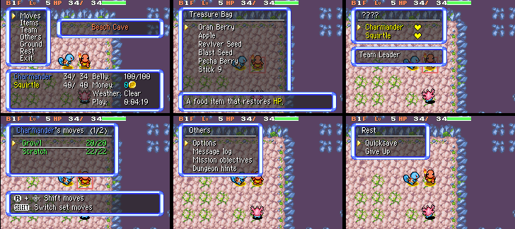
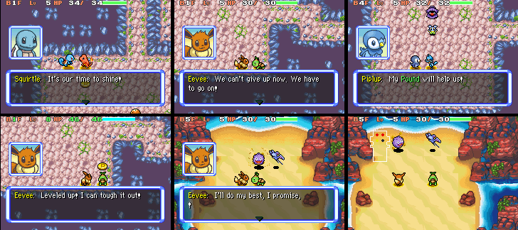
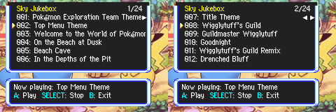
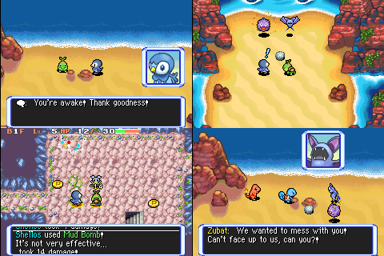

# Explorers of Sky Demake (Chapter 1)

---

## Index

- [Introduction](#introduction)
- [What plays](#what-plays)
- [Building](#building)
- [EoS maps](#eos-maps)
- [Beach Cave and the boss](#beach-cave-and-the-boss)
- [Music](#music)
- [Dungeon tilesets](#dungeon-tilesets)
- [Dungeon talk](#dungeon-talk)
- [Title screens](#title-screens)
- [Gen 4 Pokémon and moves](#gen-4-pokémon-and-moves)
- [Testing](#testing)
- [Code Locations](#code-locations)
- [Limitations](#limitations)

---

## Introduction

A demake of the opening chapter of *Pokémon Mystery Dungeon: Explorers of Sky*
("A Storm at Sea"), from the storm to the end of the Zubat & Koffing fight in
Beach Cave Pit, built from the real EoS assets: ground maps, second-screen art,
dungeon tileset, the Beach Cave Pit room, music, title screens, portraits and
the Gen 4 Pokémon and moves, all converted from a user-supplied EoS ROM (which
is never committed). The choreography and text follow the EoS scene scripts
(`SCRIPT/<level>/m01a0xxx.ssb`).


It is the default story of the modern build on this branch (`STORY=sky`).
The game is a demo of chapter 1: after the beach epilogue ("And so...") it
asks whether to save, shows "The demo ends here. Look forward to updates!"
and returns to the title screen. Continuing a finished save shows the same
ending again (`s_script_SKY_DEMO_END` in
[`src/data/ground/ground_event_data.h`](../../src/data/ground/ground_event_data.h),
`SKY_SAVE_GAME` / `SKY_DEMO_TO_TITLE` in [`src/sky_story.c`](../../src/sky_story.c),
the Continue check in [`src/ground_main.c`](../../src/ground_main.c)).

Red's story after chapter 1 is not in the sky build: only the ground maps the
demo visits keep their scripts and map files (Tiny Woods entrance/end, which
host the Sky scenes, the personality test, the two logo maps and the Sky
maps; found by tracing a full playthrough). The other 130 station script
files compile to nothing under `SKY_STORY`, their `gMapScriptTable` entries
are empty (`GetGroundScript` returns the null script) and their map files
are not linked (their names in the sorted ground file table point at a kept
file). This saves about 3.7 MB. The vanilla build keeps everything.

---

## What plays

Boot: EoS's Nintendo logo and ESRB notice, Red's logo screens, then the EoS
title (EoS's English logo, blinking "Press START", EoS title theme). The top
menu has EoS's options and background and plays the EoS top-menu theme; the quiz uses EoS's intro wording and "Welcome to the World
of Pokémon". The starter list adds Turtwig, Chimchar, Piplup, Munchlax and
Riolu (with Vulpix, Meowth, Phanpy). Then:

| # | EoS script | Map (converted EoS level) | Scene |
|---|---|---|---|
| 1 | — | — | Chapter card: EoS banner font over Sharpedo Bluff (`v01p02a` darkened, as EoS's `back_SetBanner2`), **Chapter 1 — A Storm at Sea** |
| 2 | m01a0101/0102 | `v01p07b` stormy sea, `v01p01a` storm at sea | Lightning on black, voices, the stormy sea in the rain, the storm-cliff art lit by lightning, then a fade to the waves (EoS's "Storm") |
| 3 | m01a0103 | `d01p11a` beach (day) | The EoS sky panorama, the hero washed up on the sand |
| 4 | m01a0104 | `g01p01b` Wigglytuff's Guild (dusk) | Guild sky; the partner loses their nerve on the sentry grate; the Relic Fragment close-up; Zubat & Koffing watch and follow |
| 5 | m01a0202/0203 | `v01p04b`, `v01p05b` | Dusk sky; Krabby blowing bubbles at sunset ("On the Beach at Dusk") |
| 6 | m01a0204–0208 | `d01p11b` beach (sunset) | The glittering sunset sea; the partner finds the hero; naming; Zubat & Koffing steal the Relic Fragment; "can you please help me?" |
| 7 | — | Beach Cave B1F–B4F | EoS Beach Cave tileset and wild Pokémon (Shellder, Kabuto, Corsola, Shellos), "Beach Cave" music |
| 8 | m01a0401 | Beach Cave Pit (B5F) | The EoS Pit room and background, "In the Depths of the Pit", pre-fight dialogue, then the Zubat & Koffing fight ("Boss Battle") |
| 9 | m01a0701 | `d01p41a` Beach Cave Pit | The thieves give the fragment back and flee |
| 10 | m01a0702 | `d01p11b` beach (sunset) | The Relic Fragment; "Form a team / Say no"; "And so..." |

The Relic Fragment is a ground object (EoS `GROUND/g01p01a1.wan`, ornament
`relicfragmentp`, object kind `SKY_OBJ_RELIC_FRAGMENT`): it falls on the sand
when Zubat rams the partner and is gone when Zubat grabs it (m01a0208), and it
lands in front of the heroes when Zubat throws it back in the Pit (m01a0701).

The two totem poles beside the guild entrance are ground objects too, not part
of the map: EoS places them from the level's `SCRIPT/G01P01B/enter.sse`
(`t01p01a1_174` at tile (18, 22.5), `t01p01a3_176` at (42, 22.5), hitbox 2x1),
and they stay up through the cutscene. They are converted from
`GROUND/t01p01a1.wan` and `GROUND/t01p01a3.wan` (32x64, two 32x32 pieces each)
with `convert_eos_wan_to_ax.py ornament ... totempole1|totempole2
--own-palette`: ornaments `totempole1p`/`totempole2p` on their own EoS
palettes `totempole1c`/`totempole2c`, which load into the two ground
extend-palette slots (OBJ palettes 13 and 14; object palette field
`0x125`/`0x126`). Object kinds `SKY_OBJ_TOTEM_POLE_1`/`_2` (70, 71) are past
the end of the vanilla `gGroundObjectTypes` table, so
[`src/ground_object.c`](../../src/ground_object.c) gives them type 1 (a plain
prop, no flags) from `sSkyGroundObjectTypes`. m01a0104 (group 6, sector 0 of
`sky_d01p01_scenes.h`) places them at EoS's positions; they are drawn over the
map like other sprites, and Koffing passes in front of the left one as in EoS.

Losing in Beach Cave plays m01a0301 on the beach ("Ouch! We didn't do too
well...") and goes straight back in; the re-fight uses m01a0501's text.

Dialogue uses EoS's box, measured on the DS (Sky UI style): 52 px tall with
5 px bevelled frames and EoS's rounded corners (a 7-tile window from row 12,
2 px left transparent above and below, so the bottom margin is 10 px as on
the DS; corner tiles in `graphics/custom/ui_style/sky_story_chrome.png`,
frame blues measured from EoS), text 4 px below and 6 px right of the frame's
inner edge, 13 px between lines; portraits have EoS's 4 px frame, 14 px above
the box,
bottom portraits kept just above the box, and a full box clears for the next
page instead of scrolling (`sSkyTextbox` in
[`src/string_format.c`](../../src/string_format.c)). The box is narrower than Red's and
speaker names vary, so a line that would run past it wraps at its last space
and the rest joins the next line (`SkyWrapDialogueText`). The dungeon message box has
the same box; it keeps Red's 7-row window (an 8th would reach the minimap's
tiles), so when it is full it scrolls a line up before writing the next,
and the minimap's tilemap stops at row 11 while it is up. As in EoS,
windows in a dungeon are translucent (fill blended 10/16 over 6/16 of the
dungeon, measured on DeSmuME as 60% / 40%; `ToggleWindowBgBuffer` in
[`src/window_buffer.c`](../../src/window_buffer.c)); ground windows stay opaque (`LOG_*` in [`src/dungeon_message.c`](../../src/dungeon_message.c),
`sub_803EAF0` kind 3 in [`src/dungeon_vram.c`](../../src/dungeon_vram.c),
`UpdateBgTilemapForDungeonMap`).

### Dungeon menus

The dungeon menus follow EoS's, measured on DeSmuME (Beach Cave savestate)
and from EoS's own window table (overlay 31 `DUNGEON_WINDOW_PARAMS_*`,
read from RAM with the pmdsky-debug symbols). EoS lays them out on its
32×24-tile bottom screen; the GBA has 30×20 tiles, so each window keeps
EoS's column and is 2 tiles narrower where it reaches the right edge, and
heights are trimmed to fit 160 px.



- **Frames.** EoS menu windows have the dialogue box's frame: 7 px sides,
  5 px top and bottom frames 2 px in from the tile edge, with 1 px of fill
  inside. Every Sky-style window of the sky build uses it (the title menu
  too, as in EoS): the corners are the dialogue
  box's tiles and the top / bottom edge is chrome slot 0x2F8 (a spare
  all-white tile vanilla never draws; `menu_top` in
  `sky_story_chrome.png`), swapped in by `RemapSkyFrameEntry`
  ([`src/ui_style.c`](../../src/ui_style.c)). Fill and translucency are
  unchanged (60% fill in a dungeon). A speaker's dialogue box in a dungeon (cutscenes,
  talking to the partner) stays opaque, as in EoS (`gSkyDungeonTalkOpaque`).
- **Cursor.** EoS's arrow blinks 16 frames on, 16 off (Red: 8 / 8;
  `AddMenuCursorSprite_` in [`src/menu_input.c`](../../src/menu_input.c)).
- **Main menu** (B): EoS's options **Moves, Items, Team, Others, Ground,
  Rest, Exit**. Rest opens **Quicksave / Give Up** (Red's "Quicksave or Give
  Up", which EoS moved out of Others); Exit closes the menu. EoS: menu at
  (2,2), 6×12 tiles, 14 px per option; dungeon name at (11,4) 19×2 in orange;
  team info at (2,16) 28×6. GBA: menu (2,2) 6×9 with 10 px per option (the
  9 rows left above the info panel), name (11,4) 17×2 right-aligned with the
  info panel as in EoS (Red's was one column left and not aligned), info
  (2,13) 26×6. Option text 13 px in, cursor 1 px in; info values at EoS's
  columns (HP at 68, Belly / Money / Weather / Play at 160). The name uses
  the font's coral (slot 2), the closest colour to EoS's orange in the font
  palette (`SkyPrintOnMainMenu` in [`src/dungeon_main.c`](../../src/dungeon_main.c),
  `sSkyMainMenu` in [`src/dungeon_vram.c`](../../src/dungeon_vram.c)). The
  sky build uses this menu in either window style.
- **Titled submenus** (Items, Team, Moves, Others, Rest): one box with the
  title 8 px in, EoS's separator 12 px under it (2 px in from each side,
  black shadow), options from 18 px down, 13 px in, 12 px apart (EoS 14 px
  on its taller screen; `SKY_MENU_*` in [`include/ui_style.h`](../../include/ui_style.h),
  the separator in `PrepareTextbox_8008C6C`, [`src/text_2.c`](../../src/text_2.c)).
- **Others**: Options, Message log, Mission objectives, Recruitment search
  (when recruiting is on), Dungeon hints; 13 tiles wide as in EoS.
  EoS's Window and Map entries are left out: Red has no separate screens for
  them (Options holds the window colour and map settings).
- **Items**: "Treasure Bag", 18 tiles wide, names 21 px in; pages as
  "(1/2)" at the title's right instead of arrows (Red's held-item and Ground
  pages count). EoS's description box sits under the list, its top frame
  over the list's bottom frame; Red has no short descriptions, so it shows
  the first line of Red's description and is 26 tiles wide (Red's lines are
  set for that width). It stays up while the Use / Give / ... submenu is open
  (`CreateDungeonMenuSubWindowKeepWindow1`, [`src/dungeon_submenu.c`](../../src/dungeon_submenu.c)).
- **Team**: the team name as the title ("????" before the team is named,
  as EoS shows in chapter 1; Red drops the title then), 15 tiles wide, no
  leader star, hearts at 81 px, and EoS's role window under the list: "Team
  Leader" or the member's tactic.
- **Moves**: "X's moves" with the member as "(1/2)" at the title's right
  instead of arrows.

EoS's touch-screen row at the bottom of each submenu (separator, ◀ ▶ and
the close / sort icons) is not drawn: it has no GBA use and no art in Red.

The Krabby bubbles (EoS's `supervision_SpecialActing` 4/5 effect; spawn
points, sizes and velocities measured frame by frame in EoS: down-right from
the Krabby mouths on the sand, up-left at sunset, a slow leftward drift on
the beach) drift
over the two Krabby scenes, the sunset beach and the sunset-sea cutaway:
`SKY_BUBBLES(mode)` in scripts, OBJ sprites captured from EoS's OBJ layer
([`src/sky_bubbles.c`](../../src/sky_bubbles.c),
`graphics/custom/sky_bubbles/`). Bubbles hide behind open windows, since EoS
shows text on the other screen. The same effect draws the rain over the
storm (`SKY_BUBBLES_RAIN`: the stormy sea, m01d0112, and the cliff,
m01a0102). Both EoS scenes use the same `EFFECT_VERY_HEAVY_RAIN`, a 3D-layer
effect, measured in DeSmuME with only BG0 shown: about 146 streaks on the
256x192 screen, 18–72 px long (median 36), 26.5° from vertical (dx/dy 0.5),
falling 7 px down and 3.5 px right a frame, added as rain + half the picture
(every rain colour: background weight 0.5). The demake tiles the screen with
three 64x64 sheets cut from EoS's own streaks (screen cell (c, r) shows
sheet (c + r) % 3, which wraps seamlessly; `graphics/custom/sky_rain/`,
built by [`tools/make_sky_storm_fx.py`](../../tools/make_sky_storm_fx.py)
from a capture of that layer, `eos_rain_layer.png`) and scrolls them at
EoS's speed: 20 semi-transparent 64x64 OBJs, blended 16/16 over 8/16 of the
picture, which is EoS's formula. No BG is a first blend target while it
rains (the waves would blend into the sky), and the weights also go to
`gUnknown_2026E4E`, which `ToggleWindowBgBuffer` reloads into BLDALPHA every
frame (before, it reset them to 16/0 and the streaks were drawn opaque);
the previous settings come back when the rain stops. Converted maps keep EoS's palette animations
(the sea shimmer, the sunset glitter, the Pit water) and, on maps that fit
VRAM, EoS's BPA tile animations: the storm-sea waves (`EV0101A1.bpa`) and
the guild torches (`EG0101B1.bpa`), in RT's BPA slots.

Connected CGs pan instead of cutting: where EoS shows a top-screen CG right
above the scene (the sky over the beach, the dusk clouds over the guild), the
demake shows the CG and eases down into the scene. The storm cliff instead
fades out and the stormy sea fades in, as the two screens fade on the DS. The 240x320 pictures come from
[`tools/make_sky_cutaway_scrolls.py`](../../tools/make_sky_cutaway_scrolls.py)
(`graphics/custom/sky_scrolls/`: the CG over a capture of the scene's first
view, with the player's Pokémon replaced by the rendered map; between them
the map from its top edge, so the tent is whole under the guild's sky, as on
the DS); the pan ends on exactly the map's first view and the scene is shown
at once, without a fade; the tiles
stream through a 21-row ring in the cutaway's VRAM (`ScrollConnected` in
[`src/sky_cutaways.c`](../../src/sky_cutaways.c)).

The pan hands over to the map without black or garbage frames: the map's
rebuild reuses the cutaway's VRAM, so the pan ends on an exact cover of the
map's first view (`<pair>_cover.{tiles,tilemap}`: the map's two layers as
BG0 = front and BG1 = back, using the map's own tiles, flips and palettes)
and keeps it up for a few frames while `GroundMap_Select` rebuilds BG2/BG3
(`ShowCover` / `SkyCutaway_UpdateCover`; `gSkyCoverActive` lets BG1 show
outside the text windows, see `REG_WINOUT` in
[`src/cpu.c`](../../src/cpu.c)). While the cover is up its layers take BG2 /
BG3's priorities (`src/reg_control.c`), OBJ stays on and the actors are drawn
at the cover's view, so nobody blinks out; the priorities come back one frame
after `ShowWindows` has replaced the cover. The cover's view (`CAM_X/CAM_Y` in
`src/data/sky_scrolls.h`) must equal the map's real first view, found by
matching `<pair>_bottom.png` (a capture of that view) against the map; the
beach's is (166, 88). Mid-scene CGs (the Relic Fragment, the
sunset sea) fade out of and back into the scene. The scene's actors are on
screen during the pan (the hero lying on the sand, the partner at the
grate): the pan draws them each frame with the ground camera at the map
position the picture shows (`SKY_SCROLL_<PAIR>_CAM_X/Y`,
`SkyGroundSprite_DrawActors` in [`src/ground_sprite.c`](../../src/ground_sprite.c)),
after unfading the ground palettes the scene's `FADE_OUT` darkened.

The storm voices follow m01a0101: EoS's thunder (`SE_NUM_EVENT_MAIN01_THUNDER_01/02`,
Red ids 461/467) with each white flash, and after "Waaaaaah!" (`..._WARP`,
id 488) a 90-frame white-out with the text box up, a hold on white, then
black before the cliff, whose lightning plays the same thunder.

Between the white-out and the cliff, EoS plays `V01P07B/m01d0112` (the
unionall runs it between m01a0101 and m01a0102): the stormy sea on the
bottom screen. Its script, with the timing measured in DeSmuME (frames from
the start of the fade in, F):

| EoS | Frame | Demake |
|---|---|---|
| `sound_Stop()`, `back_SetGround(LEVEL_V01P07B)` | about F−47 | `BGM_STOP`, `SELECT_MAP(MAP_SKY_STORM_WAVES)` (60 frames of black) |
| `bgm_PlayFadeIn(BGM_STORM, 160, 256)` | F−7 | `BGM_FADEIN(160, MUS_SKY_STORM)` |
| `screen_FadeIn(1, 60)` | F | `FADE_IN(TRUE, 60)` |
| `SetAnimation<object V01P07B1_192>(18)` | F+119 | `SKY_STORM_BOLT` |
| `screen_FadeOut(1, 30)` | F+359 | `FADE_OUT(TRUE, 30)` |

There is no `se_Play` in the scene (hooked `PlaySeByIdVolume` and the other
SE / BGM entry points in DeSmuME: the only calls are the BGM stop, the
storm BGM at F−7, and the cliff's own `bgm_PlayFadeIn(BGM_STORM, 0)` and
thunder `se_Play(6401)` after it). The sound of the sea is the storm BGM
(wind and rumble, EoS bgm0101) fading in. The demake used to fade the BGM
out at the white-out and keep the sea silent until the cliff; it now
restarts it at F−7 as EoS does, and the cliff's `BGM_FADEIN(30,
MUS_SKY_STORM)` leaves the playing song alone (EoS's level runs on with no
break there either). Recorded with `sndshot`: silence from the white-out to
F−7, then the BGM from −46 dB rising to about −21 dB RMS, unbroken into the
cliff.

The waves (front layer, with their 6-frame BPA animation) roll under a
cloudy sky (back layer, palette animation flickering grey to brown), dark
clouds hang over it, the rain falls, and the view pans left at 0.4 px a
frame (EoS: 48 px in 120 frames, from x 342 to 187).

The lightning is the cloud object's WAN (`GROUND/v01p07b1.wan`) animation 1,
played once (118 frames; WAN frame 0 is the dark clouds, 1–3 the hidden
cloud above the view lit from below with a spark, 4 a lit puff and lit
rims, 5 and 6 a bolt from the puff into the sea):

| From F+ | Frames | WAN frame |
|---|---|---|
| 119 | 2 | 4 |
| 123 | 4 | 4 |
| 151 | 2, 2, 2, 2, 2 | 4, 1, (dark 4), 1, 2, 3, 1 |
| 209 | 2 | 4 |
| 211 | 22 | 5 and 6 alternating every 2 frames (the bolt, map x 365–400, from the puff at the top of the view to the waves) |
| 233 | 2 | 4 |

The sky's palette animation flashes brown at F+90, 122, 150, 210, 242, 270,
330 and 362 (a 120-frame cycle), so the lit frames land on its flashes.
There is no screen flash and no thunder SE. The demake
([`src/sky_storm.c`](../../src/sky_storm.c)) plays the same animation: a
lit frame turns the two baked cloud colours to EoS's lit body colours
((16,24,24) → (0,8,8), (40,40,48) → (0,48,24), BG palette 1) and draws the
rest of the frame (yellow light, puff, bolt) as up to 33 OBJs placed in map
pixels, cut from EoS's own frames (captured from DeSmuME's OBJ layer in map
coordinates, `graphics/custom/sky_storm/lit_1..6.png`; OBJs, tiles and the
14-colour palette built by `tools/make_sky_storm_fx.py`:
`graphics/custom/sky_storm/bolts.png`, `src/data/sky_storm_bolts.h`). Each
frame's tiles (up to 201) are uploaded into whichever of two VRAM slots
(OBJ tiles 0x100–0x292) the displayed OAM does not use; OBJ palette 15. OBJ
palette 15 is the text arrow's, the emotes' and the dungeon map dot's in
other scenes, so `sky_storm.c` saves it before the bolt and puts it back when
the bolt ends. The
bolt's foot is behind the waves (OBJ priority 3 below map row 160), as in
EoS. `SKY_MAP_PAL_RESTART` restarts the map's palette animation at F−7 so
the GBA's sky flashes on the same frames as EoS's; measured on the GBA, the
flashes and the lit frames fall on exactly EoS's frames. The OAM budget in
the scene: 20 rain OBJs + at most 33 lightning OBJs. The demake plays it on `MAP_SKY_STORM_WAVES`: the view
starts at map (350, 64), 8 px right of EoS's so the 240 px screen keeps
EoS's centre, 64 px down so the 160 px screen shows the sky's lower half and
the waves, and `SKY_CAMERA_MOVE_X(-154, 102)` pans it. `SKY_CAMERA_SET(x, y)`
places the view's top-left at once (`SkyCamera_SetView`); the map loads
hidden for 5 frames, since a freshly loaded map's palettes are unfaded.

Zubat and Koffing walk in from off screen at the guild as in m01a0104: the
camera follows the partner 104 px down, the two spawn above the view, and
`SKY_CAMERA_MOVE(dy, speed)` (`SkyCamera_MoveBy` in
[`src/code_809D148.c`](../../src/code_809D148.c)) raises the camera 88 px
while they walk to their marks. Both carry lives flag `0x80000` (EoS
`SetOutputAttribute(8)`), the higher OBJ priority, so they are drawn over the
guild's bushes.

EoS's `SetAnimation` ids match Red's ground animation ids for the common
ones (2 still, 5 walking in place, 11 surprised/hurt, 12 attack), so the
scenes copy EoS's: the hero's `CORO_EXPLANATION_FUNC` (walking in place for
45 frames) when telling the partner they are human, backing off with feet
moving, the partner knocked back, Zubat's tackle.

The DS second screen has no GBA equivalent, so its art (sky panoramas, the
storm cliff, the Relic Fragment close-up, the animated sunset sea) is shown as
full-screen cutaways in the middle of scenes (`SKY_CUTAWAY(id, frames)`,
[`src/sky_cutaways.c`](../../src/sky_cutaways.c)).

---

## Building

```bash
make -j$(nproc)                 # sky story (default for the modern build)
make -j$(nproc) STORY=vanilla   # Red's story, no EoS content
```

- `STORY=sky` selects the ground-script pack `src/data/ground/sky/` and
  defines `SKY_STORY`. Everything EoS-specific is inside `#ifdef SKY_STORY`.
- `MODERN=0` (retail-matching) always uses the vanilla pack.
- `custom_story = TRUE` in `configs/runtime.c` still wins over `STORY`.
- Flipping `STORY` rebuilds every C object (the pack stamp is a dependency of
  all C objects, because headers test `SKY_STORY`).
- `SKY_ONLY_C_SOURCES` (Makefile) are linked only in the sky build;
  `NON_SKY_C_SOURCES` / `NON_SKY_ASM_SOURCES` are left out of it (Red-only
  systems, next section). Both lists keep the vanilla link unchanged.

### Red-only systems left out

To save ROM space the sky build does not link Red systems that EoS does not
have and that the demo cannot reach. The vanilla build keeps all of them
(`make STORY=vanilla` is still byte-identical). Sizes are from the sky
build's `pmd_red.map`; the ROM went from 25,537,529 to 25,294,397 bytes
(243,132 bytes, 237 KB, less).

| System | Left out of the link (`NON_SKY_C_SOURCES`) | Bytes |
|---|---|---|
| Wonder Mail, Pokémon News, mailbox, Pelipper Post Office and board, job list, thank-you mail | `pokemon_mail`, `pokemon_mail_pre`, `mailbox`, `pokemon_news1-3`, `wonder_mail*` (12 files), `thank_you_wonder_mail`, `thank_you_messages`, `mission_reward`, `post_office_guide1`, `pelipper_board`, `code_802DE84`, `code_803B344`, `code_803C1B4`, `code_8031D70`, `data/data_80E7D40.s` | 92,720 |
| Red's friend rescue (SOS / A-OK mail, rescue passwords) | `friend_rescue`, `rescue_password_menu` | 28,749 |
| Friend Areas (map, action menu, intros, habitat talk, Wigglytuff's shop and area info) | `friend_area_action_menu`, `friend_areas_map`, `friend_areas_map_util`, `friend_area_intros`, `friend_area_intros_data`, `friend_area_dialogue`, `wigglytuff_shop1-3`, `code_8023144` | 19,809 |
| Team-base flags (`flag##c` / `flag##p`, 64 ornament files) | `ornament_gfx1-4`; the 64 entries leave `gOrnamentFiles` | 90,216 |
| Code and data in kept files that only those systems used (`#ifndef SKY_STORY`) | job / mail generation and checks (`code_80958E8.c`), the password codec (`code_803D0D8.c`), the item-per-dungeon table (`items.c`), helpers in `code_8094F88.c`, `code_80A26CC.c`, `friend_area.c`, `ground_lives.c`, `world_map_sound.c`, ..., and their strings | 11,638 |

`friend_area.c` (which Friend Areas the team owns, read by recruiting),
`code_80958E8.c` / `code_8094F88.c` (the mail and job slots in the save),
`rescue_scenario.c`, `post_office_guide2.c` (Others > Mission objectives) and
the Trade Items link code stay.

Every removed object was reachable only through one of these doors, now
closed under `SKY_STORY` (the vanilla code is unchanged):

- **Top menu**: no Friend Rescue / Wonder Mail S entry, and Continue only
  (`main_menu2.c`). `main_menu1.c` drops the Friend Rescue, Wonder Mail and
  rescue-password screens. No other kept screen returns those menu ids
  (only the left-out flows, and the save menu's `0x2A`/`0x2B` modes that only
  they open). Revive Team / Awaiting Rescue need an SOS or A-OK mail: those
  come from the friend-rescue screens or from fainting where rescues are
  allowed; Beach Cave (Tiny Woods) has `rescuesAllowed = -1`.
- **Ground special texts** (`textbox.c`): Friend Rescue counter, Wonder Mail
  2, thank-you mail, Pelipper help counter, bulletin / outlaw board, mailbox,
  thank-you messages, Wigglytuff's shop, buying Friend Areas and picking a
  Friend Area (`0x16`) are compiled out, so a script asking for one gets no
  menu. The scripts the sky build links (`ground_event_data`, the d01p01 /
  d01p02 / s01 / s04 / s05 stations; checked in the preprocessed `.i`
  files) only ask for Save, Storage, the scripting menu, the personality
  quiz and kind `0x29`; code asks for the ground menu, naming, yes/no boxes,
  the dungeon / Dojo list and the custom debug menu.
- **Ground menu** (`code_801D014.c`, B in free roam; the demo has no free
  roam): no Job List; the Friend Area version of the menu (Info, Exit) and
  the unused friend-area action menu are compiled out (the sky build has no
  Friend Area maps, so `MapIdToFriendAreaId` is always 0 there).
- **Ground script**: `CMD_BYTE_03` (to the Friend Areas map) takes its "no
  areas" branch; special processes 0x04 (mailbox delivery) and 0x06 (tutorial
  mail) do nothing; 0x0A (Friend Area habitat talk, `HABITAT_TALK`, used only
  by Red's Friend Area maps) prints nothing. None is in a linked sky script.
- **Game loop** (`main_loops.c`, `ground_main.c`): `STARTMODE_FRIEND_AREAS`
  goes back to the ground map instead of the Friend Areas map; no Friend
  Area intro on entering a map.
- **Jobs**: `GeneratePelipperJobs` (run at every dungeon entry and day
  change) only clears the board; the job and mailbox generators, Wonder Mail
  validation and their tables are compiled out.
- **Mission objectives** (dungeon Others): the out-on-rescue case and the
  job list are compiled out; a job dungeon shows "Just go!".
- **Custom debug menu**: Unlock Friend Areas, All Friend Areas, Friend Area
  Intros, PMD2 Rescue Points, Outlaw Missions, Refresh Bulletin, Unrestricted
  Bulletin Jobs and Expanded Job Slots are not listed.
- **Team-base flags**: only Red's team-base scripts (not in the sky build)
  place flag objects or load flag palettes; the sky scripts place only the
  totem poles and the Relic Fragment and use no `SPAWN_OBJECT`. The palette
  name table `gUnknown_81178F4` keeps the flag names, so palette slots 37 /
  38 (the totem poles) do not move; `ORNAMENT_SKIPPED_FLAG_FILES` keeps
  `gOrnamentFiles` sorted for `OpenFile`'s binary search.

How it was checked: a symbol graph of the objects (`arm-none-eabi-nm`) gave
every reference from a kept object into the removed set, and each one is
closed above; the link has no undefined references. A sky build with
`-ffunction-sections -fdata-sections --gc-sections --print-gc-sections`
listed the code left dead in kept files, and only the pieces that the
removed systems used were compiled out. Then the demo was played headless
(title, both top menus, New Game, the quiz, chapter 1, Beach Cave and its
menus, the Pit, the aftermath, the demo end and Continue).

---

## EoS maps

The EoS ROM is never committed. Only the converted map files are:
`data/map_bg/E*.bpl`, `E*c.bpc`, `E*m.bma` (+ GMLZ copies in `data/map_bg_lz/`).

| Map id | File stem | EoS level | Tiles |
|---|---|---|---|
| `MAP_SKY_STORM_SEA` | `EV0101A` | `v01p01a` | 613 (VRAM) |
| `MAP_SKY_BEACH_DAY` | `ED0111A` | `d01p11a` | 1651 (streamed) |
| `MAP_SKY_GUILD_DUSK` | `EG0101B` | `g01p01b2` (gate closed) | 952 (VRAM) |
| `MAP_SKY_KRABBY_BUBBLES` | `EV0104B` | `v01p04b` | 1067 (streamed) |
| `MAP_SKY_KRABBY_SUNSET` | `EV0105B` | `v01p05b` | 1080 (streamed) |
| `MAP_SKY_BEACH_DUSK` | `ED0111B` | `d01p11b` | 1767 (streamed) |
| `MAP_SKY_BEACH_CAVE_PIT` | `ED0141A` | `d01p41a` | 1503 (streamed) |
| `MAP_SKY_STORM_WAVES` | `EV0107B` | `v01p07b` | 546 + 240 animated (VRAM) |

Converter: [`tools/convert_eos_ground_map.py`](../../tools/convert_eos_ground_map.py)

```bash
tools/convert_eos_ground_map.py EOS.nds d01p11b ED0111B --render check.png
```

- Lossless: EoS and RT share 4bpp tiles, 3×3-tile chunks and 16-colour
  palettes, so tiles, palettes and chunk layouts are copied, not re-quantized.
  `--render` draws the written RT files back to a PNG; for all seven maps it is
  pixel-identical to skytemple's render of the EoS original.
- Both EoS layers become the RT dual-layer map (EoS upper layer → RT layer 0,
  in front of sprites). Frame 0 of BPA tile animations is baked in; palette
  and tile animations are dropped.
- Maps over the VRAM tile budget (1024 dual-layer, 896 single-layer) are
  streamed by `src/ground_bg_tile_stream.c`, which has no tile-flip bits, so
  the converter bakes flipped tiles for those.
- Collision comes from the EoS BMA.
- New BPCs stay uncompressed in ROM (streamed like the café's);
  `compress_ground_assets.py` skips `E*.bpc`.

The stormy sea (`EV0107B`) has its own builder,
[`tools/make_sky_storm_waves_map.py`](../../tools/make_sky_storm_waves_map.py)
(`tools/make_sky_storm_waves_map.py EOS.nds`). `v01p07b`'s sky is 680 tiles,
too many next to the waves' 48 tiles and 240 animated ones, so the builder
leaves out the sky's top two chunk rows (above the view) and pools only the
chunks the map uses. EoS draws the dark clouds as sprites fixed in the
world; they were captured from DeSmuME's OBJ layer, placed in map
coordinates (`graphics/custom/sky_storm/clouds.png`, two colours), and baked
into the front layer's empty chunks above the waves on palette 1 (unused by
EoS's chunks), so they move with the sky. Its waves BPA is byte-identical to
`v01p01a`'s, so the map reuses `EV0101A1.bpa`. The lightning (the same
cloud object's lit frames) is drawn over the map at run time, see
[What plays](#what-plays).

Map registration: `include/constants/ground_map.h`, `include/map_files_table.h`,
`src/map_files_table.c`, `src/ground_map_conversion_table.c`,
`src/map_script_table.c`, `src/ground_files_table.c` (sorted by name; the
block is inserted under `#ifdef SKY_STORY` and later indices shift by
`SKY_GROUND_FILES`), `src/ground_map_files_sky.c`.

`SELECT_MAP` also selects the script file of the map in `gMapScriptTable`, so
each EoS map points at the station file whose groups use it (gs178 for the
beach, guild and storm scenes, gs179 for Beach Cave Pit).

---

## Beach Cave and the boss

Tiny Woods plays Beach Cave ([`src/sky_story.c`](../../src/sky_story.c)):

- Name "Beach Cave", floors shown as B1F–B4F (`IsStairDirectionUp`).
- EoS Beach Cave tileset (EoS tileset 1, see [Dungeon tilesets](#dungeon-tilesets)).
- Wild Pokémon from EoS's `mappa_s.bin`: Shellder L1, Kabuto L1, Corsola L2,
  Shellos L2 (25% each), Kecleon L48 for shops.
- On the story run (`SCENARIO_MAIN` major 2) B5F is **Beach Cave Pit**: EoS
  fixed floor 1 (14×15) in Red's `fixedmap` encoding, patched over the Team
  Meanies room number while in Beach Cave, with Zubat L4 and Koffing L7 and
  EoS's Pit background as the floor's tileset. Its cutscene is
  `CUTSCENE_BEACH_CAVE_PIT`
  ([`src/dungeon_cutscene_beach_cave.c`](../../src/dungeon_cutscene_beach_cave.c)):
  m01a0401 (first visit) or m01a0501 (re-fight) dialogue and sounds, the
  camera shows the thieves, EoS's two white flashes and boss wipe
  (`PitBossWipe`), boss music, and the dungeon ends once both are down. No cutscene
  flags are touched, so Sinister Woods is unaffected.
- Later visits to Beach Cave have no Pit.
- Bosses grant no EXP, as in EoS: `gSkyBossExp` (src/sky_story.c, default
  FALSE) gates EXP from Pokémon with `bossFlag` (the Pit's Zubat and Koffing
  set it); the debug menu's "Boss EXP" toggles it at runtime.
- Gen 4 Pokémon have no lines in Red's per-species talk files (level-up and
  team chat); they use a Red Pokémon's (`SkyStory_TalkSpecies`: Turtwig →
  Bulbasaur, Chimchar → Charmander, Piplup → Squirtle, Riolu → Machop, else
  Pikachu). Reading a missing talk file showed garbage and could crash.
- Zubat and Koffing use EoS's fixed-floor boss stats (overlay 10's monster
  spawn stats, entries 1 and 2): Zubat L3, 15 HP, 15 Atk / Sp. Atk, 11 Def /
  Sp. Def; Koffing L6, 27 HP, 20 / 20, 8 / 8
  (`SkyStory_ApplyFixedRoomBossStats`).
- The Pit's background keeps EoS's animated water colours (palettes 10-11,
  `dungeon_bg0.dpla`); the cutscene camera is centred on the sand.
- The Pit's background is 925 tiles, more than Red's 512-tile slot, so it
  covers the trap and grid tiles at tile 0x200. `SkyStory_RelocateGridTiles`
  copies the rotate-mode grid tiles (R) from `trappat` after the Pit tiles.
- Red's species (all 419 that EoS also has, except Munchlax) use EoS's base
  stats, EXP yield and level-up growth (`gSkyRedLevelData`, generated by
  [`tools/make_sky_gen4_data.py`](../../tools/make_sky_gen4_data.py)), so the
  Beach Cave Pokémon have EoS's stats at EoS's levels (Corsola L2: 11 base HP,
  not Red's 45).
- The sky build mixes 8 DirectSound channels instead of 12 (`src/m4a.c`),
  which cuts the frames the dungeon falls behind in Beach Cave by about a third.

---

## Music

The sky build plays no Red music: every Red song id (0–128) points at an
EoS track instead ([`tools/eos_music/sky_red_bgm_map.py`](../../tools/eos_music/sky_red_bgm_map.py)
→ `sound/sky_red_bgm_table.inc`). EoS has no versions of Red's songs, so the
mapping is by name where EoS has the same piece (Rising Fear, Kecleon's
Shop, Monster House!, Heartwarming, In the Depths of the Pit, Boss Battle!)
and otherwise by place and mood (Pokémon Square → Treasure Town, team base →
Wigglytuff's Guild, Makuhita Dojo → Marowak Dojo, Tiny Woods → Apple Woods,
Magma Cavern → Steam Cave, ...). Red's music sequences, its music
voicegroups (`bank_000`–`bank_024`, the drum kits) and the 75 samples only
they use are left out of the sky build (about 780 KB). Most sound effects are
EoS's too ([Sound effects](#sound-effects)); the ones that stay Red's keep
Red's instruments (`bank_026`–`bank_028`). Red's jingles (`seq_200`–`seq_219`)
are left out too ([Jingles](#jingles)), and so are the Red SEs the remap
replaces, with the samples only they used
([Red sound data left out](#red-sound-data-left-out)).

EoS's sequences on EoS's own instruments
([`tools/eos_music/convert_eos_bgm.py`](../../tools/eos_music/convert_eos_bgm.py)):
SMDL → MIDI (`sound/songs/midi/sky_*.mid`) → `mid2agb` →
`sound/songs/seq_061.s`–`seq_068.s` (song ids 61–68, `MUS_SKY_*` in
`include/sky_story.h`).

Instruments come from EoS's DSE sound banks
([`swdl.py`](../../tools/eos_music/swdl.py) parses them,
[`sky_soundfont.py`](../../tools/eos_music/sky_soundfont.py) converts them):

- **Samples**: the 204 samples of `SOUND/BGM/bgm.swd` the songs use, decoded
  (IMA-ADPCM / PCM), resampled to at most 18157 Hz (the mixer rate),
  normalised to full 8-bit scale, in
  `sound/direct_sound_samples/sky/eos_NNN.bin`. Loop points are kept: the
  loop length is rounded to whole samples and the playback rate adjusted to
  match.
- **WaveData**: `sound/songs/sky_samples.s`, one per sample and tuning (349,
  1.91 MB). DSE plays a note at `32728 * 2^((note - root + ctune + ftune/256)/12)`
  Hz. That pitch is baked into the WaveData `freq`, because m4a ignores a
  DirectSound voice's base key.
- **Voicegroups**: every song has its own voicegroup (`sky_vg_bgmNNNN`, at the
  top of the song's `.s`) built from its `bgmNNNN.swd`. The MIDI program is
  the EoS program id. A program with one split is a DirectSound voice. One
  with several splits is a KeySplit voice. A drum kit with per-key pan is a
  DrumTable voice. Each DSE envelope (attack, hold, decay, sustain, decay2,
  release) is approximated by m4a ADSR bytes.
- **Volumes**: split, program and sample volume, and the normalisation gain,
  scale note velocities. EoS volume × expression becomes MIDI volume, and pitch
  bends are kept. Each song's master volume comes from an offline model of the
  m4a mixer ([`m4a_render.py`](../../tools/eos_music/m4a_render.py)) so the
  8-bit mix, which wraps instead of clipping, keeps headroom. That brings
  every song to about the same level, so `LEVEL_DB` trims songs EoS keeps
  quieter: Ocean1 (`seq_070`) is 6 dB down (see
  [Chapter 1 audio audit](#chapter-1-audio-audit)).
- **Loops**: DSE loops each track by itself (its 0x99 loop point to its end).
  In music every track loops together, so a song has one loop, as mid2agb
  writes it. EoS's ambient songs (bgm0100–0118, 0179–0193) layer short loops
  of different lengths instead. In bgm0101 "Storm" the wind noise (sample
  903) loops every 85, 145 and 150 ticks, and the low rumble loops every 3420.
  With one loop for the whole song, the wind played once for 1–3 s and was
  then silent until the 36 s loop came round, so the storm voices had no wind.
  When a track's loop is under half the longest track's loop
  (`per_track_loops`), the converter runs mid2agb once per track, giving each
  track its own `GOTO`, and splices the tracks into one song. The MIDI files
  are then `midi/<name>_trackN.mid`. Of the converted songs, `seq_069`,
  `seq_070` and `seq_071` do this. Some music songs have one track whose end is 256 ticks
  later than the others' (a trailing rest). They keep the shared loop.
- **Engine**: in the sky build the mixer uses 8 DirectSound channels instead
  of Red's 5, and the BGM player has 16 tracks instead of 12 (`src/m4a.c`,
  `sound/music_player_table.inc`). The vanilla build is unchanged.

Not ported: LFOs (vibrato), key groups, and layered splits (the first split
wins).

| Id | EoS | Used for |
|---|---|---|
| 61 | bgm0069 On the Beach at Dusk | Krabby, beach scenes |
| 62 | bgm0021 Beach Cave | Beach Cave floors |
| 63 | bgm0015 Boss Battle! | Zubat & Koffing |
| 64 | bgm0014 In the Depths of the Pit | Beach Cave Pit |
| 65 | bgm0130 title theme | Title screen |
| 66 | bgm0002 Top Menu Theme | Main menu |
| 67 | bgm0001 Exploration team theme | (available) |
| 68 | bgm0006 Welcome to the World of Pokémon! | Personality quiz |
| 69 | bgm0101 Storm | The storm at sea (m01a0101, m01d0112 stormy sea, m01a0102) |
| 70 | bgm0100 Ocean1 | The waves on the beach (m01a0103, m01a0201–0208, m01a0301, m01a0702) |
| 71 | bgm0116 Fire Crackling (louder) | The guild's torches at dusk (m01a0104) |

`seq_069`–`seq_071` are past Red's music ids, so non-sky builds leave
their objects out of the link (Makefile `SONG_SRCS`): an extra object
reorders the linker's long-call stubs and would change the vanilla ROM. The
same goes for sky-only C files added since (`SKY_ONLY_C_SOURCES`:
`src/sky_storm.c`).

### The beach's waves (EoS's second BGM player)

EoS plays its ambience "Ocean1" (bgm0100: five looping tracks of wave noise)
on a second BGM player, under the music (`bgm2_PlayFadeIn`, `bgm2_Stop`,
`bgm2_FadeOut`), and in some scenes on the main player instead. Its
chapter 1 uses, from the decompiled scripts, and the demake's equivalents:

| EoS script | EoS | Demake (gs178) |
|---|---|---|
| m01a0103 (beach, day) | `sound_Stop(); bgm_PlayFadeIn(BGM_OCEAN1, 120)` … `bgm_FadeOut(120)` | group 5: `BGM_FADEIN(120, MUS_SKY_OCEAN)`; its `BGM_FADEOUT(120)` |
| m01a0201 (beach at dusk, not in the demake) | `sound_Stop(); bgm2_PlayFadeIn(BGM_OCEAN1, 160)` | group 7 (Krabby): `SKY_AMBIENCE(MUS_SKY_OCEAN, 160)` |
| m01a0202–0208 | `bgm2_PlayFadeIn(BGM_OCEAN1, 0)` (keeps playing) | groups 8 and 1: `SKY_AMBIENCE(MUS_SKY_OCEAN, 0)` |
| m01a0208, Zubat strikes | `bgm2_Stop(); se_Play(5121)` | `SKY_AMBIENCE_FADEOUT(0)`, `FANFARE_PLAY2(SE_SKY_TACKLE)` |
| m01a0208, "See you around, chicken." | `bgm_PlayFadeIn(BGM_OCEAN1, 150)` … `bgm_FadeOut(60)` | `BGM_FADEIN(150, MUS_SKY_OCEAN)` (was a `BGM_FADEOUT(60)` of nothing); the station's `BGM_FADEOUT(60)` |
| m01a0301 (defeated) | `bgm_PlayFadeIn(BGM_OCEAN1, 160)` … `bgm_FadeOut(60)` | group 2: `BGM_FADEIN(160, MUS_SKY_OCEAN)`; its `BGM_FADEOUT(60)` |
| m01a0702 (the team) | `sound_Stop(); bgm2_PlayFadeIn(BGM_OCEAN1, 160)`, the music at "It's my precious treasure.", `bgm_FadeOut(180); bgm2_FadeOut(180)` | group 3: `SKY_AMBIENCE(MUS_SKY_OCEAN, 160)`, `BGM_SWITCH(MUS_SKY_ON_THE_BEACH_AT_DUSK)` after that line (it used to start with the scene), `SKY_AMBIENCE_FADEOUT(180)` |

The second player (`SkyAmbience_Play` / `SkyAmbience_FadeOut` in
[`src/music.c`](../../src/music.c)) is an m4a music player that is not in
`gMPlayTable` (so `gNumMusicPlayers` and the vanilla table stay as they are):
opened the first time it is used, 6 tracks in IWRAM. Playing the song that
is already on leaves it running, as in EoS. `StopBGM` (EoS `sound_Stop()`,
the scripts' `BGM_STOP`) and `FadeOutAllMusic` (scene exits, entering a
dungeon) stop or fade it too, so it never outlives its scenes. Script
commands: `SKY_AMBIENCE(song, frames)` and `SKY_AMBIENCE_FADEOUT(frames)`
(SPECIAL_PROCESS 0x70 / 0x71). Checked in mGBA (`sndshot`, player status
watched): the ambience starts with the Krabby scene and plays under "On the
Beach at Dusk", alone after the music fades, stops as Zubat strikes (exact
silence between the scene's other sounds), and the ocean comes back on the
main player after "chicken" until the fade into Beach Cave.

### Jingles

Red's fanfares (song ids 200–219, played on the fanfare player by
`PlayFanfareSE` / `PlaySound` / `FANFARE_PLAY`) play EoS's own jingles in the
sky build. EoS keeps them in `SOUND/ME/me0000.smd`–`me0013.smd` with one bank,
`SOUND/ME/me.swd`, that holds both the programs and the samples.
`convert_eos_bgm.py` converts them with the same pipeline as the BGM
(`--me-only` converts only these): `sound/songs/sky_me_NNNN.s` (voicegroup
`sky_vg_meNNNN`), samples in `sound/songs/sky_me_samples.s` (labels
`sky_me_wav_*`, files `sound/direct_sound_samples/sky/me_NNN.bin`; 10 samples,
34 KB). `me0000` is not converted: it is note for note `me0006` and EoS only
plays it from a debug "ME test" menu (`T00P01/m01a0116.ssb`).

`sound/song_table.inc` points ids 200–219 at them under `SKY_STORY`, with
Red's player fields (`1, 1`); Red's `seq_200`–`seq_219` are not assembled in
the sky build. EoS jingles use up to 10 tracks, so the sky build's fanfare
player has 10 tracks instead of 6, in IWRAM (EWRAM is full).

How each id was matched. Red's use comes from its callers in `src/` and the
ground scripts. EoS's use comes from the EoS scripts (`me_Play(n)` in the
`.ssb` files, decompiled with SkyTemple) and from the callers of EoS's
`PlayMeById` (NA `0x0201820C`, veneer `0x02017C50`) in arm9 and the overlays.
"Melody" is how many note onsets (pitch class on a 16th-note grid, best
transposition) Red's and EoS's jingles share, which shows the remakes: most EoS
jingles are Red's, re-orchestrated.

| Id | Red use | EoS ME | EoS use (evidence) |
|---|---|---|---|
| 200 | dungeon level up (`sub_8083D58`) | me0001 | level up in ground mode (ov11 `PlayMeById(1)` then "became level N!"); also big rewards: `[me_play:1]` in "accepted the rare and precious item", Egg hatched, scripts' "team was rewarded" |
| 201 | rescue rank up (`mission_reward.c`, b01p02a "rescue rank went up!") | me0002 | the rank-up step of the reward screen (arm9, played after "Team … went up in rank"); melody closest to Red's 201 |
| 202 | Pokémon farewell (`party_list_menu.c`) | me0003 | "… was released from the team." (ov11 ×3, Chimecho Assembly, Day Care) |
| 203 | reward / item received (`GET_ITEM_FUNC`, shops, mission rewards) | me0004 | item received (66 script uses: "received …", reward points; Recycle Shop; dungeon). Melody 0.53 (same tempo, length) |
| 204 | joined the team (`JOIN_FUNC`, dungeon recruit, Celebi, "became leader") | me0005 | "… joined the team!" (52 of 57 script uses; Chimecho, Day Care). Melody 0.84 |
| 205 | new dungeon open ("Uproar Forest is now open") | me0006 | "You can now go to …" (42 of 45 script uses) |
| 206 | friend area obtained | me0006 | same as 205; me0006 is Red's 206 remade (melody 0.61) |
| 207 | reached the destination floor, tutorial notice, standby | me0007 | "A message has arrived from the Exploration Team Federation". Melody 0.69 |
| 208 | unused (200 at another volume) | me0001 | as 200 |
| 209 | (empty) | — | — |
| 210 | evolution at Luminous Cave (`luminous_cave.c`) | me0008 | Luminous Spring evolution (ov16 ×2), "Teddiursa evolved into Ursaring!". Melody 0.50 |
| 211 | evolution in a dungeon (`sub_8083D78`) | me0008 | as 210 |
| 212 | important item received (Teleport Gem, Red Wing, 9-Tail Crest) | me0009 | "… obtained …" key items (24 script uses), dungeon "You've completed a mission!". Same tempo (72/73 bpm) |
| 213 | Rescue Team Starter Set from the Mailbox | me0004 | as 203 (Red's 213 is 203 at another volume) |
| 214 | unused | me0010 | no caller in Red: given one of EoS's dungeon-end stings (ov29 `IsFloorOver` plays `{10, 11, 11}[i]` or `{12, 13, 13}[i]`), by length |
| 215 | unused | me0012 | as 214 |
| 216 | unused | me0010 | Red's 216–219 are sparse stings like EoS's me0010–me0013; matched by tempo and length (1.3 s / 2.9 s) |
| 217 | unused | me0011 | 6 notes, 10.8 beats at 160 bpm in both |
| 218 | unused | me0012 | 150 bpm, ~2 s in both |
| 219 | unused | me0013 | 3 notes at 240 bpm in both |

### Sound effects

397 of Red's 489 sound effects (song ids 300–938) play EoS's own sound
effect in the sky build, on EoS's own instruments; the other 92 keep Red's.
Red ids 461, 467 and 488 (unused by the sky scripts and code) carry the storm
intro's thunder and warp SEs. Ids 519–528, empty in Red's song table and
called by nothing, carry ten more chapter 1 scene SEs (`SE_SKY_*` in
`include/sky_story.h`, on SE player 5 from `SCENE_SE_PLAYERS`; see
[Chapter 1 audio audit](#chapter-1-audio-audit)).

EoS keeps its SEs in DSE "sedl" banks: `SOUND/SYSTEM/se_sys.sed` (menus) and
`SOUND/SE/*.sed` (motion, event, state, trap, waza1–15, ...). An SE id is
`bank << 8 | sequence` (`se_Play(0x2308)` = `event_s.sed` sequence 8); each
sequence names itself (`SE_NUM_EVENT_SIGN_SHOCK_01`). Tracks are SMDL tracks
that pick their instrument bank per program change (0xA8 hi lo): hi 0x64 =
`SOUND/SWD/<lo>.swd` (one sample each: footstep, punch, bell, ...), hi 0x7F =
the sedl's own bank, `motion.swd` (`motion.sed` writes 0x7F01: lo is the sedl's
bank number, *not* `SOUND/SWD/001.swd`) or `se_sys.swd`, whose programs are DS
PSG square / noise waves.
[`sedl.py`](../../tools/eos_music/sedl.py) parses them;
[`convert_eos_se.py`](../../tools/eos_music/convert_eos_se.py) writes each SE
used as `sound/songs/sky_se_BBII.s` (m4a assembly straight from the DSE events,
48 ticks per beat, own voicegroup `sky_vg_se_BBII`), the samples to
`sound/songs/sky_se_samples.s` (`sound/direct_sound_samples/sky/se*.bin`,
300 KB) and `sound/sky_red_se_table.inc`, which `sound/song_table.inc`
includes for ids 300–938 under `SKY_STORY` (player fields as in Red).

- PSG programs become the GBA's CGB square / noise voices (the DS duty
  (d+1)/8 → 12.5 / 25 / 50 / 75 %), like Red's own menu sounds.
- Pitch bend and SweepTune (0xD4, a glide from each note's start) become
  BEND with one BENDR per track; volume / pan sweeps become VOL / PAN steps;
  repeats are unrolled; envelope overrides give the track its own voice.
- A looping EoS SE loops only if Red's SE for that id loops.
- The sky build gives every SE player 2 tracks (the EoS SEs used have 1–2),
  in IWRAM (EWRAM −720 bytes, IWRAM +960 bytes).
- Not ported: LFOs (vibrato / tremolo) and fine / coarse tune events.
- Volume: EoS's own levels came out at 0.4–0.8× Red's SE for the same id
  (measured in mGBA, loudest 100 ms RMS, each SE played alone), so the
  converter multiplies them by `SE_GAIN` = 1.6 (`PSG_GAIN` = 1.25 for SEs on
  CGB voices only), into VOL up to 127 and the rest into the velocities, still
  capped at the lone-SE mix level (`TARGET_LEVEL`) where the 8-bit mixer would
  wrap. Most SEs now measure within ±30 % of Red's; a few that already hit
  VOL / velocity 127 stay quieter (608 "middle damage": ~0.5× Red's).
  Only the volumes a note is heard at count towards the VOL limit
  (`audible_vols`): many EoS SE tracks set volume 127 and then their real
  volume or expression on the same tick, or before the first note, and that
  127 used to stop the gain going into VOL (Zubat's tackle, 0x1401, came out
  3.5 dB quieter). 106 SEs changed by up to 2 dB in how VOL and velocity
  share the gain; their target level is the same.
- Channels: every SE song has Red's SE priority (80–127), above the EoS
  songs' 50, so an SE note takes a mixer channel from the BGM even when the
  BGM holds all 8 (m4a steals the lowest-priority channel). Checked in Beach
  Cave: every SE started in a 15000-frame run got a DirectSound or CGB channel.
  On the beach (frames 9700–15700 of the `EVENT_DIVIDE` run below) "On the
  Beach at Dusk" and the 5-track Ocean1 ambience fill all 8 channels in about
  a quarter of the frames and take about 35 voices from each other in 6000
  frames; every scene SE still gets its channel (priority 100–127 over 50),
  e.g. the tackle starts on the frame the ambience stops.

Motion SEs (`motion.sed`: the basic attack, hits, attack motions) used the
wrong bank until the 0x7F01 fix above: programs missing from `001.swd` became
silent voices (the hit SEs played when a move or attack connects, e.g. 608 /
609 `SE_NUM_EFF_MIDDLE_DAMAGE` / `_LARGE_DAMAGE`, and 607, 610, 621 were
silent), and the rest played `001.swd`'s PSG noise program instead (the basic
attack 351, `SE_NUM_MOTION_ANIM_2`, sounded like crunchy low noise). With `motion.swd` the basic attack is a 50 % square wave
with exactly Red's notes for 351.

Each pair and its evidence is listed in
[`sky_red_se_map.py`](../../tools/eos_music/sky_red_se_map.py):

- **Effect animations (336 ids).** Red's effect animation table
  (`gUnknown_80B9CC4`, `src/effect_data.c`) and EoS's (overlay 10
  `EFFECT_ANIMATION_INFO`) are the same table: 426 of 448 rows are identical
  (the rest differ only in the animation type number). Each row names its SE,
  so Red's SE of row *n* becomes EoS's SE of row *n*. This covers the move,
  item and status effects.
- **Move animations (13 ids).** The move and per-species move animation tables
  (`gUnknown_80BDBC4` / `gUnknown_80C183C` vs `MOVE_ANIMATION_INFO` /
  `SPECIAL_MONSTER_MOVE_ANIMATION_INFO`), matched by move and species name.
- **Code and scripts (43 ids).** Menus: EoS's `PlaySeVolumeWrapper` table
  (arm9 `0x0209915C`: 3F02 3F03 3F03 3F01 3F04 3F06 3F07 3F0B) has the layout
  of Red's `sMenuSoundEffects`; EoS's text blip (0x3F05) has Red's 3-frame
  counter. Dungeon actions: the EoS functions that play SEs with a constant
  id (found by scanning arm9 / the overlays for calls to `PlaySeByIdVolume`
  and its wrappers) against Red's functions (stairs, item / money pick-up,
  throws, misses, hunger, traps, orbs, revive, learning a move). Emotes: Red's
  `FANFARE_PLAY2(n)` + `CALL_SCRIPT(<emote>_FUNC)` against EoS's
  `se_Play(n)` + `SetEffect(EFFECT_<emote>)` over all EoS scripts.
- **Same notes (2 ids).** Many of Red's SEs are EoS's (same keys, ticks and
  lengths); two were matched only that way (door, trap mine).

| Red id | Red use | EoS SE |
|---|---|---|
| 301–307 | menu cursor, accept, back, info, text blip, sort, toggle | `SE_NUM_SYS_01`–`07` |
| 312 | learned a move | `SE_NUM_SYS_WAZA` |
| 330 / 332 | item / money picked up | `SE_NUM_MOTION_ITEM` / `_MONEY` |
| 336–338 | thrown item | `SE_NUM_MOTION_THROW`, `_02`, `_03` |
| 339 | belly empty | `SE_NUM_MOTION_HUNGRY` |
| 340 / 341 | stairs up / down | `SE_NUM_MOTION_STAIRS_UP` / `_DOWN` |
| 342 / 343 | move missed (leader / other) | `SE_NUM_MOTION_MISS_PLAYER` / `_ENEMY` |
| 351–370 | attack motions | `SE_NUM_MOTION_ANIM_*` |
| 400–404 | trip, sticky, pitfall, summon traps | `SE_NUM_TRAP_*` |
| 463 / 482 / 473 | shock emote | `SE_NUM_EVENT_SIGN_SHOCK_01` / `_02` / `_03` |
| 465 / 466 / 464 | notice emote | `SE_NUM_EVENT_SIGN_NOTICE_01` / `_04` / `_02` |
| 469 | question emote | `SE_NUM_EVENT_SIGN_HATENA_02` |
| 470 | sweat emote | `SE_NUM_EVENT_SIGN_TENSION_01` |
| 455 / 458 | jump | `SE_NUM_EVENT_MOTION_JUNP_01` / `_02` |
| 457 / 471 / 472 | anger | `SE_NUM_EVENT_SIGN_ANGER_02` / `_01` / `_02` |
| 600–938 | move / item / status effects | by effect animation row |

Red's SE stays for: 308–311, 313, 331, 335, 345, 347, 360, 364, 371, 390–392,
401, 405–409, 411–414, 416, 421, 422, 424–426 (some dungeon and status sounds
with no EoS equivalent found: curse, confusion, sleep, whiffer, charging, ...),
450–517 except the emotes above (Red's own ground-scene sounds: footsteps,
doors, crowd, cries of the legendaries, ...; the chapter 1 scenes use only the
emotes), 727, 804, 916, 917 (effect rows whose EoS SE is none) and 633–635,
637, 894, 923 (no caller found). The chapter 1 scenes' SEs (455, 457, 463,
465, 466, 469, 470, 473, 519–528) are all EoS's.

#### Red sound data left out

The remap replaces the song-table entry itself: under `SKY_STORY`
`sound/song_table.inc` includes `sound/sky_red_se_table.inc` for ids 300–938,
so a remapped id's entry names `sky_se_BBII`, and nothing else in the ROM names
Red's `seq_NNN` for it. Every song the game plays goes through `gSongTable`
(`m4aSongNumStart`, and `SkyAmbience_Play` reads `gSongTable[id].header`), so
a Red sequence the table does not name can never play. The sky build leaves
those out:

- **SE sequences**: the 397 Red `seq_3NN`–`seq_9NN` that
  `sky_red_se_table.inc` does not name are not linked (Makefile `SONG_SRCS`,
  computed from that file, so it follows the map when `convert_eos_se.py`
  regenerates it). The 92 Red SEs that stay Red's ([above](#sound-effects)) and
  `seq_939` (past the remap) stay. A table entry naming a dropped sequence
  would fail the link.
- **Voicegroup `bank_025`**: only Red's jingles and two remapped SEs (746, 869)
  use it (`sound/voice_groups.inc`).
- **Samples**: 36 of the 69 samples in `bank_025`–`bank_028` are used only by
  voices that no kept sequence selects (`VOICE` commands of the 93 kept Red
  SEs). In the sky build `sound/waves.inc` leaves them out and points their
  names at `sky_red_unused_wave`, a silent one-sample stub, so the voicegroups
  keep their size and indexing. This list is fixed: if the map changes so that
  another Red SE plays again, its voices' samples must come back out of the
  `#ifndef SKY_STORY` blocks, or it plays silence where those samples were.

The sky ROM is 254,836 bytes smaller (50,684 bytes of sequences, 204,150 of
`sound_data.o`: `bank_025` and 202,738 bytes of samples). The vanilla build
is unchanged. Checked by dumping `gSongTable` from both ROMs: every one of the
1073 entries names the same song with the same player fields, and every voice
a kept Red SE selects has the same bytes and the same sample data. The four
`sndshot` runs of chapter 1 (`EVENT_DIVIDE`; `EVENT_DIVIDE` with
`DEBUG_BOOT_FLOOR=5` through the Pit fight; `EVENT_M01E01A_L003`; title, top
menu, 12 Sky Jukebox tracks and the quiz) log the same song starts and stops
on every player, and the WAVs and screenshots are bit-identical before and
after.

### Chapter 1 audio audit

Every sound call in EoS's chapter 1 scripts (`m01a*`, `m01d*` decompiled with
SkyTemple; `CallCommon` / `ExecuteCommon` coroutines checked in
`SCRIPT/COMMON/unionall.ssb`: of the ones chapter 1 uses only
`CORO_BOSS_WIPE_FUNC` plays a sound, 5136) against the demake. EoS SE ids are
`bank << 8 | sequence`. "Was" is the demake before this audit.

| EoS script | EoS call | Was | Now |
|---|---|---|---|
| m01a0101 / 0102 / m01d0112 | Storm, thunder 6401/6402/6403 | all present | — |
| m01a0103 | Ocean1 | present | — |
| m01a0104 (gs178 g6) | `bgm_PlayFadeIn(BGM_FIRE_CRACKLING_LOUDER, 120)` | silent scene | new song 71 (bgm0116) |
| | 8968 shock, "Pokémon detected!" | 463 | — |
| | 8963 `SIGN_HATENA_03` + sweat after "Waah!" | 470 (`TENSION_01`) | 521 |
| | 8961 `SIGN_ASE_01` + sweat drop before "Whew..." | none | 520 + sweat |
| | 6410 `MAIN02_HAKO_01` as the partner steps up with the treasure | none | 522 |
| m01a0202–0207 | Ocean1 (bgm2), On the Beach at Dusk | present | — |
| m01a0208 (gs178 g1) | 8964 `NOTICE_01` "what's that?" | 466 (`NOTICE_04`) | 465 |
| | 8974 `JUNP_01` "Someone has collapsed!" | 463 | 455 |
| | 8964 "You're awake!" | 466 | 465 |
| | 8974 "You say you're a human?" | 463 | 455 |
| | (look around: no sound), then 8968 shock on the hero | 469 + 482 (`SHOCK_02`) | 463 only |
| | 8967 `NOTICE_04` + shock on the hero | 463 | 466 |
| | 8972 sweat "Sorry that I doubted you" | 470 | — |
| | 8964 on the hero, 30 frames into the thieves' approach | 466 at their start | 465 + "!" at EoS's time |
| | `bgm2_Stop(); se_Play(5121)` Zubat's tackle | ambience stop only | 519 (new) |
| | partner shocked after the hit: no sound | 463 | effect only |
| | 8971 `ANGER_02` + anger mark "Why'd you do that?!" | angry jump, no sound | 457 + anger mark |
| | 8967 "Hey! That's...!" | 466 | — |
| | 8968 as Zubat grabs the fragment ("Aaaah!") | none | 463 |
| | Ocean1 (main) 150 after "chicken", fade 60 | present | — |
| | 8968 "You won't help me?" | none | 463 |
| | 8972 / 8971 on the third / fifth refusal | — | no such lines in the demake (one refusal text) |
| m01a0301 (g2) | sweat drops, no sound | 470 | effect only |
| | 8967 "We don't have time for this!" | 466 | — |
| m01a0401 (Pit) | In the Depths of the Pit | present | — |
| | 8964 + "!" on both thieves | none | 465 + "!" |
| | partner flinches ("Urk!"): no sound | 464 | effect only |
| | 8971 with the angry jump between "Give me back..." and "That's my personal treasure!" | none | 457 (line split) |
| | 8968 + shock "Whaaaat?!" | 464 | 463 |
| | `bgm_Stop`, 5143 ×2 with white flashes, `CORO_BOSS_WIPE_FUNC` (5136) | music switched straight to Boss Battle | music stops, 526 ×2 with flashes, 527 and a white-out (`PitBossWipe`) |
| m01a0501 (re-fight) | 8962 `HATENA_02` "Oh... What?" | 464 | 469 |
| | 8964 on both thieves | none | 465 + "!" (line split) |
| | 8972 Koffing sweats | none | 470 |
| | 8973 `SHOCK_03` on the partner and the hero | 464 | 473 |
| | flashes and wipe as m01a0401 | none | as m01a0401 |
| m01a0701 (gs179) | 8972 Koffing, then 8972 Zubat after "Owowow..." | both at once | Zubat's after Koffing's line |
| | 6406 `MAIN01_KAKERA_03` as Zubat tosses the fragment | 466 when it lands | 523 |
| | 7430 `MAIN18_MIKARUGE_06` as they flee | none | 524 |
| | 8710 `EVENT_MOTION_ITEM` as the partner picks it up, `WaitSe`, then "Am I ever glad..." | none (picked up after the line) | 525, picked up before the line |
| m01a0702 (g3) | Ocean1 (bgm2) 160, On the Beach at Dusk at "precious treasure", fades 180 | present | — |
| | 6410 as the partner brings out the fragment | none | 522 |
| | 8972 sweat on the hero ("Wah! What should I do?") | none | 470 + sweat |
| | 8968 "Say no" | none | 463 |
| | 8962 / 8968 on the "Are you...?" branch | — | not in the demake (two choices) |
| | 8964 "Oh? Really?!" | 466 | 465 |
| m00a01a (quiz) | 11266 `ETC01_HADO_02` as the quiz shows the hero's Pokémon | none | 528 (`personality_test1.c`) |
| | 8712 `HADOU_CHECK` loop during the aura check | — | not in the demake (Red's quiz has no aura step) |
| m01a0601, m01d0282/0284/0712/0722 | — | — | not in the demake (post-story revisit, later-chapter flashbacks) |

New sound data: song 71 (`seq_071`, 228 bytes, two new bgm.swd samples,
22 KB) and SEs 519–528 (`sky_se_1401` ... `sky_se_2c02`, 3.1 KB, two new
`SOUND/SWD` samples, 10.6 KB): 37 KB of ROM in all. `SE_NUM_ETC01_HADO_02`
has 3 tracks; the SE players have 2, so its third (2 notes of a low hum) is
dropped.

Levels, against DeSmuME recordings of m01a0208 (EoS) and `sndshot` (GBA):
with the headroom model alone Ocean1 sat ~4.5 dB louder against the text
blips than EoS's and ~7 dB louder against the scene SEs, so `seq_070` is
trimmed 6 dB. Now the waves are 8.5 dB under the blips (EoS 7), the notice
9 dB over the waves (EoS 10) and the tackle 15 dB over them (EoS 15.5).

---

## Dungeon tilesets

[`tools/convert_eos_dungeon_tileset.py`](../../tools/convert_eos_dungeon_tileset.py)
converts an EoS dungeon tileset (`DUNGEON/dungeon.bin`: dpci tiles, dpc chunks,
dma autotile table, dpl palettes, dpla animated colours) into Red's
fon/cel/cex/pal/canm data as C arrays; both engines share the layout. A fixed
floor background (`dungeon_bgN`) becomes Red's pre-drawn "emap" tileset
(24×24 chunks over ≤249 deduplicated chunks). Output:
`src/data/sky_beach_cave_tileset.h`, `src/data/sky_beach_cave_pit_tileset.h`,
loaded by [`src/sky_dungeon_tileset.c`](../../src/sky_dungeon_tileset.c).

The sky ROM has none of Red's dungeon tilesets. Every tileset id draws Beach
Cave (`SkyStory_LoadDungeonTileset` in `LoadDungeonTilesetAssets`): ids
0x40 and up (Red's pre-drawn boss-room backgrounds; the Pit uses 64) get the
Beach Cave Pit background, the rest the Beach Cave floors. Game logic keeps
the tileset id (Beach Cave floors keep Lapis Cave's, `SKY_BEACH_CAVE_TILESET`,
for its water rules). Dungeon-type ground maps (Red's dungeon entrances and
summits, map types 10 and 11; `sub_80ADD9C` in
[`src/unk_dungeon_load_maybe.c`](../../src/unk_dungeon_load_maybe.c)) draw the
Beach Cave floor tiles too (`SkyStory_LoadGroundDungeonTileset`), so nothing
the sky build can reach opens a `b##...` file.

### The sky dungeon archive

`gDungeonFileArchive` (`data/dungeon_sbin.s`, a pksdir0 table of 455 files)
is assembled as it is by the vanilla and retail builds. For `STORY=sky` the
Makefile passes the preprocessed archive through
[`tools/make_sky_dungeon_archive.py`](../../tools/make_sky_dungeon_archive.py)
before assembling it:

- Entries named `b##fon` / `b##cel` / `b##cex` / `b##pal` / `b##canm` /
  `b##emap#` (Red's tilesets) and `talk##` / `talkp##` (Red's talk lines,
  see [Dungeon talk](#dungeon-talk)) leave the table: 442 of 455 entries. The
  13 kept (`banfont`, `banrpal`, `colvec`, `etcfont`, `etcfonta`, `fixedmap`,
  `hp5font`, `itempat`, `jyochu`, `levfont`, `mapparam`, `trappat`,
  `zmappat`) stay sorted, so `OpenFile`'s binary search works, and the entry
  count is rewritten. A name that is no longer there makes `OpenFile` return
  NULL; nothing in the sky build asks for one.
- Each labelled block of data goes when the full table reaches it and the
  reduced table does not (6787 blocks, 1,104,744 bytes). Blocks nothing
  points at (padding, data read by falling through from the label before)
  stay. Each kept block keeps its original address modulo 4 (`.balign 4`
  plus `.skip`), so word reads and `.align` inside the archive behave as in
  Red's layout.

With the EoS talk data added back (about 20 KB), the sky ROM is 1,086,172
bytes smaller (25,537,529 → 24,451,357 bytes).

---

## Dungeon talk

Talking to a team member in a dungeon, and a team member levelling up, show
EoS's lines, picked the way EoS picks them. Red keeps these lines in
per-species files (`talkNN`, and `talkpNN` for the partner: 4 lines per
species for HP high / half / low and level-up), opened by `sub_806A3D4` in
[`src/dungeon_misc.c`](../../src/dungeon_misc.c); the sky ROM leaves those
files out and calls `SkyStory_TalkLine`
([`src/sky_dungeon_talk.c`](../../src/sky_dungeon_talk.c)) instead.

How EoS does it (NA ROM: `MESSAGE/tbl_talk.tlk`, `GetTalkLine` arm9
0x202598C, `GetPersonalityIndex` ov29 0x234CFEC, the talk handler ov29
0x22F5A40, the level-up message in ov29 0x2302CC8; checked on DeSmuME in
Beach Cave, where an Eevee partner said "We'd better approach any Kabuto
carefully."):

- `tbl_talk.tlk` holds personality groups; each lists, per talk type
  (healthy, half HP, pinch, level up, and two waiting types), offsets into
  `text_e.str` from `TBL_TALK_GROUP_STRING_ID_START`. A byte per species
  picks the group; 36 more bytes are special personalities.
- **The partner** (joined at 0xD7) uses special personality 0, 1 or 2 by the
  `PARTNER_TALK_KIND` script variable, set from `PARTNER_TALK_KIND_TABLE`
  when the partner is chosen: kind 1 for Squirtle, Totodile, Chimchar, Meowth
  and Munchlax, kind 3 for Torchic, Chikorita, Eevee, Vulpix and Skitty,
  kind 2 for every other partner (Turtwig, Piplup, Riolu, Pikachu, ...). Each
  has 15 healthy lines and 5 each for half HP, pinch and level up. Other team
  members use their species' group (17 groups of 4-12 lines).
- **The situation**: healthy at HP ≥ 80% of max, pinch below 25%, half HP in
  between. In a full-floor fixed room (Beach Cave Pit) the line is always the
  group's third; in a future dungeon or on a secret floor one of the first
  two; elsewhere any. A line naming a move is retried, up to 20 times, when
  the speaker knows no move.
- **Tags**: `[player]` the hero, `[kind:0]` a random species of the floor's
  spawn list (not Kecleon), `[kind:1]` the speaker's species, `[move:1]` one
  of its moves, `[item:0]` a random item of the floor's item list.
- **Level up**: team members other than the leader say a level-up line; the
  hero says none. In a pinch the partner's portrait is the pained one.

[`tools/make_sky_dungeon_talk.py`](../../tools/make_sky_dungeon_talk.py)
reads `tbl_talk.tlk`, `text_e.str` and the partner table from the EoS ROM and
writes [`src/data/sky_dungeon_talk.h`](../../src/data/sky_dungeon_talk.h): the
30 groups the sky build's species and partners use (460 lines, about 19 KB),
a group per species (`MONSTER_MAX` entries, Red and Gen 4) and the partner
kinds. Tags become Red placeholders (`[player]` → `$m1`, `[kind:0]` → `$m2`,
`[kind:1]` → `$m3`, `[move:1]` → `$i0`, `[item:0]` → `$i1`) that
`SkyStory_TalkLine` fills before copying the line. Every hero / partner
choice of the sky build (Red's starters and Turtwig, Chimchar, Piplup,
Munchlax, Riolu) has lines; the old Gen 4 → Red talk-file remapping
(`SkyStory_TalkSpecies`) is gone.



---

## Title screens

[`tools/make_sky_title_screens.py`](../../tools/make_sky_title_screens.py)
writes `graphics/custom/sky_title/`:

- The Nintendo logo and ESRB notice (`BACK/n_logo.bgp`, `BACK/w_esrb.bgp`).
- The title card: EoS's English logo from ground level **S13P01B**
  (`MAP_BG/s13p01a.bma`/`.bpc` with the `s13p01b.bpl` palette, the end of the
  logo fade-in that opens EoS): the orange glow and the "Pokémon Mystery
  Dungeon" logo, scaled to 7/8 to fit 240 px (the DS top screen, the one
  with the logo). Under it goes EoS's green "EXPLORERS OF SKY" emblem, which
  EoS draws as OBJ sprites over the demo loop on the bottom screen:
  `graphics/custom/sky_title/emblem_src.png` is that sprite layer captured
  from the running game (DeSmuME, main-engine OBJ layer only; pure black is
  kept where the full frame is black too, so the outlines survive). The logo,
  emblem and "Press START" get their own share of the 8bpp palette. "Press START"
  blinks; the EoS title theme plays.
- The main-menu backgrounds: the ten CGs EoS shows on the DS top screen
  during its top menu (`BACK/s09p01a`–`s09p10a.bgp`), scaled to 240×180 and
  cropped to the middle 160 lines; one is picked at random each time
  (`CUSTOM_TITLE_BG_COUNT` 10 in the sky build).

All of these are full-colour 8bpp pictures on BG3 (not 16-colour 4bpp
art): up to 239 colours each, palette 15 (indices 240–255) stays the font's,
and the menu windows draw over them on BG0/BG1 as before. The palette is picked
in the GBA's 15-bit colours (`quantize_gba` in
[`convert_title_backgrounds.py`](../../convert_title_backgrounds.py): exact
when a picture has 239 GBA colours or fewer, else median cut refined by
k-means). A 24-bit median cut wasted entries on shades the GBA shows as one
colour: the CGs showed 112–217 colours (fewer than EoS's own 121–203) and the
title 146. Now the CGs show 236–239 colours, 3–7 dB closer to the scaled EoS
pictures, and the title 234. The sky build also gives this art all of VRAM
0x6000–0xF7FF (`TITLE_BG_8BPP_MAX_TILES` 608, `include/bg_control.h`; 600 in
the vanilla build), so a picture with 600 different tiles plus the blank one no
longer has a tile merged into a look-alike.

The story cutaways (`tools/make_sky_cutaways.py`), the scroll-down pictures
(`tools/make_sky_cutaway_scrolls.py`) and the chapter cards
(`tools/make_sky_chapter_cards.py`) use the same `quantize_gba` and 608-tile
budget. Their EoS sources have 16–216 GBA colours and at most 586 tiles, so
they were already shown exactly and look the same; the shared quantizer keeps
future, richer pictures exact.

`DEMO_02`/`DEMO_03`/`DEMO_04` (`src/data/ground/ground_event_data.h`) call
`SKY_CUTAWAY_BOOT_SCREENS` / `SKY_CUTAWAY_TITLE_SCREEN` instead of Red's
intro movie and logo map.

The menu windows use EoS's green top-menu frames whatever the window-colour
option (`SetUiStyleFrameColorOverride`, [`src/ui_style.c`](../../src/ui_style.c),
set while the main menu is open) and, like EoS, are sized to their longest entry.

The top menu follows EoS ([`src/main_menu2.c`](../../src/main_menu2.c),
`#ifdef SKY_STORY`): **New Game / Other** without a save, **Continue / Other**
with one. EoS's Revive Team, Awaiting Rescue, Friend Rescue and Wonder Mail S
are not there: Red's friend rescue and Wonder Mail are left out of the sky
build (see [Red-only systems left out](#red-only-systems-left-out)), and with
them no SOS or A-OK mail can exist. **Other** opens a second window: Adventure Log, Achievements (if
on), Trade Items, Delete Save Data, Sky Jukebox, Exit. The descriptions are EoS's, with the
DS-only parts (wireless, Nintendo WFC) replaced by the GBA's link cable.


### Sky Jukebox

[`src/sky_jukebox.c`](../../src/sky_jukebox.c) lists EoS's 141 Sky Jukebox
tracks in EoS's order with EoS's names (A play, SELECT/START stop, Left/Right
page, B back to the top menu theme). The track → song table comes from EoS's
overlay 9 (the jukebox) and the names from the "Music Tracks" strings;
`tools/eos_music/convert_eos_bgm.py` converts every track. The eight the story
uses keep song ids 61–68; the other 133 are `sound/songs/sky_bgm_NNNN.s`,
appended after Red's song table (`sound/sky_jukebox_songs.inc`, song ids
940–1072), and `IsBGSong` accepts that range (≈1.4 MB with their voicegroups; the shared EoS samples are another 1.9 MB).
Song id 999 is Red's `STOP_BGM`, which `StartNewBGM` / `FadeInNewBGM` ignore,
so the converter keeps that slot as a never-played placeholder and the
jukebox songs after it start at 1000 ("Dialga's Fight to the Finish!" used to
land on 999 and stayed silent).



---

## Gen 4 Pokémon and moves

All Gen 4 species in EoS (105 new ids, 424–528: dex 387–492 without Munchlax,
which keeps Red's id 420 but gets EoS's data; EoS has no Arceus) and the Gen 4
moves, from [`tools/make_sky_gen4_data.py`](../../tools/make_sky_gen4_data.py)
(`include/constants/sky_gen4.h`, `src/data/sky_gen4_data.c`):

- **Species data** from `BALANCE/monster.md` (types, abilities mapped by name
  onto Red's + Custom Abilities, stats, movement type, body size, recruit
  rate, evolutions) and level-up tables from `m_level.bin`. Evolutions that
  need Gen 4 items or move/gender conditions evolve at level 40 instead.
  EoS has no friend areas: each Gen 4 evolution line joins its Red family's
  area or the area where Red puts most Pokémon of its type, at most 16 species
  per area (the Wigglytuff list size). Alphabetical order is recomputed over
  all species.
- **Moves**: EoS move ids 0x000–0x1AD are Red's, so Gen 4 moves keep their EoS
  ids 0x1AE–0x21E with EoS's power, type, category, range, accuracy and PP;
  names and descriptions from EoS's text. Red has no handlers or animations for
  them, so each borrows a Red move's effect handler and animation
  ([`src/sky_gen4_moves.c`](../../src/sky_gen4_moves.c)), e.g. Dark Pulse →
  Headbutt's flinch, Close Combat → Superpower's stat drop, Flare Blitz →
  Double-Edge's recoil, Draco Meteor → Overheat's Sp. Atk drop.
- **Learnsets**: every species (Red's too) uses its EoS level-up and TM/HM
  learnset, so old species can learn Gen 4 moves.
- **Portraits**: EoS's `FONT/kaomado.kao` faces, each of Red's 13 emotions EoS
  has ([`tools/make_sky_gen4_portraits.py`](../../tools/make_sky_gen4_portraits.py)
  → `graphics/portraits/<species>/`, built by `convert_custom_portraits.py`
  into the custom portrait archive under `SKY_STORY`).
  The same tool exports EoS's faces for every Red hero / partner choice and
  for Zubat and Koffing into `graphics/portraits_sky/<species>/`; in the sky
  build they replace those species' Red faces (Red's Charmander "Determined"
  grins, EoS's frowns), the vanilla build keeps Red's.
- **Sprites**: EoS's WAN sprites converted to Red's AX format by
  [`tools/convert_eos_wan_to_ax.py`](../../tools/convert_eos_wan_to_ax.py)
  (`batch EOS.nds 387-445 447-492 --names <dex name file>`). AX is WAN's GBA
  ancestor, so frames, OAM pieces, offsets, shadows and the 8 directions map
  one to one; Red's 13 animation groups are EoS's first 13 (walk, attack,
  kick, shoot, strike, sleep, hurt, idle, swing, double, hop, charge, rotate),
  taken from `monster.bin` / `m_attack.bin`. Each sprite uses the closest of
  Red's 13 shared overworld palettes (written into the header comment and read
  back as the species' `overworldPalette`). Frames over Red's VRAM budget (16
  tiles per body-size unit) drop their outermost effect pieces. Output:
  `graphics/ax/mon/<species>/`, `src/data/ax/<species>.h`,
  [`src/monster_gfx_sky.c`](../../src/monster_gfx_sky.c), registered as
  `ax424`–`ax528` in `src/monster_files_table.c` (≈2.5 MB).
  Red's cutscene animation groups 13+ (lying, getting up, ...) don't exist in
  the converted sprites; `AxResInit` falls back to Sleep for lying (13) and
  Idle for the rest.
- **Zubat and Koffing** use EoS's sprites too (`gAxZubatsky`,
  `gAxKoffingsky` in `monster_gfx_sky.c`; Red's `gAxZubat` / `gAxKoffing`
  are left out of the sky build). EoS drew their dungeon groups from Red's
  art, so they look the same as Red's except Zubat's redrawn Hurt pose; what
  is new are two cutscene poses from EoS's ground set (`m_ground.bin`), added
  with `convert ... dex41 zubatsky --ground-groups 13,15 --max-tiles 0`
  (and `dex109 koffingsky`) at their EoS group index, so the scripts use
  EoS's animation ids: 22 (`GROUND_ANIM_TWITCH`, 0x100D → group 13) is the
  nod after "We do." at the guild, 24 (`GROUND_ANIM_BEATEN`, 0x100F → group
  15) the beaten pose after the Beach Cave Pit fight. Group 14 repeats Idle
  (what `AxResInit` would pick anyway). `--max-tiles 0` keeps Koffing's
  24-tile attack frames whole (gold gas puffs), as Red's own Koffing has them.
  Both match Red's overworld palettes (7 and 2) exactly.



The sky build reads species, moves, learnsets and level data from these tables
(`LoadMonsterParameters`, `LoadWazaParameters`, `GetLvlUpEntry`); Red's
entries in them match the retail data except the alphabetical order.

### Save format (sky build)

Old saves need a new game. Following the save-layout checklist
(`tools/check_save_layout.py` checks the sky widths):

- Species and move ids take 10 bits (`SPECIES_SAVE_BITS`, `MOVE_ID_SAVE_BITS`);
  `RECRUITED_POKEMON_SAVE_SIZE` 0x4B40.
- Per-species and per-move flag arrays grow to 17 words
  (`MONSTER_FLAGS_U32STORAGE`, `MOVE_FLAGS_U32STORAGE`), so the adventure chunk
  is 0x140 (`ADVENTURE_SAVE_SIZE`) and `unk448` 0x5A80 (`SAVE_CHUNKS_SIZE`).
- Dungeon spawn entries carry species bits 9+ (`SpawnPokemonData.speciesHi`);
  `mapparam` is read through the 9-bit `FileSpawnPokemonData`.
- Wonder Mail keeps 9-bit species, because its bits are also the rescue
  password format. The mailbox, Pelipper board and job slots stay in the
  save with the same layout, but the sky build never fills them (no job
  generation; see [Red-only systems left out](#red-only-systems-left-out)).

---

## Testing

Two test-only Makefile hooks (normal builds are unaffected):

```bash
make DEBUG_BOOT_EVENT=EVENT_DIVIDE DEBUG_BOOT_FLOOR=5
```

- `DEBUG_BOOT_EVENT=<script>`: New Game skips the quiz, creates the default
  team (Charmander / Squirtle) at story scenario (2,0) and runs that event
  script; `EVENT_DIVIDE` starts chapter 1 the normal way. Naming screens are
  skipped (`RENAME_ALLY` keeps the default name).
- `DEBUG_BOOT_FLOOR=<n>`: every dungeon run starts on floor n (5 = Beach Cave
  Pit).

Then drive it with `mgba_shot` (A every 60 frames reaches the dungeon at about
frame 15000):

```bash
P="--press 600:START --press 900:A --press 1200:A --press 1500:A --press 1800:A"
for f in $(seq 2100 60 30000); do P="$P --press $f:A"; done
build/tools/mgba_shot pmd_red.gba build/shots/sky --frames 30000 --every 250 $P
make -j$(nproc)   # plain build again afterwards
```

Winning the boss fight by mashing A needs a strong team; for that test set
`max_level_stats = TRUE` in `configs/runtime.c` temporarily.

---

## Code Locations

| Piece | Path |
|-------|------|
| Story pack select, test hooks | [`Makefile`](../../Makefile) (`STORY`, `DEBUG_BOOT_EVENT`, `DEBUG_BOOT_FLOOR`) |
| Red-only systems left out (Wonder Mail, friend rescue, Friend Areas, team-base flags) | [`Makefile`](../../Makefile) (`NON_SKY_C_SOURCES`), the `SKY_STORY` guards in [`src/textbox.c`](../../src/textbox.c), [`src/main_menu1.c`](../../src/main_menu1.c), [`src/code_801D014.c`](../../src/code_801D014.c), [`src/code_80958E8.c`](../../src/code_80958E8.c), [`src/main_loops.c`](../../src/main_loops.c), [`src/ground_script.c`](../../src/ground_script.c), [`src/ornament_files_table.c`](../../src/ornament_files_table.c) |
| Opening scenes (gs178 groups 1–8) | [`src/data/ground/sky/sky_d01p01_scenes.h`](../../src/data/ground/sky/sky_d01p01_scenes.h) |
| Beach Cave Pit aftermath (gs179 group 1) | [`src/data/ground/sky/ground_data_d01p02_station.h`](../../src/data/ground/sky/ground_data_d01p02_station.h) |
| Scene order, boot/title demos | [`src/data/ground/ground_event_data.h`](../../src/data/ground/ground_event_data.h) |
| Ground actors, Relic Fragment object | [`src/ground_lives.c`](../../src/ground_lives.c), [`src/ground_sprite_data.c`](../../src/ground_sprite_data.c), [`src/ornament_files_table.c`](../../src/ornament_files_table.c), [`include/sky_story.h`](../../include/sky_story.h) |
| Cutaways, boot and title screens | [`src/sky_cutaways.c`](../../src/sky_cutaways.c), [`src/sky_cutaways_data.c`](../../src/sky_cutaways_data.c), [`src/sky_title_data.c`](../../src/sky_title_data.c), [`src/custom_title_backgrounds.c`](../../src/custom_title_backgrounds.c) |
| Rain, bubbles, lightning, ambience | [`src/sky_bubbles.c`](../../src/sky_bubbles.c), [`src/sky_storm.c`](../../src/sky_storm.c), [`src/data/sky_storm_bolts.h`](../../src/data/sky_storm_bolts.h), `SkyAmbience_*` in [`src/music.c`](../../src/music.c), `tools/make_sky_storm_fx.py` (from the committed EoS captures) |
| Story song and scene SE ids (`MUS_SKY_*`, `SE_SKY_*`), Red id → EoS SE map | [`include/sky_story.h`](../../include/sky_story.h), [`tools/eos_music/sky_red_se_map.py`](../../tools/eos_music/sky_red_se_map.py); quiz reveal SE in [`src/personality_test1.c`](../../src/personality_test1.c) |
| Chapter cards | [`src/chapter_titles.c`](../../src/chapter_titles.c), [`src/chapter_cards_data.c`](../../src/chapter_cards_data.c) |
| Beach Cave overrides | [`src/sky_story.c`](../../src/sky_story.c), [`src/dungeon_floor_spawns.c`](../../src/dungeon_floor_spawns.c), [`src/dungeon_generation.c`](../../src/dungeon_generation.c), [`src/dungeon_generation_fixed.c`](../../src/dungeon_generation_fixed.c), [`src/dungeon_info.c`](../../src/dungeon_info.c) |
| Dungeon tilesets | [`src/sky_dungeon_tileset.c`](../../src/sky_dungeon_tileset.c), [`src/dungeon_map_access.c`](../../src/dungeon_map_access.c), [`src/unk_dungeon_load_maybe.c`](../../src/unk_dungeon_load_maybe.c) |
| Sky dungeon archive (no Red tilesets / talk files) | [`tools/make_sky_dungeon_archive.py`](../../tools/make_sky_dungeon_archive.py) (run by the [`Makefile`](../../Makefile) for `STORY=sky`) |
| Dungeon talk (EoS lines and rules) | [`src/sky_dungeon_talk.c`](../../src/sky_dungeon_talk.c), [`src/data/sky_dungeon_talk.h`](../../src/data/sky_dungeon_talk.h), [`src/dungeon_action_handler.c`](../../src/dungeon_action_handler.c), [`src/dungeon_leveling.c`](../../src/dungeon_leveling.c) |
| Boss cutscene | [`src/dungeon_cutscene_beach_cave.c`](../../src/dungeon_cutscene_beach_cave.c), [`src/dungeon_cutscene.c`](../../src/dungeon_cutscene.c) |
| Gen 4 data / moves / sprites | [`src/data/sky_gen4_data.c`](../../src/data/sky_gen4_data.c), [`src/sky_gen4_moves.c`](../../src/sky_gen4_moves.c), [`src/monster_gfx_sky.c`](../../src/monster_gfx_sky.c), [`src/sprite.c`](../../src/sprite.c) (animation fallback) |
| Dialogue box layout, word wrap (`SkyWrapDialogueText`) | [`src/string_format.c`](../../src/string_format.c), [`src/text_2.c`](../../src/text_2.c) |
| Dungeon menus (main menu, Items, Team, Moves, Others, Rest), frame and cursor | [`src/dungeon_main.c`](../../src/dungeon_main.c), [`src/dungeon_vram.c`](../../src/dungeon_vram.c), [`src/dungeon_menu_items.c`](../../src/dungeon_menu_items.c), [`src/dungeon_menu_team.c`](../../src/dungeon_menu_team.c), [`src/dungeon_menu_moves.c`](../../src/dungeon_menu_moves.c), [`src/dungeon_menu_others.c`](../../src/dungeon_menu_others.c), [`src/dungeon_submenu.c`](../../src/dungeon_submenu.c), [`src/ui_style.c`](../../src/ui_style.c), [`src/menu_input.c`](../../src/menu_input.c) |
| Converters (need an EoS ROM) | `tools/convert_eos_ground_map.py`, `tools/make_sky_storm_waves_map.py`, `tools/make_sky_cutaways.py`, `tools/make_sky_cutaway_scrolls.py`, `tools/make_sky_chapter_cards.py`, `tools/make_sky_title_screens.py`, `tools/eos_music/convert_eos_bgm.py`, `tools/eos_music/convert_eos_se.py`, `tools/convert_eos_dungeon_tileset.py`, `tools/make_sky_dungeon_talk.py`, `tools/make_sky_gen4_data.py`, `tools/make_sky_gen4_portraits.py`, `tools/convert_eos_wan_to_ax.py` |

---

## Limitations

- The EoS logo is scaled to 7/8 to fit the GBA screen. EoS options with no
  Red feature (Sky Jukebox, Trade Team, Rename Team, Send Demo Dungeon,
  Nintendo WFC) are left out of the top menu. The jukebox has no Loop or
  Lock; every track loops as converted.
- Music uses EoS's samples at 8 bits and at most 18157 Hz. LFO vibrato, key
  groups and layered splits are not ported, and envelopes are approximated.
  8 mixer channels cost more CPU than Red's 5.
- Sprites and the Relic Fragment use Red's 13 shared overworld palettes, so
  some colours shift (the fragment's red mark becomes grey; Turtwig loses its
  yellow). Converted sprites lack Red's cutscene animation groups 13+ (they
  fall back to Sleep / Idle); only Zubat and Koffing carry EoS ground-only
  poses (groups 13 and 15).
- Gen 4 moves borrow Red effect handlers; effects Red has no mechanism for
  (Gravity, Trick Room, Heal Block, Embargo, Shadow Force's vanish turn, ...)
  behave like the nearest Red move.
- Gen 4 evolutions needing Gen 4 items or move/gender conditions evolve at
  level 40. Gen 4 Pokémon only appear in the wild in Beach Cave (Shellos); the
  rest of Red's dungeons keep Red's spawn lists.
- Beach Cave Pit's background is folded into Red's 249-chunk limit by
  merging the most alike chunks (pixel distance weighted by use), so the
  picture keeps its shape; a few near-identical rock and sand chunks repeat.
- Dungeon menus: the GBA's 160 px height puts EoS's 7 main-menu options
  10 px apart (EoS 14 px) and submenu options 12 px apart (EoS 13-14 px);
  EoS's touch row (◀ ▶, close and sort icons) is not drawn; the dungeon
  name is coral and item names white, as the font palette has no free slot
  for EoS's orange (F8C060) or light pink (F8C8C8); the item description is
  the first line of Red's long description, not EoS's short one; EoS's
  Others > Window and Map have no screens of their own.
- Old saves need a new game in the sky build.
- Test hooks: `DEBUG_BOOT_STARTER=<id> DEBUG_BOOT_PARTNER=<id>` pick the team
  `DEBUG_BOOT_EVENT` creates.
- To save ROM space, the sky build leaves out Red-only art EoS has no use
  for: every starter shares one team base (Pikachu's; `BASE_KIND` is ignored
  in `GetAdjustedGroundMap`, and the other 15 bases' map files are not linked,
  about 640 KB), and there are no Friend Area pictures (Red's chapter-card
  backgrounds, also shown on entering a Friend Area; about 1.5 MB), no Red
  dungeon tilesets and no Red dungeon talk files (about 1.1 MB, see
  [The sky dungeon archive](#the-sky-dungeon-archive)). The vanilla build
  keeps all of them.
- Dungeon talk: each group's last `tbl_talk.tlk` entry is an unfinished
  `[M:D1]TALK_MESSAGE_...` placeholder, which EoS can pick at random; the sky
  build leaves those out. Future dungeons and secret floors (EoS's "first two
  lines" rule) don't exist in the sky build. `[player]` is blank in
  `DEBUG_BOOT_EVENT` test runs, where the hero's name is empty (Red's own
  messages show it empty there too).
