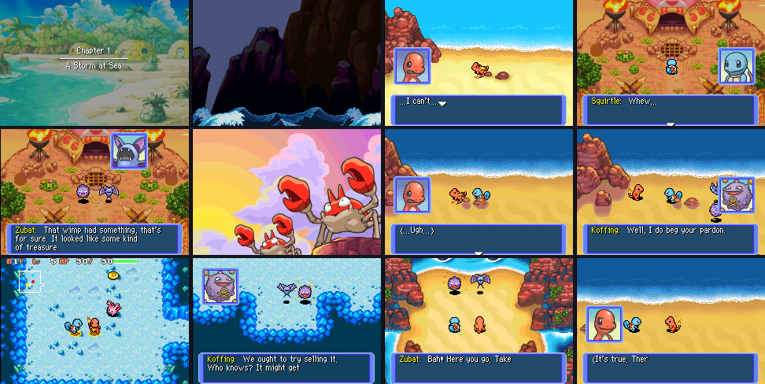

# Explorers of Sky Demake (Chapter 1)

---

## Index

- [Introduction](#introduction)
- [What plays](#what-plays)
- [Building](#building)
- [EoS maps](#eos-maps)
- [Beach Cave and the boss](#beach-cave-and-the-boss)
- [Music](#music)
- [Dungeon tilesets](#dungeon-tilesets)
- [Title screens](#title-screens)
- [Gen 4 Pokémon and moves](#gen-4-pokémon-and-moves)
- [Testing](#testing)
- [Code Locations](#code-locations)
- [Limitations](#limitations)

---

## Introduction

A demake of the opening chapter of *Pokémon Mystery Dungeon: Explorers of Sky*
("A Storm at Sea"), from the storm to the end of the Zubat & Koffing fight in
Beach Cave Pit, built from the real EoS assets: ground maps, second-screen art,
dungeon tileset, the Beach Cave Pit room, music, title screens, portraits and
the Gen 4 Pokémon and moves, all converted from a user-supplied EoS ROM (which
is never committed). The choreography and text follow the EoS scene scripts
(`SCRIPT/<level>/m01a0xxx.ssb`).



It is the default story of the modern build on this branch (`STORY=sky`).
The game is a demo of chapter 1: after the beach epilogue ("And so...") it
asks whether to save, shows "The demo ends here. Look forward to updates!"
and returns to the title screen. Continuing a finished save shows the same
ending again (`s_script_SKY_DEMO_END` in
[`src/data/ground/ground_event_data.h`](../../src/data/ground/ground_event_data.h),
`SKY_SAVE_GAME` / `SKY_DEMO_TO_TITLE` in [`src/sky_story.c`](../../src/sky_story.c),
the Continue check in [`src/ground_main.c`](../../src/ground_main.c)).

Red's story after chapter 1 is not in the sky build: only the ground maps the
demo visits keep their scripts and map files (Tiny Woods entrance/end, which
host the Sky scenes, the personality test, the two logo maps and the Sky
maps; found by tracing a full playthrough). The other 130 station script
files compile to nothing under `SKY_STORY`, their `gMapScriptTable` entries
are empty (`GetGroundScript` returns the null script) and their map files
are not linked (their names in the sorted ground file table point at a kept
file). This saves about 3.7 MB. The vanilla build keeps everything.

---

## What plays

Boot: EoS's Nintendo logo and ESRB notice, Red's logo screens, then the EoS
title (EoS's English logo, blinking "Press START", EoS title theme). The top
menu has EoS's options and background and plays the EoS top-menu theme; the quiz uses EoS's intro wording and "Welcome to the World
of Pokémon". The starter list adds Turtwig, Chimchar, Piplup, Munchlax and
Riolu (with Vulpix, Meowth, Phanpy). Then:

| # | EoS script | Map (converted EoS level) | Scene |
|---|---|---|---|
| 1 | — | — | Chapter card: black screen, EoS banner font, **Chapter 1 — A Storm at Sea** |
| 2 | m01a0101/0102 | `v01p01a` storm at sea | Lightning on black, voices, the storm-cliff art lit by lightning, then the waves |
| 3 | m01a0103 | `d01p11a` beach (day) | The EoS sky panorama, the hero washed up on the sand |
| 4 | m01a0104 | `g01p01b` Wigglytuff's Guild (dusk) | Guild sky; the partner loses their nerve on the sentry grate; the Relic Fragment close-up; Zubat & Koffing watch and follow |
| 5 | m01a0202/0203 | `v01p04b`, `v01p05b` | Dusk sky; Krabby blowing bubbles at sunset ("On the Beach at Dusk") |
| 6 | m01a0204–0208 | `d01p11b` beach (sunset) | The glittering sunset sea; the partner finds the hero; naming; Zubat & Koffing steal the Relic Fragment; "can you please help me?" |
| 7 | — | Beach Cave B1F–B4F | EoS Beach Cave tileset and wild Pokémon (Shellder, Kabuto, Corsola, Shellos), "Beach Cave" music |
| 8 | m01a0401 | Beach Cave Pit (B5F) | The EoS Pit room and background, "In the Depths of the Pit", pre-fight dialogue, then the Zubat & Koffing fight ("Boss Battle") |
| 9 | m01a0701 | `d01p41a` Beach Cave Pit | The thieves give the fragment back and flee |
| 10 | m01a0702 | `d01p11b` beach (sunset) | The Relic Fragment; "Form a team / Say no"; "And so..." |

The Relic Fragment is a ground object (EoS `GROUND/g01p01a1.wan`, ornament
`relicfragmentp`, object kind `SKY_OBJ_RELIC_FRAGMENT`): it falls on the sand
when Zubat rams the partner and is gone when Zubat grabs it (m01a0208), and it
lands in front of the heroes when Zubat throws it back in the Pit (m01a0701).

Losing in Beach Cave plays m01a0301 on the beach ("Ouch! We didn't do too
well...") and goes straight back in; the re-fight uses m01a0501's text.

Dialogue uses EoS's box layout (Sky UI style): 6 tiles tall with a margin
under it, text 4 px below and 6 px right of the frame, 13 px between lines,
bottom portraits kept just above the box, and a full box clears for the next
page instead of scrolling (`sSkyTextbox` in
[`src/string_format.c`](../../src/string_format.c)).

The Krabby bubbles (EoS's `supervision_SpecialActing` 4/5 effect; spawn
points, sizes and velocities measured frame by frame in EoS: down-right from
the Krabby mouths on the sand, up-left at sunset, a slow leftward drift on
the beach) drift
over the two Krabby scenes, the sunset beach and the sunset-sea cutaway:
`SKY_BUBBLES(mode)` in scripts, OBJ sprites captured from EoS's OBJ layer
([`src/sky_bubbles.c`](../../src/sky_bubbles.c),
`graphics/custom/sky_bubbles/`). Bubbles hide behind open windows, since EoS
shows text on the other screen. The same effect draws the rain over the
storm (`SKY_BUBBLES_RAIN`, m01a0102): 1 px teal streaks falling steeply over
the cliff, through the lightning and over the sea after the pan
(`graphics/custom/sky_rain/`). As in EoS the rain is blended over the
picture: the streaks are semi-transparent OBJs, alpha-blended (10/16 over
8/16) with BG2/BG3/the backdrop, so they are dim over the cliff and bright
over the sky; the previous blend settings come back when the rain stops. Converted maps keep EoS's palette animations
(the sea shimmer, the sunset glitter, the Pit water) and, on maps that fit
VRAM, EoS's BPA tile animations: the storm-sea waves (`EV0101A1.bpa`) and
the guild torches (`EG0101B1.bpa`), in RT's BPA slots.

Connected CGs pan instead of cutting: where EoS shows a top-screen CG right
above the scene (the cliff over the stormy sea, the sky over the beach, the
dusk clouds over the guild), the demake shows the CG and eases down into the
scene. The 240x320 pictures come from
[`tools/make_sky_cutaway_scrolls.py`](../../tools/make_sky_cutaway_scrolls.py)
(`graphics/custom/sky_scrolls/`: the CG over a capture of the scene's first
view, with the player's Pokémon replaced by the rendered map; between them
the map from its top edge, so the tent is whole under the guild's sky, as on
the DS); the pan ends on exactly the map's first view and the scene is shown
at once, without a fade; the tiles
stream through a 21-row ring in the cutaway's VRAM (`ScrollConnected` in
[`src/sky_cutaways.c`](../../src/sky_cutaways.c)).

The DS second screen has no GBA equivalent, so its art (sky panoramas, the
storm cliff, the Relic Fragment close-up, the animated sunset sea) is shown as
full-screen cutaways in the middle of scenes (`SKY_CUTAWAY(id, frames)`,
[`src/sky_cutaways.c`](../../src/sky_cutaways.c)).

---

## Building

```bash
make -j$(nproc)                 # sky story (default for the modern build)
make -j$(nproc) STORY=vanilla   # Red's story, no EoS content
```

- `STORY=sky` selects the ground-script pack `src/data/ground/sky/` and
  defines `SKY_STORY`. Everything EoS-specific is inside `#ifdef SKY_STORY`.
- `MODERN=0` (retail-matching) always uses the vanilla pack.
- `custom_story = TRUE` in `configs/runtime.c` still wins over `STORY`.
- Flipping `STORY` rebuilds every C object (the pack stamp is a dependency of
  all C objects, because headers test `SKY_STORY`).

---

## EoS maps

The EoS ROM is never committed. Only the converted map files are:
`data/map_bg/E*.bpl`, `E*c.bpc`, `E*m.bma` (+ GMLZ copies in `data/map_bg_lz/`).

| Map id | File stem | EoS level | Tiles |
|---|---|---|---|
| `MAP_SKY_STORM_SEA` | `EV0101A` | `v01p01a` | 613 (VRAM) |
| `MAP_SKY_BEACH_DAY` | `ED0111A` | `d01p11a` | 1651 (streamed) |
| `MAP_SKY_GUILD_DUSK` | `EG0101B` | `g01p01b` | 952 (VRAM) |
| `MAP_SKY_KRABBY_BUBBLES` | `EV0104B` | `v01p04b` | 1067 (streamed) |
| `MAP_SKY_KRABBY_SUNSET` | `EV0105B` | `v01p05b` | 1080 (streamed) |
| `MAP_SKY_BEACH_DUSK` | `ED0111B` | `d01p11b` | 1767 (streamed) |
| `MAP_SKY_BEACH_CAVE_PIT` | `ED0141A` | `d01p41a` | 1503 (streamed) |

Converter: [`tools/convert_eos_ground_map.py`](../../tools/convert_eos_ground_map.py)

```bash
tools/convert_eos_ground_map.py EOS.nds d01p11b ED0111B --render check.png
```

- Lossless: EoS and RT share 4bpp tiles, 3×3-tile chunks and 16-colour
  palettes, so tiles, palettes and chunk layouts are copied, not re-quantized.
  `--render` draws the written RT files back to a PNG; for all seven maps it is
  pixel-identical to skytemple's render of the EoS original.
- Both EoS layers become the RT dual-layer map (EoS upper layer → RT layer 0,
  in front of sprites). Frame 0 of BPA tile animations is baked in; palette
  and tile animations are dropped.
- Maps over the VRAM tile budget (1024 dual-layer, 896 single-layer) are
  streamed by `src/ground_bg_tile_stream.c`, which has no tile-flip bits, so
  the converter bakes flipped tiles for those.
- Collision comes from the EoS BMA.
- New BPCs stay uncompressed in ROM (streamed like the café's);
  `compress_ground_assets.py` skips `E*.bpc`.

Map registration: `include/constants/ground_map.h`, `include/map_files_table.h`,
`src/map_files_table.c`, `src/ground_map_conversion_table.c`,
`src/map_script_table.c`, `src/ground_files_table.c` (sorted by name; the
block is inserted under `#ifdef SKY_STORY` and later indices shift by
`SKY_GROUND_FILES`), `src/ground_map_files_sky.c`.

`SELECT_MAP` also selects the script file of the map in `gMapScriptTable`, so
each EoS map points at the station file whose groups use it (gs178 for the
beach, guild and storm scenes, gs179 for Beach Cave Pit).

---

## Beach Cave and the boss

Tiny Woods plays Beach Cave ([`src/sky_story.c`](../../src/sky_story.c)):

- Name "Beach Cave", floors shown as B1F–B4F (`IsStairDirectionUp`).
- EoS Beach Cave tileset (EoS tileset 1, see [Dungeon tilesets](#dungeon-tilesets)).
- Wild Pokémon from EoS's `mappa_s.bin`: Shellder L1, Kabuto L1, Corsola L2,
  Shellos L2 (25% each), Kecleon L48 for shops.
- On the story run (`SCENARIO_MAIN` major 2) B5F is **Beach Cave Pit**: EoS
  fixed floor 1 (14×15) in Red's `fixedmap` encoding, patched over the Team
  Meanies room number while in Beach Cave, with Zubat L4 and Koffing L7 and
  EoS's Pit background as the floor's tileset. Its cutscene is
  `CUTSCENE_BEACH_CAVE_PIT`
  ([`src/dungeon_cutscene_beach_cave.c`](../../src/dungeon_cutscene_beach_cave.c)):
  m01a0401 (first visit) or m01a0501 (re-fight) dialogue, the camera shows the
  thieves, boss music, and the dungeon ends once both are down. No cutscene
  flags are touched, so Sinister Woods is unaffected.
- Later visits to Beach Cave have no Pit.

---

## Music

The sky build plays no Red music: every Red song id (0–128) points at an
EoS track instead ([`tools/eos_music/sky_red_bgm_map.py`](../../tools/eos_music/sky_red_bgm_map.py)
→ `sound/sky_red_bgm_table.inc`). EoS has no versions of Red's songs, so the
mapping is by name where EoS has the same piece (Rising Fear, Kecleon's
Shop, Monster House!, Heartwarming, In the Depths of the Pit, Boss Battle!)
and otherwise by place and mood (Pokémon Square → Treasure Town, team base →
Wigglytuff's Guild, Makuhita Dojo → Marowak Dojo, Tiny Woods → Apple Woods,
Magma Cavern → Steam Cave, ...). Red's music sequences, its music
voicegroups (`bank_000`–`bank_024`, the drum kits) and the 75 samples only
they use are left out of the sky build (about 780 KB). Red's sound effects
keep Red's instruments (`bank_025`–`bank_028`).

EoS's sequences on EoS's own instruments
([`tools/eos_music/convert_eos_bgm.py`](../../tools/eos_music/convert_eos_bgm.py)):
SMDL → MIDI (`sound/songs/midi/sky_*.mid`) → `mid2agb` →
`sound/songs/seq_061.s`–`seq_068.s` (song ids 61–68, `MUS_SKY_*` in
`include/sky_story.h`).

Instruments come from EoS's DSE sound banks
([`swdl.py`](../../tools/eos_music/swdl.py) parses them,
[`sky_soundfont.py`](../../tools/eos_music/sky_soundfont.py) converts them):

- **Samples**: the 204 samples of `SOUND/BGM/bgm.swd` the songs use, decoded
  (IMA-ADPCM / PCM), resampled to at most 18157 Hz (the mixer rate),
  normalised to full 8-bit scale, in
  `sound/direct_sound_samples/sky/eos_NNN.bin`. Loop points are kept: the
  loop length is rounded to whole samples and the playback rate adjusted to
  match.
- **WaveData**: `sound/songs/sky_samples.s`, one per sample and tuning (349,
  1.91 MB). DSE plays a note at `32728 * 2^((note - root + ctune + ftune/256)/12)`
  Hz. That pitch is baked into the WaveData `freq`, because m4a ignores a
  DirectSound voice's base key.
- **Voicegroups**: every song has its own voicegroup (`sky_vg_bgmNNNN`, at the
  top of the song's `.s`) built from its `bgmNNNN.swd`. The MIDI program is
  the EoS program id. A program with one split is a DirectSound voice. One
  with several splits is a KeySplit voice. A drum kit with per-key pan is a
  DrumTable voice. Each DSE envelope (attack, hold, decay, sustain, decay2,
  release) is approximated by m4a ADSR bytes.
- **Volumes**: split, program and sample volume, and the normalisation gain,
  scale note velocities. EoS volume × expression becomes MIDI volume, and pitch
  bends are kept. Each song's master volume comes from an offline model of the
  m4a mixer ([`m4a_render.py`](../../tools/eos_music/m4a_render.py)) so the
  8-bit mix, which wraps instead of clipping, keeps headroom.
- **Engine**: in the sky build the mixer uses 12 DirectSound channels instead
  of Red's 5, and the BGM player has 16 tracks instead of 12 (`src/m4a.c`,
  `sound/music_player_table.inc`). The vanilla build is unchanged.

Not ported: LFOs (vibrato), key groups, and layered splits (the first split
wins).

| Id | EoS | Used for |
|---|---|---|
| 61 | bgm0069 On the Beach at Dusk | Krabby, beach scenes |
| 62 | bgm0021 Beach Cave | Beach Cave floors |
| 63 | bgm0015 Boss Battle! | Zubat & Koffing |
| 64 | bgm0014 In the Depths of the Pit | Beach Cave Pit |
| 65 | bgm0130 title theme | Title screen |
| 66 | bgm0002 Top Menu Theme | Main menu |
| 67 | bgm0001 Exploration team theme | (available) |
| 68 | bgm0006 Welcome to the World of Pokémon! | Personality quiz |

### Jingles

Red's fanfares (song ids 200–219, played on the fanfare player by
`PlayFanfareSE` / `PlaySound` / `FANFARE_PLAY`) play EoS's own jingles in the
sky build. EoS keeps them in `SOUND/ME/me0000.smd`–`me0013.smd` with one bank,
`SOUND/ME/me.swd`, that holds both the programs and the samples.
`convert_eos_bgm.py` converts them with the same pipeline as the BGM
(`--me-only` converts only these): `sound/songs/sky_me_NNNN.s` (voicegroup
`sky_vg_meNNNN`), samples in `sound/songs/sky_me_samples.s` (labels
`sky_me_wav_*`, files `sound/direct_sound_samples/sky/me_NNN.bin`; 10 samples,
34 KB). `me0000` is not converted: it is note for note `me0006` and EoS only
plays it from a debug "ME test" menu (`T00P01/m01a0116.ssb`).

`sound/song_table.inc` points ids 200–219 at them under `SKY_STORY`, with
Red's player fields (`1, 1`); Red's `seq_200`–`seq_219` are not assembled in
the sky build. EoS jingles use up to 10 tracks, so the sky build's fanfare
player has 10 tracks instead of 6, in IWRAM (EWRAM is full).

How each id was matched. Red's use comes from its callers in `src/` and the
ground scripts. EoS's use comes from the EoS scripts (`me_Play(n)` in the
`.ssb` files, decompiled with SkyTemple) and from the callers of EoS's
`PlayMeById` (NA `0x0201820C`, veneer `0x02017C50`) in arm9 and the overlays.
"Melody" is how many note onsets (pitch class on a 16th-note grid, best
transposition) Red's and EoS's jingles share, which shows the remakes: most EoS
jingles are Red's, re-orchestrated.

| Id | Red use | EoS ME | EoS use (evidence) |
|---|---|---|---|
| 200 | dungeon level up (`sub_8083D58`) | me0001 | level up in ground mode (ov11 `PlayMeById(1)` then "became level N!"); also big rewards: `[me_play:1]` in "accepted the rare and precious item", Egg hatched, scripts' "team was rewarded" |
| 201 | rescue rank up (`mission_reward.c`, b01p02a "rescue rank went up!") | me0002 | the rank-up step of the reward screen (arm9, played after "Team … went up in rank"); melody closest to Red's 201 |
| 202 | Pokémon farewell (`party_list_menu.c`) | me0003 | "… was released from the team." (ov11 ×3, Chimecho Assembly, Day Care) |
| 203 | reward / item received (`GET_ITEM_FUNC`, shops, mission rewards) | me0004 | item received (66 script uses: "received …", reward points; Recycle Shop; dungeon). Melody 0.53 (same tempo, length) |
| 204 | joined the team (`JOIN_FUNC`, dungeon recruit, Celebi, "became leader") | me0005 | "… joined the team!" (52 of 57 script uses; Chimecho, Day Care). Melody 0.84 |
| 205 | new dungeon open ("Uproar Forest is now open") | me0006 | "You can now go to …" (42 of 45 script uses) |
| 206 | friend area obtained | me0006 | same as 205; me0006 is Red's 206 remade (melody 0.61) |
| 207 | reached the destination floor, tutorial notice, standby | me0007 | "A message has arrived from the Exploration Team Federation". Melody 0.69 |
| 208 | unused (200 at another volume) | me0001 | as 200 |
| 209 | (empty) | — | — |
| 210 | evolution at Luminous Cave (`luminous_cave.c`) | me0008 | Luminous Spring evolution (ov16 ×2), "Teddiursa evolved into Ursaring!". Melody 0.50 |
| 211 | evolution in a dungeon (`sub_8083D78`) | me0008 | as 210 |
| 212 | important item received (Teleport Gem, Red Wing, 9-Tail Crest) | me0009 | "… obtained …" key items (24 script uses), dungeon "You've completed a mission!". Same tempo (72/73 bpm) |
| 213 | Rescue Team Starter Set from the Mailbox | me0004 | as 203 (Red's 213 is 203 at another volume) |
| 214 | unused | me0010 | no caller in Red: given one of EoS's dungeon-end stings (ov29 `IsFloorOver` plays `{10, 11, 11}[i]` or `{12, 13, 13}[i]`), by length |
| 215 | unused | me0012 | as 214 |
| 216 | unused | me0010 | Red's 216–219 are sparse stings like EoS's me0010–me0013; matched by tempo and length (1.3 s / 2.9 s) |
| 217 | unused | me0011 | 6 notes, 10.8 beats at 160 bpm in both |
| 218 | unused | me0012 | 150 bpm, ~2 s in both |
| 219 | unused | me0013 | 3 notes at 240 bpm in both |

---

## Dungeon tilesets

[`tools/convert_eos_dungeon_tileset.py`](../../tools/convert_eos_dungeon_tileset.py)
converts an EoS dungeon tileset (`DUNGEON/dungeon.bin`: dpci tiles, dpc chunks,
dma autotile table, dpl palettes, dpla animated colours) into Red's
fon/cel/cex/pal/canm data as C arrays; both engines share the layout. A fixed
floor background (`dungeon_bgN`) becomes Red's pre-drawn "emap" tileset
(24×24 chunks over ≤249 deduplicated chunks). Output:
`src/data/sky_beach_cave_tileset.h`, `src/data/sky_beach_cave_pit_tileset.h`,
loaded by [`src/sky_dungeon_tileset.c`](../../src/sky_dungeon_tileset.c).

---

## Title screens

[`tools/make_sky_title_screens.py`](../../tools/make_sky_title_screens.py)
writes `graphics/custom/sky_title/`:

- The Nintendo logo and ESRB notice (`BACK/n_logo.bgp`, `BACK/w_esrb.bgp`).
- The title card: EoS's English logo from ground level **S13P01B**
  (`MAP_BG/s13p01a.bma`/`.bpc` with the `s13p01b.bpl` palette, the end of the
  logo fade-in that opens EoS): the orange glow and the "Pokémon Mystery
  Dungeon" logo, scaled to 7/8 to fit 240 px (the DS top screen, the one
  with the logo). Under it goes EoS's green "EXPLORERS OF SKY" emblem, which
  EoS draws as OBJ sprites over the demo loop on the bottom screen:
  `graphics/custom/sky_title/emblem_src.png` is that sprite layer captured
  from the running game (DeSmuME, main-engine OBJ layer only; pure black is
  kept where the full frame is black too, so the outlines survive). The logo,
  emblem and "Press START" get their own share of the 8bpp palette. "Press START"
  blinks; the EoS title theme plays.
- The main-menu backgrounds: the ten CGs EoS shows on the DS top screen
  during its top menu (`BACK/s09p01a`–`s09p10a.bgp`), scaled to 240×180 and
  cropped to the middle 160 lines; one is picked at random each time
  (`CUSTOM_TITLE_BG_COUNT` 10 in the sky build).

`DEMO_02`/`DEMO_03`/`DEMO_04` (`src/data/ground/ground_event_data.h`) call
`SKY_CUTAWAY_BOOT_SCREENS` / `SKY_CUTAWAY_TITLE_SCREEN` instead of Red's
intro movie and logo map.

The menu windows use EoS's green top-menu frames whatever the window-colour
option (`SetUiStyleFrameColorOverride`, [`src/ui_style.c`](../../src/ui_style.c),
set while the main menu is open) and, like EoS, are sized to their longest entry.

The top menu follows EoS ([`src/main_menu2.c`](../../src/main_menu2.c),
`#ifdef SKY_STORY`): **New Game / Other** without a save, **Continue**
(Revive Team, Awaiting Rescue) **/ Other** with one (no Friend Rescue or
Wonder Mail S in the demo: rescues run on Red's later-story maps, which are
not in the sky build). **Other** opens a second window: Adventure Log, Achievements (if
on), Trade Items, Delete Save Data, Sky Jukebox, Exit. The descriptions are EoS's, with the
DS-only parts (wireless, Nintendo WFC) replaced by the GBA's link cable and
passwords.


### Sky Jukebox

[`src/sky_jukebox.c`](../../src/sky_jukebox.c) lists EoS's 141 Sky Jukebox
tracks in EoS's order with EoS's names (A play, SELECT/START stop, Left/Right
page, B back to the top menu theme). The track → song table comes from EoS's
overlay 9 (the jukebox) and the names from the "Music Tracks" strings;
`tools/eos_music/convert_eos_bgm.py` converts every track. The eight the story
uses keep song ids 61–68; the other 133 are `sound/songs/sky_bgm_NNNN.s`,
appended after Red's song table (`sound/sky_jukebox_songs.inc`, song ids
940–1072), and `IsBGSong` accepts that range (≈1.4 MB with their voicegroups; the shared EoS samples are another 1.9 MB).


---

## Gen 4 Pokémon and moves

All Gen 4 species in EoS (105 new ids, 424–528: dex 387–492 without Munchlax,
which keeps Red's id 420 but gets EoS's data; EoS has no Arceus) and the Gen 4
moves, from [`tools/make_sky_gen4_data.py`](../../tools/make_sky_gen4_data.py)
(`include/constants/sky_gen4.h`, `src/data/sky_gen4_data.c`):

- **Species data** from `BALANCE/monster.md` (types, abilities mapped by name
  onto Red's + Custom Abilities, stats, movement type, body size, recruit
  rate, evolutions) and level-up tables from `m_level.bin`. Evolutions that
  need Gen 4 items or move/gender conditions evolve at level 40 instead.
  EoS has no friend areas: each Gen 4 evolution line joins its Red family's
  area or the area where Red puts most Pokémon of its type, at most 16 species
  per area (the Wigglytuff list size). Alphabetical order is recomputed over
  all species.
- **Moves**: EoS move ids 0x000–0x1AD are Red's, so Gen 4 moves keep their EoS
  ids 0x1AE–0x21E with EoS's power, type, category, range, accuracy and PP;
  names and descriptions from EoS's text. Red has no handlers or animations for
  them, so each borrows a Red move's effect handler and animation
  ([`src/sky_gen4_moves.c`](../../src/sky_gen4_moves.c)), e.g. Dark Pulse →
  Headbutt's flinch, Close Combat → Superpower's stat drop, Flare Blitz →
  Double-Edge's recoil, Draco Meteor → Overheat's Sp. Atk drop.
- **Learnsets**: every species (Red's too) uses its EoS level-up and TM/HM
  learnset, so old species can learn Gen 4 moves.
- **Portraits**: EoS's `FONT/kaomado.kao` faces, each of Red's 13 emotions EoS
  has ([`tools/make_sky_gen4_portraits.py`](../../tools/make_sky_gen4_portraits.py)
  → `graphics/portraits/<species>/`, built by `convert_custom_portraits.py`
  into the custom portrait archive under `SKY_STORY`).
- **Sprites**: EoS's WAN sprites converted to Red's AX format by
  [`tools/convert_eos_wan_to_ax.py`](../../tools/convert_eos_wan_to_ax.py)
  (`batch EOS.nds 387-445 447-492 --names <dex name file>`). AX is WAN's GBA
  ancestor, so frames, OAM pieces, offsets, shadows and the 8 directions map
  one to one; Red's 13 animation groups are EoS's first 13 (walk, attack,
  kick, shoot, strike, sleep, hurt, idle, swing, double, hop, charge, rotate),
  taken from `monster.bin` / `m_attack.bin`. Each sprite uses the closest of
  Red's 13 shared overworld palettes (written into the header comment and read
  back as the species' `overworldPalette`). Frames over Red's VRAM budget (16
  tiles per body-size unit) drop their outermost effect pieces. Output:
  `graphics/ax/mon/<species>/`, `src/data/ax/<species>.h`,
  [`src/monster_gfx_sky.c`](../../src/monster_gfx_sky.c), registered as
  `ax424`–`ax528` in `src/monster_files_table.c` (≈2.5 MB).
  Red's cutscene animation groups 13+ (lying, getting up, ...) don't exist in
  the converted sprites; `AxResInit` falls back to Sleep for lying (13) and
  Idle for the rest.


The sky build reads species, moves, learnsets and level data from these tables
(`LoadMonsterParameters`, `LoadWazaParameters`, `GetLvlUpEntry`); Red's
entries in them match the retail data except the alphabetical order.

### Save format (sky build)

Old saves need a new game. Following the save-layout checklist
(`tools/check_save_layout.py` checks the sky widths):

- Species and move ids take 10 bits (`SPECIES_SAVE_BITS`, `MOVE_ID_SAVE_BITS`);
  `RECRUITED_POKEMON_SAVE_SIZE` 0x4B40.
- Per-species and per-move flag arrays grow to 17 words
  (`MONSTER_FLAGS_U32STORAGE`, `MOVE_FLAGS_U32STORAGE`), so the adventure chunk
  is 0x140 (`ADVENTURE_SAVE_SIZE`) and `unk448` 0x5A80 (`SAVE_CHUNKS_SIZE`).
- Dungeon spawn entries carry species bits 9+ (`SpawnPokemonData.speciesHi`);
  `mapparam` is read through the 9-bit `FileSpawnPokemonData`.
- Wonder Mail keeps 9-bit species, because its bits are also the rescue
  password format; mail jobs only use species below 512.

---

## Testing

Two test-only Makefile hooks (normal builds are unaffected):

```bash
make DEBUG_BOOT_EVENT=EVENT_DIVIDE DEBUG_BOOT_FLOOR=5
```

- `DEBUG_BOOT_EVENT=<script>`: New Game skips the quiz, creates the default
  team (Charmander / Squirtle) at story scenario (2,0) and runs that event
  script; `EVENT_DIVIDE` starts chapter 1 the normal way. Naming screens are
  skipped (`RENAME_ALLY` keeps the default name).
- `DEBUG_BOOT_FLOOR=<n>`: every dungeon run starts on floor n (5 = Beach Cave
  Pit).

Then drive it with `mgba_shot` (A every 60 frames reaches the dungeon at about
frame 15000):

```bash
P="--press 600:START --press 900:A --press 1200:A --press 1500:A --press 1800:A"
for f in $(seq 2100 60 30000); do P="$P --press $f:A"; done
build/tools/mgba_shot pmd_red.gba build/shots/sky --frames 30000 --every 250 $P
make -j$(nproc)   # plain build again afterwards
```

Winning the boss fight by mashing A needs a strong team; for that test set
`max_level_stats = TRUE` in `configs/runtime.c` temporarily.

---

## Code Locations

| Piece | Path |
|-------|------|
| Story pack select, test hooks | [`Makefile`](../../Makefile) (`STORY`, `DEBUG_BOOT_EVENT`, `DEBUG_BOOT_FLOOR`) |
| Opening scenes (gs178 groups 1–8) | [`src/data/ground/sky/sky_d01p01_scenes.h`](../../src/data/ground/sky/sky_d01p01_scenes.h) |
| Beach Cave Pit aftermath (gs179 group 1) | [`src/data/ground/sky/ground_data_d01p02_station.h`](../../src/data/ground/sky/ground_data_d01p02_station.h) |
| Scene order, boot/title demos | [`src/data/ground/ground_event_data.h`](../../src/data/ground/ground_event_data.h) |
| Ground actors, Relic Fragment object | [`src/ground_lives.c`](../../src/ground_lives.c), [`src/ground_sprite_data.c`](../../src/ground_sprite_data.c), [`src/ornament_files_table.c`](../../src/ornament_files_table.c), [`include/sky_story.h`](../../include/sky_story.h) |
| Cutaways, boot and title screens | [`src/sky_cutaways.c`](../../src/sky_cutaways.c), [`src/sky_cutaways_data.c`](../../src/sky_cutaways_data.c), [`src/sky_title_data.c`](../../src/sky_title_data.c), [`src/custom_title_backgrounds.c`](../../src/custom_title_backgrounds.c) |
| Chapter cards | [`src/chapter_titles.c`](../../src/chapter_titles.c), [`src/chapter_cards_data.c`](../../src/chapter_cards_data.c) |
| Beach Cave overrides | [`src/sky_story.c`](../../src/sky_story.c), [`src/dungeon_floor_spawns.c`](../../src/dungeon_floor_spawns.c), [`src/dungeon_generation.c`](../../src/dungeon_generation.c), [`src/dungeon_generation_fixed.c`](../../src/dungeon_generation_fixed.c), [`src/dungeon_info.c`](../../src/dungeon_info.c) |
| Dungeon tilesets | [`src/sky_dungeon_tileset.c`](../../src/sky_dungeon_tileset.c), [`src/dungeon_map_access.c`](../../src/dungeon_map_access.c) |
| Boss cutscene | [`src/dungeon_cutscene_beach_cave.c`](../../src/dungeon_cutscene_beach_cave.c), [`src/dungeon_cutscene.c`](../../src/dungeon_cutscene.c) |
| Gen 4 data / moves / sprites | [`src/data/sky_gen4_data.c`](../../src/data/sky_gen4_data.c), [`src/sky_gen4_moves.c`](../../src/sky_gen4_moves.c), [`src/monster_gfx_sky.c`](../../src/monster_gfx_sky.c), [`src/sprite.c`](../../src/sprite.c) (animation fallback) |
| Dialogue box layout | [`src/string_format.c`](../../src/string_format.c), [`src/text_2.c`](../../src/text_2.c) |
| Converters (need an EoS ROM) | `tools/convert_eos_ground_map.py`, `tools/make_sky_cutaways.py`, `tools/make_sky_cutaway_scrolls.py`, `tools/make_sky_chapter_cards.py`, `tools/make_sky_title_screens.py`, `tools/eos_music/convert_eos_bgm.py`, `tools/convert_eos_dungeon_tileset.py`, `tools/make_sky_gen4_data.py`, `tools/make_sky_gen4_portraits.py`, `tools/convert_eos_wan_to_ax.py` |

---

## Limitations

- The EoS logo is scaled to 7/8 to fit the GBA screen. EoS options with no
  Red feature (Sky Jukebox, Trade Team, Rename Team, Send Demo Dungeon,
  Nintendo WFC) are left out of the top menu. The jukebox has no Loop or
  Lock; every track loops as converted.
- Music uses EoS's samples at 8 bits and at most 18157 Hz. LFO vibrato, key
  groups and layered splits are not ported, and envelopes are approximated.
  12 mixer channels cost more CPU than Red's 5.
- Sprites and the Relic Fragment use Red's 13 shared overworld palettes, so
  some colours shift (the fragment's red mark becomes grey; Turtwig loses its
  yellow). Converted sprites lack Red's cutscene animation groups 13+ (they
  fall back to Sleep / Idle).
- Gen 4 moves borrow Red effect handlers; effects Red has no mechanism for
  (Gravity, Trick Room, Heal Block, Embargo, Shadow Force's vanish turn, ...)
  behave like the nearest Red move.
- Gen 4 evolutions needing Gen 4 items or move/gender conditions evolve at
  level 40. Gen 4 Pokémon only appear in the wild in Beach Cave (Shellos); the
  rest of Red's dungeons keep Red's spawn lists.
- Beach Cave Pit's background has some black areas at the top where the EoS
  picture was folded into Red's 249-chunk limit.
- Old saves need a new game in the sky build.
- Test hooks: `DEBUG_BOOT_STARTER=<id> DEBUG_BOOT_PARTNER=<id>` pick the team
  `DEBUG_BOOT_EVENT` creates.
- To save ROM space, the sky build leaves out Red-only art EoS has no use
  for: every starter shares one team base (Pikachu's; `BASE_KIND` is ignored
  in `GetAdjustedGroundMap`, and the other 15 bases' map files are not linked,
  about 640 KB), and there are no Friend Area pictures (Red's chapter-card
  backgrounds, also shown on entering a Friend Area; about 1.5 MB). The
  vanilla build keeps all of them.
