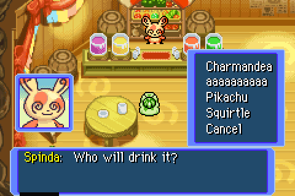
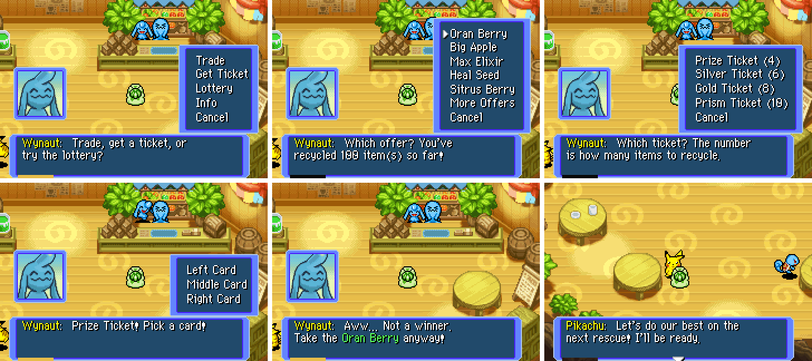

# Spinda's Café (Whiscash Pond)

---

## Index

- [Introduction](#introduction)
- [Behavior](#behavior)
- [New Items](#new-items)
- [Code Locations](#code-locations)
- [Limitations](#limitations)

---

## Introduction

Adds a PMD2-style **Spinda's Café** entered from Whiscash Pond (north of Pokémon Square): stairs + café sign ornaments on the west grass warp into an indoor café map with the Juice Bar (Spinda) and Recycle Shop (Wynaut). Wobbuffet is present and only says his name. Spinda dances while mixing each drink, and team members other than the leader and partner relax at the tables.

Toggle: `gRuntimeConfig.spinda_cafe` in [`configs/runtime.c`](../../configs/runtime.c) (default `TRUE`).

Unlock: stairs + indoor staff after `QUEST_CAN_ACCESS_JOBS`.

---

## Behavior

### Entrance (Whiscash Pond)

- Stairs ornament at `{15,45}` with café **sign** at `{18,45}` on the west grass (group 31).
- Stepping on the 3×3 warp event enters `MAP_SPINDA_CAFE`.
- Outdoor café NPCs are **not** on the pond; staff live only inside.

### Juice Bar (Spinda)

1. Mix Drink → pick a Toolbox food item (berries / seeds / vitamins / food / gummis).
2. Pick a teammate currently on the active team.
3. Item is consumed. Message flow:
   - Spinda: "OK! Coming right up〜♪ Watch me mix it!" (Happy portrait).
   - **Spinda's dance:** the textbox closes and Spinda hops, spins on the spot (spin animation + eight quick turns), tail-whips, turns back to face you and hops again.
   - Spinda: "Ta-da! Here you go〜♪"
   - **System:** `{NAME} drank the juice!`
   - Spinda reacts (Happy / Joyous / Sad portraits; miracle has its own line).
   - **System:** IQ / Attack / Defense / HP / level / Ginseng rises (amounts via `{VALUE_0}`).
   - **System:** If IQ rose past a skill threshold, each newly available IQ skill is announced (same as gummi feeding).
4. Effects:
   - **Permanent base (always):**
     - **Gummi:** type IQ via `GetGummiItemStatBoost` + at least one offense stat.
     - **Protein / Calcium / Iron / Zinc:** +3 to the matching offense stat.
     - **Life Seed:** +3 max HP; **Sitrus Berry:** +2 max HP.
     - **Joy Seed:** +1 level (stats/moves like a normal level-up).
     - **Ginseng:** +1 (12% +3) power on the set move, same as dungeon Ginseng.
     - **Doom Seed:** no positive effect (no level loss).
   - **Good feeling** (per-item chance; skipped for vitamins / Joy / Life / Sitrus / Doom / Hunger): ingredient-specific +IQ and/or +HP from [`src/data/spinda_juice_effects.h`](../../src/data/spinda_juice_effects.h). Gummis use 25% for +2 IQ.
   - **Miracle** (~1%; Hunger Seed allowed, other permanent boosters not): +2–5 to one of HP / Atk / Sp.Atk / Def / Sp.Def / IQ, on top of the base effect.

### Recycle Shop (Wynaut / Wobbuffet)

Modelled on Explorers of Sky's shop, with Red's items. Menu: **Trade / Get Ticket / Lottery / Info / Cancel**.

**Trade.** Fixed offers of the form "give N × item A, get item B". Five offers per page, plus **More Offers** when more are unlocked. Offers unlock as the lifetime recycle count (`itemsRecycled`) grows. Trades and ticket exchanges both add to it.

| Unlock at | Reward | Cost |
|---|---|---|
| 0 | Oran Berry | 2 Plain Seed |
| 0 | Big Apple | 2 Apple |
| 0 | Max Elixir | 3 Oran Berry |
| 4 | Heal Seed | 2 Pecha Berry |
| 6 | Sitrus Berry | 3 Oran Berry |
| 8 | Huge Apple | 2 Big Apple |
| 10 | Reviver Seed | 2 Escape Orb |
| 12 | Escape Orb | 2 Warp Seed |
| 14 | Power Band | 3 Blast Seed |
| 16 | Def. Scarf | 3 Sleep Seed |
| 18 | Special Band | 3 Totter Seed |
| 20 | Zinc Band | 3 Stun Seed |
| 25 | Joy Seed | 2 Sitrus Berry |
| 30 | Life Seed | 2 Huge Apple |
| 40 | Gold Gummi | 3 White Gummi |
| 50 | Reviver Orb | 2 Reviver Seed |
| 60 | Gold Ribbon | 3 Life Seed |
| 80 | Wonder Gummi | 3 Gold Gummi |

**Get Ticket.** Recycle any Toolbox items for a ticket. Sky's costs and rank gates:

| Ticket | Items to recycle | Rank needed | Lottery odds (loss / win / big win) |
|---|---|---|---|
| Prize Ticket | 4 | Normal | 65 / 30 / 5 % |
| Silver Ticket | 6 | Silver | 55 / 40 / 5 % |
| Gold Ticket | 8 | Gold | 45 / 45 / 10 % |
| Prism Ticket | 10 | Diamond | 30 / 50 / 20 % |

Stackable throwables (Stick, Iron Thorn, Silver Spike, Geo Pebble, thrown categories), money, Link Boxes and tickets cannot be recycled.

**Lottery.** Pick a ticket you hold (the menu shows how many of each you have), then **Left / Middle / Right Card**. The card only picks the draw; the outcome is rolled from the ticket's odds:

- **Loss:** a consolation item from the loss pool ("Aww... Not a winner. Take the … anyway!").
- **Win / big win:** a prize from that tier's pool, with a winning jingle. Big wins can award a higher ticket (Prize → Silver/Gold, Silver → Gold, Gold → Prism) and the Prism big-win pool holds the Wonder Gummi.

Pools are in [`src/data/recycle_shop.h`](../../src/data/recycle_shop.h).

**Bonus draw.** After a trade or ticket exchange there is a 1-in-32 chance of a free Prize Ticket draw.

If the Toolbox is full, the reward goes to storage and Wynaut says so.

### Team tables

Team members on the active team, other than the leader and the partner, sit beside the café tables (dynamic lives kinds 10–13). Empty slots don't spawn. Talk to one for a random café line (six lines). Recruits have no portrait, the same as vanilla team-base talk (legendaries excepted).

The café ignores `QUEST_CAN_DEPOSIT_PARTNER` when choosing members, so the partner never takes a table seat.

Progress (`itemsRecycled`) is saved in a `SPINDA_CAFE_SAVE_SIZE` (0x20) flash chunk after achievements. Saves from the older shop stored one abstract ticket (`ticketType`). On the first shop visit it is converted into the matching ticket item.

---

## New Items

Five items use the free IDs 240–244 (`NUMBER_OF_ITEM_IDS` is now 245):

| ID | Item | Category | Notes |
|---|---|---|---|
| 240 | Prize Ticket | Other | Red card sprite, sells for 100 |
| 241 | Silver Ticket | Other | Grey card, 200 |
| 242 | Gold Ticket | Other | Gold card, 400 |
| 243 | Prism Ticket | Other | Blue card, 800 |
| 244 | Wonder Gummi | Food / Gummi | Counts as the gummi type that suits the eater best (highest IQ gain for its types). Works in dungeons, from the Toolbox, and at the Juice Bar. |

The items are never in dungeon spawn tables or mail-job rewards. They are listed in `gInvalidItemIDs`, and the mail-job loop stops at `ITEM_FIRST_CUSTOM`.

Adding more items: append to [`data/item/item_data.json`](../../data/item/item_data.json), `item_names.s`, `item_descriptions.s`, `include/constants/item.h`, `src/effect_data.c`, the `tools/dungeonjson` item map, and the RescueEditor name/sprite/palette arrays. Spawn sets re-encode automatically: `dungeon_item.mk` depends on the `dungeonjson` tool, and the decoders clamp at the end of the array.

---

## Code Locations

| Area | Paths |
|------|--------|
| Toggle | [`include/runtime.h`](../../include/runtime.h), [`configs/runtime.c`](../../configs/runtime.c) |
| Pond stairs / warp | [`src/data/ground/vanilla/ground_data_t01p02a_station.h`](../../src/data/ground/vanilla/ground_data_t01p02a_station.h) / [`custom/`](../../src/data/ground/custom/) (group 31; keep both packs in sync) |
| Indoor map / NPCs | [`src/data/ground/vanilla/ground_data_cafe_station.h`](../../src/data/ground/vanilla/ground_data_cafe_station.h) / [`custom/`](../../src/data/ground/custom/) (`MAP_SPINDA_CAFE` / gs229) |
| Map conversion | [`src/ground_map_conversion_table.c`](../../src/ground_map_conversion_table.c) (`unk0 = 6` dual-layer) |
| Map art source | [`graphics/custom/spinda_cafe.png`](../../graphics/custom/spinda_cafe.png) → `data/map_bg/T01P08*` via [`tools/convert_ground_map_png.py`](../../tools/convert_ground_map_png.py); VRAM streaming in [`src/ground_bg_tile_stream.c`](../../src/ground_bg_tile_stream.c) |
| Stairs / sign ornaments | [`graphics/ornament/Stairs01/`](../../graphics/ornament/Stairs01/), [`graphics/ornament/Sign01/`](../../graphics/ornament/Sign01/), [`src/data/ornament/stairs01.h`](../../src/data/ornament/stairs01.h), [`src/data/ornament/sign01.h`](../../src/data/ornament/sign01.h) (from [`graphics/custom/spinda_cafe_stairs.png`](../../graphics/custom/spinda_cafe_stairs.png) / [`spinda_cafe_sign.png`](../../graphics/custom/spinda_cafe_sign.png)) |
| Special text | [`include/constants/script_cmd.h`](../../include/constants/script_cmd.h), [`src/textbox.c`](../../src/textbox.c) |
| Juice Bar | [`src/spinda_cafe.c`](../../src/spinda_cafe.c), [`include/spinda_cafe.h`](../../include/spinda_cafe.h) |
| Good-feeling table | [`src/data/spinda_juice_effects.h`](../../src/data/spinda_juice_effects.h) |
| Recycle Shop | [`src/recycle_shop.c`](../../src/recycle_shop.c), offers / tickets / pools in [`src/data/recycle_shop.h`](../../src/data/recycle_shop.h) |
| Spinda's dance | Juice Bar talk + Spinda's behaviour script in the café station files (cues 40 / 41); `SPECIAL_TEXT_SPINDA_JUICE_SERVE` resumes the order after the dance |
| Team tables | Café lives kinds 10–13; member selection `GetTeamSlotMembers` in [`src/ground_lives.c`](../../src/ground_lives.c) |
| New items | [`include/constants/item.h`](../../include/constants/item.h), [`data/item/`](../../data/item/), Wonder Gummi in [`src/items.c`](../../src/items.c) (`GetBestGummiIndexForTypes`) and [`src/dungeon_item_action.c`](../../src/dungeon_item_action.c) |
| Strings | [`src/data/locale/spinda_cafe_usa.h`](../../src/data/locale/spinda_cafe_usa.h) |
| Save | [`src/save.c`](../../src/save.c), `savedSpindaCafe` (reuses former `fill42C`) |

---

## Limitations

- Indoor art source is **520×400** (~146 colors, ~1840 unique 8×8 tiles). GBA **4bpp** multi-bank BGs cannot reproduce that art 1:1 (some tiles use 16+ colors; co-occurrence exceeds 14×15 palette slots). The café therefore uses **8bpp / 256-color** BG2+BG3 (`gGroundMap8bpp`), with art tiles at **CHARBASE1 indices 128–767** (`0x6000–0xFFFF`, 640 slots — font/chrome at `0x4F00–0x5FFF` preserved like title 8bpp) and maps at **SB 0/1**. Window tile gfx starts at **tile 128** (`ShowWindowsInternal`) so dialogue cannot overwrite those maps; UI (BG0/BG1) maps stay at **SB 6/7** while exploring (256 window tiles). Unique tiles still exceed VRAM, so **[dynamic tile loading](../gba_techniques/DynamicTileLoading.md)** streams the visible window from an **uncompressed ROM BPC**. Convert with `tools/convert_ground_map_png.py --bpp 8` (asserts 100% PNG match). Map conversion stays **`unk0 = 6`** so sprites sit between layers — do not use `unk0 = 5`. The 640-slot pool covers typical top-of-room windows (~550–630 unique); Remap uses two-pass stamp-then-alloc over the full **32×24** buffer.
- **Wide UI (dynamic):** `ShowWindows` counts the window stack. If it needs more than 256 tiles, art tilemaps move to **SB 30/31** (streamer pool capped at 704), window gfx loads from **tile 2** in low VRAM (`0x06000000+`), and art cells under each menu rect are cleared (invisible under opaque UI — frees those streamer tiles). BG2/BG3 stay on so the café remains visible around menus. Closing remaps art back to SB 0/1. Dialogue width / Toolbox row caps still avoid flipping for small boxes. A dialogue that will open a menu reserves the menu's tiles up front (`gGroundMap8bppUiReserveTiles`), so wide UI is chosen before the text is drawn. Switching later would move the window tiles and blank the dialogue and portrait.
- Collision: cave walls/void from luminance; **bars** (counter through approach row `y=22`) and **round tables** from fixed tile regions. Player stands on `y=24`; invisible kind-4 talk objects on `y=22` bridge A-range. Staff stay on solid fascia tiles.
- **Bar occlusion:** bottom **4px** of the fascia row on **BMA layer0 (BG2)** in front of Pokémon (left bar FG ends at `x=24`, dropping Spinda’s rightmost two jar tiles). Rest of the room on **layer1 (BG3)**.
- No cup-dungeon unlocks, door recruits, or Project P dungeon unlocks.
- No bad drinks (Hunger / Grimy lookalike stat drops).
- Good-feeling chances are approximate (community-tested rates), not decomp-verified.
- Trade offers and prize pools are Red-adapted, not a full Sky dump. Ticket costs, rank gates and Prize/Silver odds follow Sky; Gold/Prism odds are estimates.
- The lottery is a menu pick; there is no card-flip animation.
- Picked items are not marked in the Toolbox list during a ticket exchange. Picking the same slot twice is refused.
- Stairs / NPC positions may need in-game tuning.
