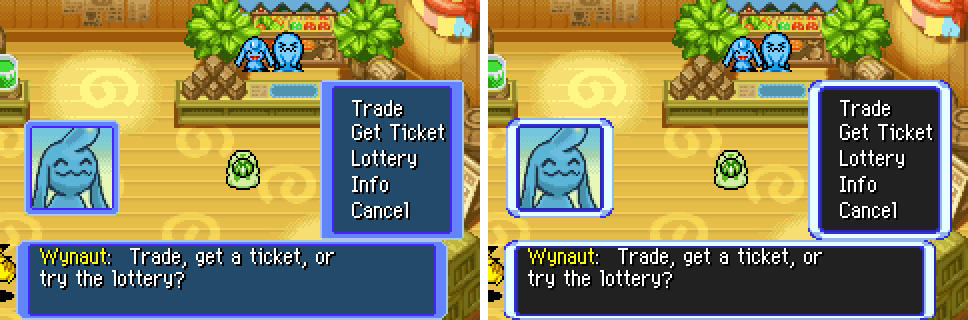
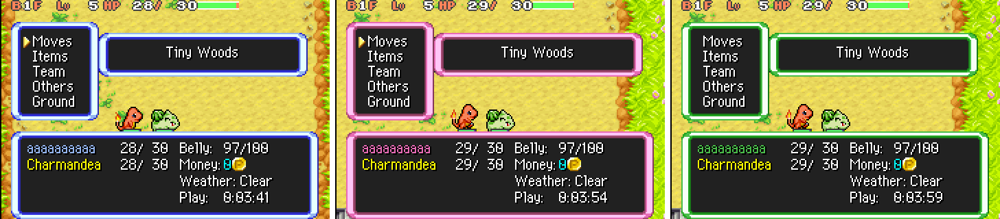
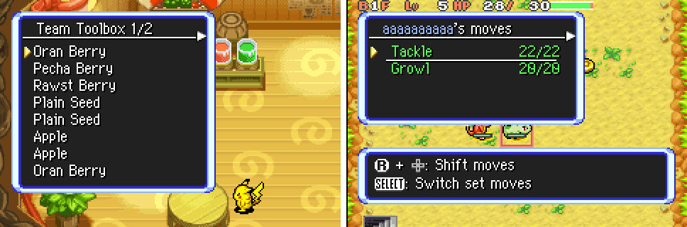

# UI Styles

---

## Index

- [Introduction](#introduction)
- [Explorers of Sky Style](#explorers-of-sky-style)
- [How It Works](#how-it-works)
- [Editing the Frames](#editing-the-frames)
- [Code Locations](#code-locations)
- [Limitations](#limitations)

---

## Introduction

Swaps the look of windows and frames: dialogue boxes, menus, header windows and portrait frames. Window layouts, text and the dungeon HUD are unchanged.

| `ui_style` | Look |
|---|---|
| `0` — `UI_STYLE_RED` (default) | Vanilla Red Rescue Team windows |
| `1` — `UI_STYLE_SKY` | Explorers of Sky windows |



Set it in [`configs/runtime.c`](../../configs/runtime.c), from the in-game debug menu (**UI: Red / UI: Sky**, last page; applies immediately), or in RescueTemple (**UI Style**, Graphics / UI).

---

## Explorers of Sky Style

Modelled on Explorers of Sky screenshots:

- **Opaque dark grey fill** (`32,32,32`). Vanilla windows are translucent in towns and dungeons; Sky windows are not.
- **Beveled frame in four tones**, outer edge to inner edge: outer tone, light band, inner tone, dark line.
  - The frame is lit from the top left like EoS. The right edge ends in a dark outer line, and the right-hand corners are their own tiles, not flips of the left ones.
  - Corners carry EoS's darker outer ring and light glow.
- **Frame colour** follows Options > Windows. EoS ties it to the leader's gender; here the existing option picks it:

| Windows option | Sky frame |
|---|---|
| Blue | Blue |
| Red | Pink |
| Green | Green |



- **Titled windows** (vanilla's tab headers) become one box with the title inside and a full-width white separator with a black shadow, as in EoS menus. There are no tabs.
- **Menu cursor**: EoS's yellow arrow, with a white tip and orange/brown shading.
- **Readable name colour.** The leader-name colour (`COLOR_LIGHT_BLUE`) and the `E` / `S` / `T` colour codes draw from frame slots 14 / 15. Those slots hold the outer tone and light band, so names stay light on the dark fill.



---

## How It Works

Window palettes stay inside font palette bank 15 and the font chrome tile sheet; the cursor uses the existing OBJ bank-15 gold ramp.

1. **Palette.** `ApplyUiStyleToFontPalette` patches the `gFontPalette` master copy after `fontpal` loads (`InitFontPalette`) and after the Windows option is applied (`SetWindowBGColor`). In window palette sets 0–6 it sets:
   - slot 1: fill
   - slot 13: dark line
   - slot 9: inner tone (an unused grey in vanilla)
   - slot 14: outer tone
   - slot 15: light band
2. **Frame tiles.** `LoadUiStyleChromeTiles` copies 23 Sky tiles over the chrome sheet in VRAM (`0x4F00`) whenever the sheet is uploaded (`InitGraphics`, `ReloadFontSheet`).
   - Window frames: `0x2D8`–`0x2DA`, plus `0x2E8`–`0x2EA`, the frame used by menus attached to a dialogue box.
   - Portrait frames: `0x2DC`–`0x2DE`.
   - Vanilla header tab pieces (kept for completeness).
   - Five slots vanilla leaves empty or never draws:
     - `0x2E4` / `0x2E5`: dialogue left corners
     - `0x2FF` / `0x2E6`: dialogue right corners
     - `0x2FC`: right edge
     - `0x2FD` / `0x2FE`: right corners

   `AddWindow` runs `RemapUiStyleFrameTiles` over each window's border, swapping the flipped left-hand entries for the right-hand tiles.
3. **Titled windows.** `PutSkyHeaderWindowTopBorderTilemap` draws a plain top border and shows both header graphics rows across the full width. `DrawWindowBg` gives these windows the normal fill rectangle.
3. **Dialogue box.** Its top and bottom edges are drawn into the text graphics (not tilemap tiles). In Sky style these rows use the Sky band:
   - Top, rows 0–3: mid, light, light, dark.
   - Bottom, rows 5–7: dark, light, mid.

   Its left and right corners use the two extra tiles.
4. **Opacity.** `ToggleWindowBgBuffer` sets the window layer's blend to fully opaque while vanilla's translucent-window blend mode is active.
5. **Cursor.** The Sky menu cursor is written over OBJ tile `0x3F4` (from the `fontsp` sheet). Switching back to Red reloads the vanilla sheet.
6. **Switching.** `ApplyUiStyle` reloads the chrome sheet, palette and cursor when the style differs from what is loaded. It runs at boot (after the runtime config exists), after a save's settings load, and from the debug menu.

The runtime-override save record grew to 0x4C bytes (version 4). Older records keep their overrides and take `ui_style` from the ROM default.

---

## Editing the Frames

The Sky tiles live in [`graphics/custom/ui_style/sky_chrome.png`](../../graphics/custom/ui_style/sky_chrome.png): an indexed strip of 8×8 tiles whose pixel values are bank-15 slots (0 transparent, 13 dark line, 9 inner tone, 14 outer tone, 15 light band). After editing it, run:

```
python3 tools/convert_ui_style_chrome.py
```

This regenerates [`src/data/ui_style_sky_chrome.h`](../../src/data/ui_style_sky_chrome.h). The tile order and the chrome tiles each one replaces are listed at the top of the script. The fill and tint colours are in `sSkyFrameTints` / `sSkyFill` in [`src/ui_style.c`](../../src/ui_style.c).

Window geometry matters. The fill is shown through the GBA hardware windows, which cover each window's content plus 5 px of its border. Frame pixels inside that area must be opaque, and pixels cut away by the rounded corners must stay in the outer 3 px.

To add another style:

- Add a value to `enum UiStyle` in [`include/runtime.h`](../../include/runtime.h), a name in `GetUiStyleName`, and its palette / tiles / dialogue rows in [`src/ui_style.c`](../../src/ui_style.c).
- Raise `max` for `ui_style` in the RescueTemple schema.

---

## Code Locations

| What | Where |
|---|---|
| Style logic, palettes, getters | [`src/ui_style.c`](../../src/ui_style.c), [`include/ui_style.h`](../../include/ui_style.h) |
| Sky tile art / converter | [`graphics/custom/ui_style/sky_chrome.png`](../../graphics/custom/ui_style/sky_chrome.png), [`tools/convert_ui_style_chrome.py`](../../tools/convert_ui_style_chrome.py) |
| Palette / tile hooks | `InitGraphics`, `ReloadFontSheet`, `InitFontPalette` in [`src/graphics_memory.c`](../../src/graphics_memory.c); `SetWindowBGColor` in [`src/game_options.c`](../../src/game_options.c) |
| Dialogue corners, right-hand remap, titled windows | `PutWindowLeftBorderTilemap` / `PutWindowRightBorderTilemap`, `AddWindow`, `PutSkyHeaderWindowTopBorderTilemap` in [`src/text_1.c`](../../src/text_1.c) |
| Dialogue edge rows, header separator, titled-window fill | `PrepareTextbox_8008C6C`, `xxx_update_bg_vram`, `DrawWindowBg` in [`src/text_2.c`](../../src/text_2.c) |
| Opaque windows | `ToggleWindowBgBuffer` in [`src/window_buffer.c`](../../src/window_buffer.c) |
| Runtime field / save record (v4) | `ui_style` in [`include/runtime.h`](../../include/runtime.h), [`src/runtime_config.c`](../../src/runtime_config.c) |
| Debug menu | [`src/custom_debug_menu.c`](../../src/custom_debug_menu.c), [`src/data/custom_debug_menu.h`](../../src/data/custom_debug_menu.h) |
| RescueTemple metadata | [`RescueEditor/src/RescueEditor.Core/RuntimeConfigSchema.cs`](../../RescueEditor/src/RescueEditor.Core/RuntimeConfigSchema.cs) |

---

## Limitations

- **Windows, frames and the cursor.** Text colours (besides the readable name slot), the dungeon HUD and the dual-screen layouts of EoS are unchanged.
- **Four frame tones.** EoS uses about six. Its light-highlight step merges into the band, and its two mid steps share slots. Pink's straight edges are a little brighter than EoS so its corners can glow.
- **Padding left as is.** Measured against EoS, the gap from the frame's inner line to the text is the same on the left (about 9–10 px). At the top EoS is tighter (2 px vs 5 px). Text positions are unchanged.
- **Titled windows drop vanilla's tabs.** Windows with several tabs show only the current title.
- **Dialogue top edge is 4 px.** The dialogue box draws its top edge inside the first text row, where only 4 rows sit above the text (EoS uses 5). Its bottom edge is 3 px for the same reason.
- **Pink and blue were sampled from JPEGs.** Their colours are averaged along long frame edges; green comes from a lossless capture.
- **Portrait frames mirror left to right.** There are no free slots left for separate right-hand portrait pieces.
- **Café dialogue fix (both styles).** The dialogue's bottom edge copy assumed a 26-tile-wide box; the café's 25-wide box drew it 4 tiles off. It now uses the window's width.
